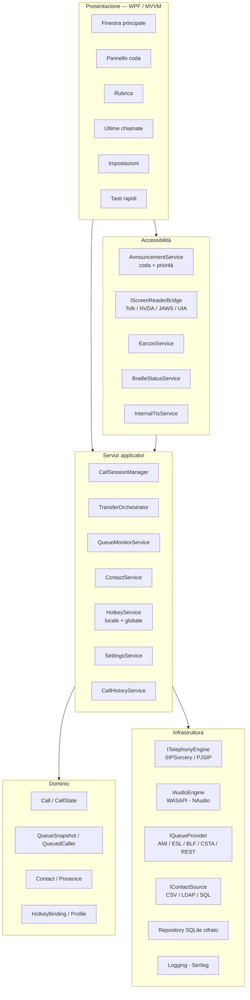
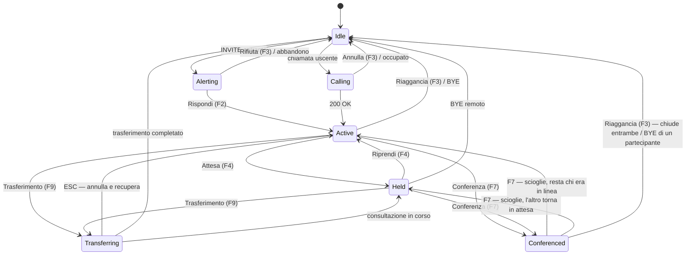
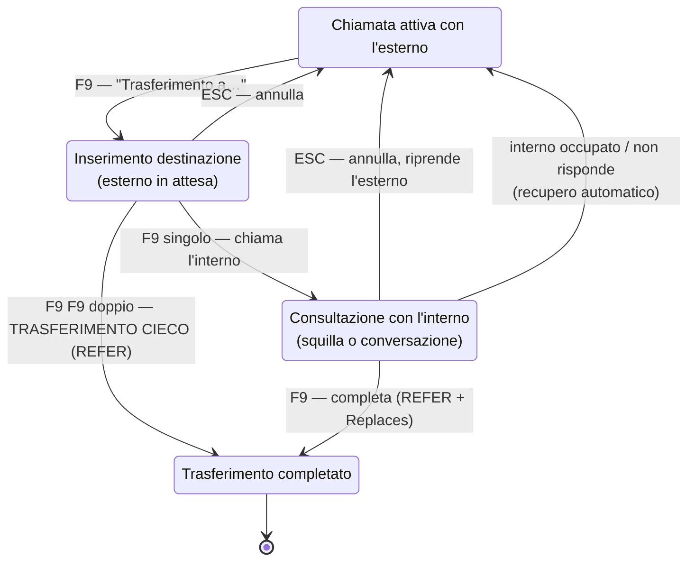

# BlindPhone — Analisi tecnico-funzionale completa

**Posto operatore di centralino telefonico accessibile a operatori non vedenti e ipovedenti**

| | |
|---|---|
| **Nome prodotto** | BlindPhone |
| **Versione documento** | 1.0 |
| **Data** | 3 agosto 2026 |
| **Piattaforma target** | Windows 10 22H2 / Windows 11 (x64, ARM64 opzionale) |
| **Screen reader supportati** | NVDA 2023.1+, JAWS 2022+, Narrator, SuperNova, ZoomText, fallback SAPI5 |
| **Protocollo di segnalazione** | SIP (RFC 3261 e famiglia) |
| **PBX di riferimento** | **Yeastar P-Series** (Appliance / Software / Cloud Edition) |
| **Mercato di riferimento** | **Pubblica Amministrazione italiana**, con estensione al privato soggetto a L. 113/1985 |

> **Documenti complementari**
> - [YEASTAR-INTEGRAZIONE.md](YEASTAR-INTEGRAZIONE.md) — progetto di dettaglio del connettore Yeastar: API, eventi, mappature, checklist di verifica pre-vendita
> - [CONFORMITA-PA-ITALIANA.md](CONFORMITA-PA-ITALIANA.md) — quadro normativo, requisiti tecnici cogenti, percorso di acquisto, deliverable di gara
> - [SCHEDA-TASTI-RAPIDI.md](SCHEDA-TASTI-RAPIDI.md) — scheda dei tasti in formato adatto a screen reader e stampa braille

---

## Indice

1. [Sintesi esecutiva](#1-sintesi-esecutiva)
2. [Obiettivi, ambito e non-ambito](#2-obiettivi-ambito-e-non-ambito)
3. [Utenti tipo e scenari operativi](#3-utenti-tipo-e-scenari-operativi)
4. [Requisiti di accessibilità — il cuore del prodotto](#4-requisiti-di-accessibilità--il-cuore-del-prodotto)
5. [Architettura software](#5-architettura-software)
6. [Scelta dello stack tecnologico](#6-scelta-dello-stack-tecnologico)
7. [Modulo telefonia SIP](#7-modulo-telefonia-sip)
8. [Modulo audio](#8-modulo-audio)
9. [Gestione delle code di chiamata](#9-gestione-delle-code-di-chiamata)
10. [Modello di interazione da tastiera](#10-modello-di-interazione-da-tastiera)
11. [Trasferimento di chiamata a combinazione unica](#11-trasferimento-di-chiamata-a-combinazione-unica)
12. [Pannello rubrica](#12-pannello-rubrica)
13. [Pannello impostazioni](#13-pannello-impostazioni)
14. [Pannello tasti rapidi](#14-pannello-tasti-rapidi)
15. [Persistenza, sicurezza e privacy](#15-persistenza-sicurezza-e-privacy)
16. [Funzionalità aggiuntive proposte](#16-funzionalità-aggiuntive-proposte)
17. [Piano di test e QA di accessibilità](#17-piano-di-test-e-qa-di-accessibilità)
18. [Roadmap, stime e team](#18-roadmap-stime-e-team)
19. [Rischi e mitigazioni](#19-rischi-e-mitigazioni)
20. [Decisioni aperte](#20-decisioni-aperte)

---

## 1. Sintesi esecutiva

BlindPhone è un **softphone specializzato per posto operatore di centralino**, progettato *nativamente* per l'uso senza vista: non è un softphone commerciale a cui si aggiunge un livello di accessibilità, ma un'applicazione la cui interazione primaria è la tastiera e la cui interfaccia primaria è **audio** (voce sintetica + suoni non vocali) e **braille**.

Tre scelte progettuali qualificanti:

1. **Doppio canale di annuncio.** Gli eventi vengono esposti sia tramite le API di accessibilità standard (UI Automation → letto da JAWS/NVDA), sia — opzionalmente — tramite un **motore vocale interno indipendente** instradabile su un dispositivo audio dedicato. Questo risolve il problema reale per cui la voce dello screen reader e l'audio della conversazione finiscono sullo stesso auricolare e si sovrappongono.
2. **Trasferimento a combinazione unica.** Una sola scorciatoia (`F9` di default) governa l'intero ciclo di trasferimento: cieco, con annuncio, e annullamento, tramite una macchina a stati deterministica e sempre annunciata. Nessuna combinazione da ricordare per la seconda modalità.
3. **Astrazione del provider di coda.** Il protocollo SIP da solo *non* espone la profondità di una coda: quell'informazione vive nel PBX. BlindPhone definisce un'interfaccia `IQueueProvider` con connettori intercambiabili; l'implementazione primaria è **Yeastar P-Series Open API**, ma l'astrazione mantiene il prodotto vendibile su Asterisk, FreeSWITCH o BLF generico senza riscritture.

**Stima MVP:** 5–6 mesi con 2,5 FTE (≈ 260 giornate/uomo). **Prodotto completo v1.0:** 9–11 mesi.

### Le due decisioni di indirizzo, e cosa comportano

**PBX = Yeastar P-Series.** È la notizia migliore possibile per il progetto: l'Open API di Yeastar espone un endpoint (`queue/call_status`) che restituisce direttamente l'elenco dei chiamanti in attesa con nome, numero e tempo di attesa, più eventi WebSocket in tempo reale. Il rischio più grave dell'analisi iniziale — *"il PBX potrebbe non esporre l'informazione di coda"* — **si chiude**. In più, presenza degli interni, stato agente con codici di pausa, rubrica aziendale e parcheggio arrivano dalla stessa integrazione, rendendo economiche funzionalità che erano solo "da valutare".

Va segnalato un vincolo commerciale da verificare subito: **l'API richiede il piano Enterprise o Ultimate**. Se il cliente ha il piano Standard, è un costo di licenza che ricade sul progetto ed è bloccante.

**Mercato = PA italiana.** Qui l'analisi porta a un risultato che va oltre la conformità tecnica: **il mercato è creato dalla legge**. La *Legge 113/1985* obbliga i datori pubblici ad assumere un centralinista non vedente per ogni ufficio, sede o stabilimento dotato di posto operatore; la *Legge 4/2004 art. 4 comma 4* obbliga il datore, pubblico e privato, a fornire al dipendente con disabilità *"la strumentazione hardware e software e la tecnologia assistiva adeguata alla specifica disabilità... in relazione alle mansioni effettivamente svolte"*. Due obblighi indipendenti che convergono su questo prodotto.

Sul piano tecnico ne discendono requisiti cogenti, non facoltativi: **EN 301 549 capitoli 5, 6, 11 e 12**, richiamati dalle Linee guida AgID, il cui ambito comprende espressamente *il software e la postazione di lavoro del dipendente con disabilità*. Due conseguenze immediate sul progetto: il **G.722 diventa obbligatorio** (§6.1 della norma, banda ≥ 7000 Hz) e il **testo in tempo reale (RTT)** richiede una decisione consapevole prima della gara. Dettagli in [CONFORMITA-PA-ITALIANA.md](CONFORMITA-PA-ITALIANA.md).

---

## 2. Obiettivi, ambito e non-ambito

### 2.1 Obiettivi funzionali

| # | Obiettivo | Criterio di accettazione |
|---|---|---|
| O1 | Registrazione SIP e gestione chiamate voce | Registrazione su registrar SIP standard; chiamata in/out con audio bidirezionale |
| O2 | Visibilità in tempo reale della coda | Conteggio e dettaglio chiamate in attesa annunciati entro 300 ms dall'evento |
| O3 | Operatività al 100% da tastiera | Nessuna funzione richiede il mouse; verificato da test formale |
| O4 | Compatibilità screen reader | Tutte le informazioni di stato leggibili da JAWS e NVDA senza script proprietari |
| O5 | Trasferimento cieco e con annuncio | Una sola combinazione per entrambe le modalità |
| O6 | Personalizzazione totale delle scorciatoie | Ogni comando rimappabile, con rilevamento conflitti |
| O7 | Rubrica multi-sorgente | Import CSV, sincronizzazione LDAP, ripristino da backup SQL |
| O8 | Configurazione audio a tre vie | Microfono, audio conversazione, audio suoneria su dispositivi distinti |

### 2.2 Obiettivi non funzionali

| Categoria | Requisito |
|---|---|
| **Latenza percepita** | Da pressione tasto ad annuncio vocale: ≤ 150 ms (p95). Da evento SIP ad annuncio: ≤ 300 ms (p95) |
| **Affidabilità** | Riconnessione automatica al registrar; nessuna perdita di chiamata attiva per riavvio del modulo UI |
| **Capacità** | Fino a 100 chiamate in coda visualizzate; 50.000 contatti in rubrica con ricerca < 100 ms |
| **Risorse** | < 250 MB RAM a regime, < 5% CPU su i5 di 8ª gen durante chiamata attiva |
| **Autonomia operativa** | L'operatore deve poter gestire un turno completo senza assistenza vedente |
| **Installazione** | MSI silenziabile, distribuibile via GPO/Intune, senza privilegi amministrativi per l'aggiornamento utente |

### 2.3 Fuori ambito (v1.0)

- Client mobile (iOS/Android) e client web.
- Videochiamata (l'architettura non la preclude, ma non è implementata).
- Funzioni da supervisore (whisper, barge-in, monitoraggio agenti) — valutate per v2.
- Sostituzione del PBX: BlindPhone è un endpoint, non un centralino.

---

## 3. Utenti tipo e scenari operativi

### 3.1 Persona primaria — Operatore non vedente (cieco totale)

Usa NVDA o JAWS con sintesi vocale a velocità elevata (400–600 parole/minuto) e/o display braille a 40 celle. Conosce a memoria le scorciatoie. **Non tollera**: informazioni disponibili solo visivamente, dialoghi modali che rubano il focus, elementi che cambiano posizione, voce che parla sopra la conversazione con l'utente.

> *"Devo sapere quante persone stanno aspettando senza smettere di parlare con chi ho in linea."*

### 3.2 Persona secondaria — Operatore ipovedente

Residuo visivo utile. Usa ZoomText o l'ingranditore di Windows, contrasto elevato, caratteri 18–24 pt. Ha bisogno di **layout stabile, contrasto ≥ 7:1, nessuna informazione veicolata dal solo colore**.

### 3.3 Persona di supporto — Amministratore IT / installatore

Vedente. Configura SIP e LDAP, distribuisce l'MSI, esporta la diagnostica. Ha bisogno di configurazione centralizzabile (JSON + ADMX per GPO) e log leggibili.

### 3.4 Scenari chiave

| ID | Scenario | Frequenza |
|---|---|---|
| S1 | Rispondere alla prima chiamata in coda e trasferirla a un interno | Continua |
| S2 | Verificare quante chiamate sono in attesa durante una conversazione | Molto alta |
| S3 | Trasferire con annuncio: mettere in attesa l'esterno, consultare l'interno, completare | Alta |
| S4 | Trasferimento fallito (interno occupato/non risponde) → recupero automatico del chiamante | Alta |
| S5 | Cercare un contatto per cognome e chiamarlo dalla rubrica | Alta |
| S6 | Richiamare un numero dalle ultime chiamate | Media |
| S7 | Gestire due chiamate contemporanee alternando tra interno ed esterno | Media |
| S8 | Mettersi in pausa/uscire dalla coda per una pausa di servizio | Media |
| S9 | Perdita di rete durante il turno → allerta e ripristino | Rara ma critica |

---

## 4. Requisiti di accessibilità — il cuore del prodotto

Questa sezione è **vincolante**: ogni requisito qui elencato ha priorità sulle scelte estetiche o di comodità implementativa.

### 4.1 Principi guida

| # | Principio | Implicazione concreta |
|---|---|---|
| P1 | **Nessuna informazione solo visiva** | Ogni dato mostrato a schermo è ottenibile via comando da tastiera con annuncio vocale |
| P2 | **Il focus non si sposta da solo** | Una chiamata entrante *annuncia* ma non ruba il focus; il focus si sposta solo per azione dell'operatore |
| P3 | **Layout stabile** | La posizione degli elementi non cambia mai; gli elenchi crescono in coda, non riordinano il contenuto sotto le dita dell'utente |
| P4 | **Silenzio durante la conversazione** | Con chiamata attiva, gli annunci automatici a bassa priorità sono sospesi e sostituiti da earcon |
| P5 | **Ogni azione conferma il proprio esito** | "Trasferimento inviato", "Chiamata in attesa", "Interno occupato" — mai un'azione muta |
| P6 | **Reversibilità** | `ESC` annulla sempre l'operazione in corso e riporta allo stato precedente, annunciandolo |
| P7 | **Nessun timeout invisibile** | Nessuna finestra si chiude da sola; nessuna azione scade senza avviso |
| P8 | **Zero dipendenza da script proprietari** | L'app deve funzionare con JAWS/NVDA "vanilla"; gli script opzionali migliorano, non abilitano |

### 4.2 Stack di accessibilità tecnico

#### Livello 1 — UI Automation (obbligatorio, standard)

Tutti i controlli espongono correttamente:

- `AutomationProperties.Name`, `HelpText`, `AutomationId`, `LabeledBy`
- `ControlType` semanticamente corretto (una lista di chiamate è una `DataGrid`/`List`, non un `Panel` di bottoni)
- `LiveSetting` (`Polite` / `Assertive`) sulle regioni dinamiche (contatore coda, barra di stato)
- `AutomationPeer.RaiseNotificationEvent(...)` per annunci puntuali **senza spostare il focus** — è l'API chiave per "chiamata in arrivo da Mario Rossi" mentre l'operatore è altrove
- `ItemStatus` sugli elementi di lista per stati dinamici (tempo di attesa, priorità)
- `SelectionPattern`, `InvokePattern`, `TogglePattern` dove pertinenti

#### Livello 2 — Comunicazione diretta con lo screen reader (opzionale, "modalità avanzata")

Astrazione `IScreenReaderBridge` con implementazioni:

| Implementazione | Meccanismo | Note |
|---|---|---|
| `TolkBridge` | Libreria **Tolk** (LGPL) | Copre NVDA, JAWS, Window-Eyes, SuperNova, System Access, ZoomText, con fallback SAPI. Scelta consigliata come default |
| `NvdaBridge` | `nvdaControllerClient64.dll` → `nvdaController_speakText`, `nvdaController_brailleMessage`, `nvdaController_cancelSpeech` | Controllo fine su interruzione e braille |
| `JawsBridge` | COM `FreedomSci.JawsApi` → `SayString(testo, interrompi)`, `RunScript` | Permette anche di attivare script JAWS forniti a corredo |
| `UiaOnlyBridge` | Solo notifiche UIA | Fallback sempre attivo, nessuna dipendenza |

> **Regola:** il bridge diretto è un *potenziamento*. Se disattivato o non disponibile, l'applicazione resta pienamente utilizzabile via UIA. Impostazione: *Accessibilità → Modalità annunci → Automatica / Solo UIA / Diretta*.

#### Livello 3 — Voce interna indipendente (differenziante)

Motore TTS interno (SAPI5 locale, opzionalmente Azure/Piper per voci di qualità) con:

- **Dispositivo di uscita configurabile e distinto** da quello della conversazione (es. voce sugli altoparlanti, chiamata in cuffia — o viceversa)
- Voce, velocità, tono e volume indipendenti da quelli dello screen reader
- Ducking automatico dell'audio di chiamata durante gli annunci P0 (attenuazione configurabile, default −8 dB)

Risolve il problema pratico numero uno del posto operatore non vedente: **la voce dello screen reader e la voce del chiamante nello stesso orecchio.**

### 4.3 Modello di annuncio — priorità, coda, interruzione

Ogni evento genera un `Announcement` con priorità:

| Livello | Tipo | Comportamento | Esempi |
|---|---|---|---|
| **P0** | Critico | Interrompe la voce in corso, duck dell'audio chiamata, earcon dedicato | Chiamata entrante, caduta linea, perdita registrazione SIP, chiamata di emergenza in coda |
| **P1** | Alto | Non interrompe P0; accodato con priorità | Chiamata risposta/terminata, esito trasferimento, messa in attesa, interno occupato |
| **P2** | Normale | Accodato, con **coalescing** (finestra 800 ms), soppresso durante chiamata attiva se P4 è abilitato | Variazione conteggio coda, cambio presenza contatto |
| **P3** | Basso | Solo se la coda annunci è vuota; mai durante una chiamata | Sincronizzazione rubrica completata, suggerimenti |

**Regole aggiuntive:**

- **Soppressione durante digitazione:** mentre l'operatore compone un numero, gli annunci P2/P3 sono trattenuti (il feedback tasto ha precedenza).
- **Coalescing coda:** tre chiamate che entrano in 500 ms producono un solo annuncio ("3 chiamate in coda"), non tre.
- **Anti-ripetizione:** un annuncio identico entro 2 s viene scartato.
- **Ripeti ultimo annuncio:** `Ctrl+F12` ripete l'ultimo messaggio; `Ctrl+Shift+F12` apre lo storico degli ultimi 20 annunci (lista navigabile).

### 4.4 Earcon — segnali acustici non vocali

Per un operatore esperto un suono di 120 ms comunica più velocemente di una frase. Set base (tutti sostituibili dall'utente, tutti disattivabili singolarmente):

| Evento | Suono | Panning stereo suggerito |
|---|---|---|
| Nuova chiamata in coda | Doppio tono ascendente breve | Sinistra |
| Coda svuotata | Tono discendente singolo | Sinistra |
| Attesa superiore alla soglia (default 60 s) | Tick ripetuto crescente di urgenza | Sinistra |
| Chiamata risposta | Click sordo | Centro |
| Chiamata terminata | Click doppio | Centro |
| Messa in attesa / ripresa | Tono basso / tono alto | Destra |
| Trasferimento riuscito | Arpeggio ascendente | Destra |
| Trasferimento fallito | Tono basso dissonante | Destra |
| Errore / comando non valido | Buzz breve | Centro |
| Registrazione SIP persa | Allarme ripetuto ogni 10 s finché non risolto | Centro, entrambi i dispositivi |

Il **panning per categoria** (coda a sinistra, chiamata al centro, controllo linea a destra) crea una mappa spaziale che l'operatore interiorizza in pochi giorni.

### 4.5 Supporto braille

- Riga di stato compatta configurabile, inviata al display braille via `nvdaController_brailleMessage` o API JAWS.
- Formato di default (personalizzabile con template): `C:3 A:Rossi 01:24 H:1` = 3 in coda, attiva con Rossi da 1:24, 1 in attesa.
- Modalità estesa e modalità ultra-compatta per display a 20 celle.
- Tutte le liste sono `DataGrid` UIA correttamente strutturate, quindi navigabili in braille con intestazioni di colonna.

### 4.6 Ipovisione

- Tema chiaro / scuro / **contrasto elevato** (rispetto di `SystemParameters.HighContrast`).
- Scala testo 100–300% senza troncamenti né sovrapposizioni; layout responsivo verticale.
- Focus visibile con outline ≥ 3 px, contrasto ≥ 3:1 rispetto allo sfondo adiacente.
- Nessuna informazione veicolata dal solo colore: ogni stato ha anche testo e/o icona.
- Riga "chiamata attiva" ingrandibile fino a occupare metà schermo (modalità "focus chiamata").

### 4.7 Conformità normativa

Con il mercato PA come riferimento, questa sezione passa da *"buone pratiche"* a **requisito contrattuale verificato in collaudo**.

| Norma | Applicabilità | Capitoli rilevanti |
|---|---|---|
| **EN 301 549** | **Cogente**, richiamata dalle Linee guida AgID, il cui ambito comprende espressamente il software e la postazione di lavoro del dipendente con disabilità | **5** generici · **6** comunicazione vocale bidirezionale · **11** software · **12** documentazione e supporto |
| **Legge 4/2004 (Stanca), art. 4 c. 4** | Obbligo del datore di lavoro, pubblico e privato, di fornire hardware, software e tecnologia assistiva adeguati alla disabilità e alle mansioni | È l'obbligo su cui poggia l'acquisto |
| **Legge 113/1985** | Disciplina il collocamento dei centralinisti non vedenti: è ciò che crea la platea di utenti | Contesto di mercato |
| **WCAG 2.2 AA** (criteri applicabili al software non-web) | Riferimento per contrasto, focus, tempi, prevedibilità | — |
| **ISO 9241-171** | Linee guida ergonomiche di riferimento | — |
| **GDPR (Reg. UE 2016/679)** | Registrazione chiamate, log, rubrica, dati di traffico | — |
| **Section 508 / VPAT** | Solo per un eventuale mercato USA | — |

**I due capitoli che vengono regolarmente dimenticati:**

- **Cap. 6** — si applica a qualsiasi ICT con comunicazione vocale bidirezionale, quindi a pieno titolo a un posto operatore. Ne discendono il **G.722 obbligatorio** (§6.1, banda ≥ 7000 Hz) e la questione **RTT** (§6.2), da decidere consapevolmente.
- **Cap. 12** — la documentazione e i **servizi di supporto** devono essere a loro volta accessibili. Ha una conseguenza organizzativa, non solo editoriale: il personale di assistenza va formato.

**Deliverable richiesti:** *Dichiarazione di conformità EN 301 549* (capitoli 5, 6, 11, 12) + *ACR/VPAT 2.5* con scostamenti motivati. Analisi completa in [CONFORMITA-PA-ITALIANA.md](CONFORMITA-PA-ITALIANA.md).

---

## 5. Architettura software

### 5.1 Vista a livelli



### 5.2 Principi architetturali

- **Il core non dipende dalla UI.** `CallSessionManager`, `QueueMonitorService` e `TransferOrchestrator` sono librerie .NET pure, testabili headless. La UI è un consumatore di eventi. Questo consente test automatici su migliaia di scenari senza avviare l'interfaccia.
- **Ogni evento di dominio produce un `Announcement`.** L'accessibilità non è aggiunta nei code-behind: è una proiezione dichiarativa dello stato di dominio (`EventToAnnouncementMapper`), quindi non può essere dimenticata in un ramo di codice.
- **Tutto ciò che è esterno è dietro un'interfaccia.** Stack SIP, motore audio, provider di coda, sorgente contatti: sostituibili senza toccare il core. Riduce il rischio di lock-in su una libreria o un PBX.
- **Processo singolo, thread dedicati.** Thread real-time per l'audio (priorità `AboveNormal` con MMCSS "Pro Audio"), thread separato per la segnalazione SIP, UI thread mai bloccato. Nessuna operazione I/O sul thread UI: un freeze dell'interfaccia per un operatore non vedente equivale a un guasto totale.
- **Stato ripristinabile.** Il core mantiene lo stato in memoria e lo persiste in modo incrementale: un crash della UI non deve far cadere la chiamata attiva (v2: separazione in due processi con IPC).

### 5.3 Macchina a stati della chiamata



Ogni transizione emette: (a) un evento di dominio, (b) un annuncio con priorità, (c) un earcon, (d) un aggiornamento della riga braille, (e) una riga di log. Questa quintupla è verificata da test automatici: **una transizione senza annuncio è un test rosso**.

`Conferenced` è uno stato e non un attributo di `Active` per una ragione precisa: in conferenza le chiamate con audio attivo sono **due**, e la domanda «con chi sono in linea» ha due risposte. Le due gambe vi entrano e ne escono insieme, quindi le rispettive transizioni tacciono e l'annuncio è uno solo, complessivo — è l'unica eccezione alla regola «ogni transizione annuncia», la stessa già in uso per l'alternanza fra due chiamate, e per lo stesso motivo: due frasi consecutive direbbero a pezzi una cosa sola.

---

## 6. Scelta dello stack tecnologico

### 6.1 Framework UI — confronto

| Opzione | Accessibilità Windows | Pro | Contro | Verdetto |
|---|---|---|---|---|
| **WPF (.NET 8/9)** | UIA nativa completa, `RaiseNotificationEvent`, LiveRegion | Maturo, MVVM, testabile, temi/contrasto, ottimo con JAWS e NVDA | Curva su UIA custom peer per controlli non standard | ✅ **Consigliato** |
| WinForms (.NET 8) | MSAA + UIA via bridge; controlli Win32 nativi | Comportamento screen reader estremamente prevedibile | Layout scalabile e temi più faticosi; MVVM assente | 🟡 Alternativa conservativa |
| WinUI 3 | UIA, ma maturità inferiore | Look moderno | Bug di accessibilità storici; deployment più complesso | ❌ |
| Electron / web | Bridge Chromium→UIA | Cross-platform, ARIA nota | Consumo risorse; latenza tastiera; comportamenti anomali con JAWS in modalità virtuale | ❌ |
| Qt / Avalonia | Bridge parziale | Cross-platform | Copertura UIA incompleta: rischio inaccettabile per il caso d'uso | ❌ |

> **Decisione: WPF su .NET 8 LTS (migrazione a .NET 10 LTS pianificata).** Con controlli standard "vestiti", mai reimplementati: si usa `ListView`/`DataGrid` reali, non `ItemsControl` di `Border`. Ogni controllo custom richiede un `AutomationPeer` esplicito e un test UIA in CI.

### 6.2 Stack SIP — confronto

| Libreria | Licenza | Copertura | Note |
|---|---|---|---|
| **SIPSorcery** | MIT | SIP, SDP, RTP, SRTP, ICE, REFER/Replaces, WebRTC | C# nativo, attivamente mantenuto, nessun costo né vincolo di licenza. Media via `SIPSorceryMedia.Windows` (WASAPI) |
| **PJSIP / pjsua2** | GPLv2+ **o** commerciale | Riferimento del settore: SRTP/TLS, ICE, molti codec, altissima interoperabilità | Wrapper P/Invoke o binding .NET; licenza GPL incompatibile con distribuzione proprietaria → costo licenza commerciale |
| Ozeki VoIP SDK | Commerciale | .NET nativo, API semplice | Costo per postazione; dipendenza da fornitore singolo |
| Linphone SDK | GPL/commerciale | Completo | Stessa questione di licenza di PJSIP |

> **Decisione: SIPSorcery come implementazione di default** (licenza MIT, zero costi ricorrenti), **dietro l'interfaccia `ITelephonyEngine`**. Se in fase di interoperabilità emergono problemi con PBX specifici (tipicamente Cisco CUCM o centralini legacy), si aggiunge `PjSipTelephonyEngine` come implementazione alternativa senza modificare una riga del core. Prevedere in budget la licenza commerciale PJSIP come opzione di rischio.

### 6.3 Altre componenti

| Ambito | Scelta | Motivazione |
|---|---|---|
| Audio | **NAudio** + WASAPI (shared mode, event-driven) | Enumerazione e instradamento per-dispositivo, gestione hot-plug, latenza controllata |
| DSP audio | WebRTC APM (AEC3, NS, AGC) via wrapper, o SpeexDSP | Cancellazione eco indispensabile in modalità viva-voce |
| Screen reader | **Tolk** (LGPL) + client NVDA + COM JAWS | Copertura massima con un'unica astrazione |
| Persistenza | **SQLite** + **SQLCipher** | File singolo, nessun server, cifratura a riposo per la rubrica |
| LDAP | `System.DirectoryServices.Protocols` | In-box .NET, supporta LDAPS e paging |
| Logging | **Serilog** (file rolling + JSON) | Diagnostica esportabile in un clic |
| Configurazione | JSON in `%APPDATA%` + policy in `%ProgramData%` + **ADMX** | Distribuzione centralizzata via GPO/Intune |
| Hotkey globali | `RegisterHotKey` Win32, fallback `WH_KEYBOARD_LL` | Funzionamento anche con app in background |
| Installer | **WiX v4** → MSI | Silent install, GPO, aggiornamenti per-utente |
| Test | xUnit + FlaUI (automazione UIA) + Accessibility Insights | Test di accessibilità automatizzati in CI |

---

## 7. Modulo telefonia SIP

### 7.1 RFC di riferimento da implementare

| Area | RFC |
|---|---|
| Core SIP | 3261 |
| Offer/Answer SDP | 3264, 4566 |
| Affidabilità risposte provvisorie | 3262 (PRACK) |
| UPDATE | 3311 |
| **Trasferimento** | **3515 (REFER)**, **4488 (Refer sub suppression)**, **5589 (Call Control – Transfer)**, **3891 (Replaces)**, **3892 (Referred-By)** |
| Stato dialoghi / BLF | **4235 (dialog event package)**, 3265/6665 (SUBSCRIBE/NOTIFY) |
| Presenza | 3856, 3863, 4479 |
| Messaggio in segreteria | 3842 (MWI) |
| Session timer | 4028 |
| DTMF | 4733/2833, 6086 (INFO) |
| Sicurezza media | 3711 (SRTP), 4568 (SDES), 5763 (DTLS-SRTP) |
| NAT / attraversamento | 3581 (rport), 5626 (Outbound), 5389 (STUN), 5766 (TURN), 8445 (ICE) |
| Trasporto sicuro | 3261 §26 (SIPS/TLS) |

> **Stato del trasporto sicuro: implementato, dopo la correzione di un difetto grave.** Fino alla versione precedente il ramo TLS registrava un avviso e apriva un canale **TCP in chiaro**: chi configurava «TLS» otteneva una segnalazione non cifrata, e l'unico modo di accorgersene era leggere il registro o mettere uno sniffer sulla rete. Su un prodotto destinato alla PA è il difetto peggiore della sua categoria, perché la promessa non mantenuta è proprio quella di riservatezza. Adesso il canale è un `SIPTLSChannel` lato client — BlindPhone apre connessioni e non ne accetta, quindi non serve un certificato proprio — e se non si apre la registrazione **fallisce** invece di ripiegare: ripiegare significherebbe trasmettere in chiaro le credenziali di chi ha chiesto il contrario. Va notato che aprire il canale non basta: lo stack sceglie il trasporto in base a quello dichiarato nell'**indirizzo**, e un indirizzo senza parametro vale UDP; registrar e destinazioni portano ora `transport=tls`. Si usa `sip:` con parametro e non lo schema `sips:`, formalmente più corretto ma che impone TLS su tutto il percorso oltre il centralino e che diversi apparati rifiutano per questo.

> **Certificati non verificabili: richiesta di fiducia all'operatore.** Nella PA italiana il centralino espone quasi sempre un certificato autofirmato o emesso da un'autorità interna all'ente, e le due risposte estreme sono entrambe sbagliate: rifiutare senza appello rende TLS inutilizzabile, accettare qualunque cosa toglie a TLS la parte che lo rende utile — senza verificare chi c'è dall'altra parte, la cifratura protegge la conversazione con chiunque si sia messo in mezzo. La via di mezzo è quella di un browser, adattata a chi ascolta invece di guardare: si dice **prima cosa non torna** e poi di chi si tratta, e l'impronta si legge **a gruppi di quattro caratteri**, perché l'unica verifica che un operatore può fare davvero è farsela dettare da chi amministra il centralino e confrontarla. Ogni decisione vale per quel certificato **su quel server**: legarla alla sola impronta la renderebbe valida ovunque quel certificato ricompaia. Le approvazioni vivono in un file separato da `settings.json`, che è documentato come esportabile e condivisibile — una decisione di fiducia che viaggiasse con la configurazione verrebbe applicata su macchine il cui operatore non l'ha mai presa, ed è il rilievo che un collaudo di sicurezza solleva.

### 7.2 Funzioni telefoniche

- **Registrazione**: account multipli, registrar primario + secondario con failover automatico, re-REGISTER adattivo, keep-alive (CRLF o OPTIONS), gestione 401/407 con Digest, supporto `Path` (RFC 3327).

  > **Account multipli: implementati.** Il caso reale non è il centralinista con due linee ma quello che copre due enti, e la postazione condivisa a turni fra persone con interni diversi. Il cambio avviene **senza riavviare**, tramite un involucro commutabile dietro `ITelephonyEngine`: sostituire il motore senza intermediario avrebbe richiesto di riagganciare a mano ogni sottoscrittore — gestore chiamate, orchestratore trasferimenti, sorveglianza interni, due finestre — oppure di riavviare, che su un telefono di servizio significa smettere di essere raggiungibili. Il cambio viene **rifiutato** con una chiamata in corso, non chiesto in conferma: un tasto premuto per abitudine non deve poter far cadere una conversazione con un secondo tasto premuto altrettanto per abitudine. Ogni account ha la password sotto una chiave propria nel deposito protetto; il primo conserva la chiave storica, perché cambiarla avrebbe messo fuori servizio ogni postazione già configurata al primo aggiornamento.
- **Chiamata uscente**: composizione, richiamata, chiamata da rubrica/storico, piano di normalizzazione numeri (prefisso uscita, prefisso internazionale, regole regex configurabili).
- **Chiamata entrante**: risposta, rifiuto (486/603), inoltro immediato, risposta automatica opzionale con earcon di preavviso.
- **Attesa**: re-INVITE `a=sendonly` (RFC 6337); music-on-hold lato PBX o locale; **promemoria di attesa** con earcon periodico configurabile (default ogni 30 s) — evita l'errore classico di dimenticare qualcuno in attesa.
- **Trasferimento**: cieco (`REFER` + `Refer-To`), con annuncio (`REFER` + `Refer-To` con header `Replaces`), monitoraggio esito via `NOTIFY` con corpo `message/sipfrag` (100 → 180 → 200 / 4xx-5xx-6xx) e annuncio dell'esito.
- **Chiamate multiple**: fino a N linee (call appearance) configurabili, default 6; alternanza; conferenza a 3.

  > **Scelta effettuata: missaggio locale, non sala conferenze del centralino.** Il posto operatore fa da ponte fra le due linee, mandando a ciascuna la voce dell'operatore sommata a quella dell'altro partecipante, secondo la regola *N meno uno* — ogni linea riceve tutto tranne se stessa, perché rimandarle il proprio audio produce un'eco ritardata del giro di rete. Le ragioni della scelta sono tre: (a) funziona su qualunque centralino, senza sale da configurare né codici di servizio che cambiano con la marca; (b) non dipende dal piano di licenza, che nella PA è la variabile meno controllabile; (c) si regge su due chiamate contemporanee, che il prodotto sa già gestire perché servono al trasferimento con annuncio. La contropartita è che richiede un percorso audio reale: senza dispositivi il comando lo dichiara invece di aprire una conferenza muta, che a orecchio è indistinguibile da una riuscita in cui nessuno parla. Le due gambe possono aver negoziato codec diversi (esterno in G.729 a 8 kHz, interno in G.722 a 16 kHz): il contributo viene ricampionato con filtro anti-alias, in modalità guidata dall'uscita come ogni altra conversione del percorso audio.

  > **Conseguenza sulla macchina a stati.** La conferenza ha richiesto uno stato proprio, `Conferenced`, e non una variante di `Active`: in conferenza le chiamate attive sono **due**, e con lo stesso stato di una conversazione normale il posto operatore non avrebbe modo di dire quale delle due è «quella in linea» — perché non lo è nessuna, lo sono entrambe. Lo stato distinto rende inoltre annunciabili l'ingresso e l'uscita, che è il solo modo in cui un operatore non vedente può sapere in quale delle due modalità si trova.
- **DTMF**: RFC 4733 (default), SIP INFO, inband; invio da tastierino con eco vocale della cifra.
- **Servizi supplementari**: DND, deviazione (incondizionata / su occupato / su non risposta), parcheggio e ripresa, risposta per assente (pickup diretto e di gruppo), riconferma numero prima della chiamata verso numeri esterni ad alto costo.
- **Codec**: **G.722 obbligatorio** (banda larga), G.711 A-law (default Europa), G.711 μ-law, Opus, G.729 (opzionale, verificare licenza). Ordine di priorità configurabile e negoziazione visibile nella diagnostica.

  > **Requisito di conformità, non miglioria di qualità.** La EN 301 549 §6.1 richiede, per l'ICT con comunicazione vocale bidirezionale, il supporto di una banda audio con limite superiore di almeno 7000 Hz. Ne discendono tre obblighi progettuali: (a) G.722 o Opus sempre negoziabili e in cima alla lista di default; (b) verifica che il codec sia abilitato anche sugli interni del PBX Yeastar; (c) **l'operatore deve poter sapere con una scorciatoia se la chiamata in corso è a banda larga** — informazione oggi assente in tutti i softphone, e che qui serve anche come evidenza di collaudo. Integrato nel comando "Qualità linea" (`Ctrl+Q`).
- **Qualità**: statistiche RTCP (jitter, perdita pacchetti, MOS stimato) consultabili con scorciatoia e annunciate a richiesta — utile per segnalare all'IT un problema di linea.

### 7.3 Diagnostica SIP accessibile

Finestra "Diagnostica" (`Ctrl+Alt+D`) con:
- stato registrazione per account, con motivo dell'ultimo fallimento in linguaggio naturale ("Credenziali rifiutate dal server" invece di "403 Forbidden");
- **console SIP** navigabile: elenco messaggi con timestamp, metodo, esito — leggibile riga per riga dallo screen reader;
- test connettività (DNS SRV, raggiungibilità proxy, STUN, porte RTP) con esito parlato;
- pulsante "Esporta diagnostica" → ZIP con log anonimizzati da inviare all'assistenza.

---

## 8. Modulo audio

### 8.1 Instradamento a tre (quattro) vie

| Via | Uso | Impostazione |
|---|---|---|
| **1. Microfono** | Cattura voce operatore | Dispositivo, guadagno, boost, soglia noise gate, test con VU-meter *sonoro* (tono la cui altezza segue il livello) |
| **2. Uscita conversazione** | Audio del chiamante | Dispositivo (tipicamente cuffia USB), volume |
| **3. Uscita suoneria** | Suoneria ed earcon di coda | Dispositivo (tipicamente altoparlanti), volume indipendente. Opzione "suona su entrambi" |
| **4. Uscita annunci vocali** *(consigliata)* | Voce interna BlindPhone | Dispositivo, volume, voce e velocità dedicati — separa gli annunci dalla conversazione |

**Requisiti di robustezza:**
- Gestione **hot-plug**: se la cuffia viene scollegata durante una chiamata, l'audio migra sul dispositivo di fallback configurato e l'evento è annunciato in P0 ("Cuffia scollegata, audio su Altoparlanti").
- I dispositivi sono memorizzati per **ID stabile + nome descrittivo**, con risoluzione tollerante ai cambi di indice.
- Selezione dispositivi con **anteprima sonora** ("Riproduci suono di prova su questo dispositivo") navigabile da tastiera.

### 8.2 Elaborazione

- **AEC** (cancellazione eco acustica) — obbligatoria in viva-voce, disattivabile in cuffia.
- **NS** (soppressione rumore) e **AGC** (controllo automatico guadagno), a livelli selezionabili.
- **Jitter buffer** adattivo (min/max/target configurabili) e PLC.
- **Comfort noise** (RFC 3389) e VAD opzionali.
- **Normalizzazione del volume in ingresso**, per evitare sbalzi tra chiamanti — apprezzata da chi ascolta a volume alto.

> **Stato (ottobre 2026).** NS e AGC sul **microfono** sono realizzati, con `NAudio.Effects` — già nel pacchetto NAudio, senza dipendenze nuove — e si accendono da *Impostazioni → Audio → Elaborazione del microfono*; vedi il README. **Non sono realizzati**: AEC, comfort noise e VAD verso l'interlocutore, e la normalizzazione del volume *in ingresso* dalla linea (la voce che si ascolta).

### 8.3 Suonerie

- Formati WAV e MP3; suoneria di default fornita, più set alternativi.
- **Suoneria per contesto**: per coda, per gruppo di contatti, per singolo contatto, per chiamata interna vs esterna, per chiamata VIP, per chiamata di emergenza.
- **Distinctive ring** da header `Alert-Info` inviato dal PBX, con mappatura configurabile.
- Volume suoneria indipendente, con **crescendo** opzionale e **anteprima**.
- Suoneria discreta durante chiamata attiva (call waiting): tono breve non invasivo invece della suoneria piena.

### 8.4 Integrazione cuffia (fortemente consigliata)

Supporto ai comandi HID delle cuffie professionali (Jabra, Poly/Plantronics, EPOS/Sennheiser, Yealink):
- **rispondi / riaggancia dal pulsante della cuffia**;
- mute sincronizzato bidirezionale (il LED della cuffia riflette lo stato reale, e il mute da cuffia è annunciato);
- controllo volume;
- rilevamento indossamento per risposta automatica.

Per un operatore non vedente **il pulsante fisico della cuffia è spesso più veloce e sicuro di qualsiasi scorciatoia**: è una funzione ad alto valore percepito.

---

## 9. Gestione delle code di chiamata

### 9.1 Il punto critico: SIP non basta

**Va detto chiaramente in fase di analisi:** il protocollo SIP standard *non* trasporta l'informazione "ci sono N chiamate in attesa nella coda X". Quell'informazione esiste solo nel PBX. Un endpoint SIP puro vede unicamente le chiamate che gli vengono offerte.

Sono possibili tre livelli di funzionalità:

| Livello | Requisito | Cosa vede l'operatore |
|---|---|---|
| **A — Completo** | Connettore CTI verso il PBX (AMI/ARI/ESL/CSTA/REST) | Numero esatto in coda, elenco chiamanti, posizione, tempo di attesa, priorità, stato agenti |
| **B — Parziale** | BLF/`dialog-info` (RFC 4235) su interni o pseudo-interni di coda | Presenza di chiamate in attesa, conteggio approssimato, nessun dettaglio sul chiamante |
| **C — Minimo** | Solo SIP, più call appearance offerte in parallelo | Solo le chiamate effettivamente squillanti sul posto operatore |

BlindPhone implementa **tutti e tre**, degradando in modo esplicito e annunciato ("Dettaglio coda non disponibile: connettore PBX non configurato").

### 9.2 Astrazione `IQueueProvider`

```csharp
public interface IQueueProvider
{
    Task<bool> ConnectAsync(CancellationToken ct);
    IObservable<QueueSnapshot> Snapshots { get; }   // stato completo periodico
    IObservable<QueueEvent> Events { get; }         // join / leave / abandon / answered
    Task<AgentState> GetAgentStateAsync();
    Task SetAgentStateAsync(AgentState state, string? reasonCode);
    Task<CallActionResult> PickCallAsync(string queuedCallId);  // se supportato
    ProviderCapabilities Capabilities { get; }      // capacità dichiarate
}

public sealed record QueuedCaller(
    string Id, string QueueName, string? CallerNumber, string? CallerName,
    DateTimeOffset EnqueuedAt, int Position, int Priority, bool IsVip, bool IsEmergency);
```

`ProviderCapabilities` dichiara cosa il connettore supporta (dettaglio chiamante, posizione, tempo di attesa, prelievo selettivo, gestione stato agente): la UI **abilita o nasconde le funzioni di conseguenza**, e lo comunica invece di lasciare comandi che non fanno nulla.

### 9.3 Connettori previsti

| Connettore | Tecnologia | Copertura | Priorità |
|---|---|---|---|
| **Yeastar P-Series** | REST `/openapi/v1.0` + WebSocket `subscribe` | **Livello A completo.** `queue/call_status` restituisce `waiting_calls`, `waiting_list` (chiamante, nome, tempo di attesa), `ringing_list`, `active_list`. Eventi in tempo reale, stato agente, presenza, rubrica, parcheggio | **1 — da sviluppare** |
| **BLF / dialog-info** | SIP SUBSCRIBE `Event: dialog` (RFC 4235) | Universale, funziona con quasi tutti i PBX. Livello B | 2 — rete di sicurezza |
| **Asterisk AMI** | TCP + protocollo Manager | `QueueStatus`, `QueueSummary`; eventi `QueueCallerJoin/Leave/Abandon`, `AgentCalled`, `AgentConnect`. Livello A | 3 — secondo mercato |
| **Asterisk ARI** | REST + WebSocket | Alternativa moderna per Asterisk 16+ | 4 |
| **FreeSWITCH ESL** | Event Socket | `mod_callcenter`. Livello A | 4 |
| **REST generica** | HTTP polling/webhook + mapping JSON configurabile | 3CX, Wildix, gestionali custom. Configurabile senza ricompilare | 5 |
| **CSTA / uaCSTA** | ECMA-269/323 su SIP | Innovaphone, Unify, Alcatel, Mitel | Su richiesta |
| **TAPI 2.x** | TSP di terze parti | Solo centralini legacy | Su richiesta |

> **Decisione: `YeastarQueueProvider` come implementazione primaria.** Progetto di dettaglio, mappature campo per campo e checklist di verifica pre-vendita in [YEASTAR-INTEGRAZIONE.md](YEASTAR-INTEGRAZIONE.md).
>
> **L'astrazione va mantenuta comunque.** Costa 3–4 giornate in più rispetto a scrivere codice Yeastar-specifico nel core, e si ripaga alla seconda installazione con un centralino diverso. Considerato che il mercato di riferimento è la PA — dove Asterisk e 3CX sono ampiamente diffusi quanto Yeastar — è un investimento a rischio molto basso.

### 9.4 Presentazione della coda

**Elenco chiamate in coda** (`F6` per portarvi il focus) — `DataGrid` UIA con colonne:

| Colonna | Contenuto | Annuncio |
|---|---|---|
| Posizione | 1, 2, 3… | "Uno" |
| Chiamante | Nome da rubrica se risolto, altrimenti numero letto cifra per cifra | "Mario Rossi" / "zero due, uno due tre, quattro cinque sei" |
| Attesa | mm:ss dall'ingresso, aggiornato | "in attesa da un minuto e ventiquattro" |
| Coda | Nome coda/servizio | "Centralino" |
| Stato | Normale / VIP / Emergenza / Richiamata | Solo se diverso da normale |

**Ordine di lettura configurabile** (l'operatore esperto vuole prima il nome, il principiante prima la posizione).

**Comandi sull'elenco coda:**

| Tasto | Azione |
|---|---|
| `F12` | Annuncia il conteggio: *"3 chiamate in coda, attesa massima 2 minuti e 10"* — **funziona da qualsiasi punto dell'app e anche con app in background** (versione globale) |
| `F12` doppia pressione (< 400 ms) | Legge l'elenco completo dei chiamanti in coda senza spostare il focus |
| `F6` | Sposta il focus sull'elenco coda |
| `Frecce` | Naviga tra le chiamate in attesa |
| `Invio` sull'elenco | Preleva la chiamata selezionata (se il connettore lo supporta) |
| `Ctrl+I` | Dettagli completi della chiamata selezionata |

**Annunci automatici** (configurabili: tutti / solo oltre soglia / solo variazioni / disattivati):
- Ingresso in coda: earcon + (opzionale) *"Nuova chiamata in coda, totale 3"*.
- Superamento soglia di attesa: earcon di urgenza crescente + annuncio *"Attesa oltre 2 minuti"*.
- Coda svuotata: earcon.
- **Soppressione automatica durante conversazione attiva** (principio P4): resta solo l'earcon, la voce tace.

### 9.5 Gestione stato agente

Funzione indispensabile in un contesto di coda reale, da includere in v1:

| Tasto | Azione |
|---|---|
| `Ctrl+Alt+L` | Login / logout dalla coda |
| `Ctrl+Alt+P` | Pausa / ripresa, con selezione del codice motivo (pausa, riunione, formazione, amministrativo) |
| `Ctrl+Alt+S` | Annuncia stato agente corrente e code di appartenenza |

Wrap-up time (tempo di post-chiamata) configurabile, con annuncio del countdown e possibilità di terminarlo anticipatamente.

---

## 10. Modello di interazione da tastiera

### 10.1 Due livelli di scorciatoie

| Livello | Ambito | Formato di default | Uso |
|---|---|---|---|
| **Locale** | Solo con BlindPhone a fuoco | Tasti funzione singoli `F2`–`F12` | Massima velocità operativa |
| **Globale** | Sistema, anche con app in background | `Ctrl+Shift+F2`–`F12` | L'operatore prende appunti in Word e risponde senza cambiare finestra |

Entrambi i livelli sono **completamente rimappabili** e ogni comando può avere un binding locale, uno globale, entrambi o nessuno.

### 10.2 Mappa di default

> **Criterio di scelta:** evitare i tasti modificatori usati da NVDA (`Insert`, `BlocMaiusc`) e JAWS (`Insert`), evitare le combinazioni riservate di Windows (`Win+…`, `Alt+F4`, `Ctrl+Alt+Canc`) e le combinazioni di uso comune negli applicativi d'ufficio.

#### Gestione chiamata

| Comando | Locale | Globale |
|---|---|---|
| Rispondi / accetta | `F2` | `Ctrl+Shift+F2` |
| Riaggancia / rifiuta | `F3` | `Ctrl+Shift+F3` |
| Attesa / riprendi (toggle) | `F4` | `Ctrl+Shift+F4` |
| **Alterna interno ↔ esterno** (swap) | `F5` | `Ctrl+Shift+F5` |
| Conferenza a tre | `F7` | `Ctrl+Shift+F7` |
| **Trasferimento (unico)** | `F9` | `Ctrl+Shift+F9` |
| Microfono muto / attivo | `Ctrl+M` | `Ctrl+Shift+M` |
| Richiama ultimo numero | `Ctrl+R` | — |

#### Navigazione e pannelli

| Comando | Locale | Globale |
|---|---|---|
| Focus sul **dialer** (campo composizione) | `F8` | `Ctrl+Shift+F8` |
| Focus sull'**elenco chiamate in coda** | `F6` | `Ctrl+Shift+F6` |
| Apri **rubrica** | `F10` | `Ctrl+Shift+F10` |
| Apri **ultime chiamate** | `F11` | `Ctrl+Shift+F11` |
| Impostazioni | `Ctrl+,` | — |
| Diagnostica | `Ctrl+Alt+D` | — |
| Ciclo tra i pannelli | `Ctrl+Tab` / `Ctrl+Shift+Tab` | — |
| Torna alla chiamata attiva | `Ctrl+Home` | `Ctrl+Shift+Home` |

#### Informazione e accessibilità

| Comando | Locale | Globale |
|---|---|---|
| **Conteggio chiamate in coda** | `F12` | `Ctrl+Shift+F12` |
| Elenco completo coda (doppia pressione) | `F12 F12` | `Ctrl+Shift+F12` ×2 |
| Riepilogo stato completo | `Ctrl+F5` | `Ctrl+Alt+F5` |
| Ripeti ultimo annuncio | `Ctrl+F12` | — |
| Storico annunci | `Ctrl+Shift+A` | — |
| Durata chiamata corrente | `Ctrl+T` | — |
| Qualità linea (MOS, perdita pacchetti) | `Ctrl+Q` | — |
| Leggi elenco scorciatoie | `Ctrl+K` poi `Ctrl+K` | — |
| Guida contestuale | `F1` | — |

#### Coda e stato agente

| Comando | Locale | Globale |
|---|---|---|
| Login / logout coda | `Ctrl+Alt+L` | `Ctrl+Alt+Shift+L` |
| Pausa / ripresa | `Ctrl+Alt+P` | `Ctrl+Alt+Shift+P` |
| Stato agente | `Ctrl+Alt+S` | — |
| Preleva chiamata selezionata | `Invio` (su elenco coda) | — |

#### Chiamata rapida

| Comando | Locale |
|---|---|
| Numeri rapidi 1–9 | `Alt+1` … `Alt+9` |
| Numeri rapidi 10–20 | `Ctrl+Alt+1` … `Ctrl+Alt+0` |

**Riepilogo stato completo (`Ctrl+F5`)** — comando di orientamento immediato, il più usato dopo `F12`:

> *"Attiva con Mario Rossi, zero due uno due tre quattro cinque sei, da 1 minuto e 24. Una chiamata in attesa: interno 4021, Bianchi. 3 chiamate in coda, attesa massima 2 minuti 10. Stato agente: disponibile. Registrazione SIP attiva."*

### 10.3 Regole di interazione

- **Nessun tasto è "modale a sorpresa":** all'ingresso in una modalità (composizione, trasferimento, ricerca) l'app annuncia esplicitamente la modalità e i tasti validi in essa.
- **`ESC` è universale:** annulla la modalità corrente e annuncia il ritorno allo stato precedente.
- **Eco delle cifre:** durante la composizione ogni cifra è pronunciata; `Ctrl+Freccia su` rilegge il numero composto per intero, raggruppato (a due o tre cifre, configurabile).
- **Conferma prima di comporre** (opzionale, default attivo per numeri esterni): rilettura del numero e `Invio` per confermare — previene la composizione errata, causa frequente di errore.
- **Ricerca a filtro incrementale (type-ahead)** in tutte le liste, con annuncio del numero di risultati.
- **Rilevamento conflitti:** all'assegnazione di una scorciatoia l'app verifica conflitti con (a) altri comandi BlindPhone, (b) scorciatoie riservate di Windows, (c) **tabella dei tasti riservati di NVDA e JAWS**, e avvisa vocalmente prima di salvare.

---

## 11. Trasferimento di chiamata a combinazione unica

Questa è la richiesta funzionale più delicata. Di seguito il progetto dettagliato.

### 11.1 Requisito

Una **sola combinazione di tasti** deve consentire sia il **trasferimento cieco** (senza consultazione) sia il **trasferimento con annuncio** (con consultazione), senza che l'operatore debba scegliere in anticipo la modalità né ricordare un secondo tasto.

### 11.2 Soluzione: macchina a stati progressiva su tasto unico

Il tasto `F9` (rimappabile) assume un significato diverso a seconda dello stato, **sempre annunciato prima dell'uso**. La distinzione tra le due modalità nasce da un solo elemento aggiuntivo: **pressione singola vs doppia pressione rapida** (< 400 ms, soglia configurabile) nel momento della conferma della destinazione.



### 11.3 Flusso passo-passo, con annunci

**Trasferimento CON ANNUNCIO** (il caso più frequente):

| Passo | Azione operatore | Comportamento sistema | Annuncio |
|---|---|---|---|
| 1 | `F9` con chiamata attiva | Mette l'esterno in attesa, apre il campo destinazione | *"Trasferimento. Digita numero o nome. F9 per chiamare, doppio F9 per trasferimento cieco, ESC per annullare."* |
| 2 | Digita `4021` oppure `ros` | Eco cifre / ricerca incrementale in rubrica | *"4-0-2-1"* / *"Rossi Mario, interno 4021, libero"* |
| 3 | `F9` (singolo) | Avvia chiamata di consultazione verso l'interno | *"Chiamata a Rossi Mario, in corso"* → *"Squilla"* → *"Risposta"* |
| 4 | Parla con l'interno | — | — |
| 5 | `F9` | Invia `REFER` con `Replaces`, connette esterno e interno | earcon successo + *"Trasferimento completato, chiamata con Rossi Mario passata a Bianchi"* |

**Trasferimento CIECO** (stessa combinazione, doppia pressione):

| Passo | Azione operatore | Comportamento sistema | Annuncio |
|---|---|---|---|
| 1 | `F9` | Come sopra | *"Trasferimento. Digita numero o nome…"* |
| 2 | Digita `4021` | Eco | *"4-0-2-1"* |
| 3 | `F9` `F9` (rapido) | Invia `REFER` immediato, senza consultazione. L'operatore è subito libero | earcon successo + *"Trasferimento cieco a Rossi Mario, interno 4021, inviato"* |
| 4 | — | Monitoraggio `NOTIFY`: se il trasferimento fallisce, annuncio P1 | *"Attenzione: trasferimento a 4021 non riuscito, interno occupato"* |

### 11.4 Comportamenti di sicurezza (essenziali)

| Situazione | Comportamento | Annuncio |
|---|---|---|
| Interno occupato durante consultazione | **Recupero automatico** del chiamante esterno, ritorno a stato Attiva | *"Interno occupato. Ripresa chiamata con Mario Rossi."* |
| Interno non risponde entro N secondi (default 20, configurabile) | Recupero automatico | *"Nessuna risposta. Ripresa chiamata con Mario Rossi."* |
| `ESC` in qualsiasi punto | Annulla, chiude eventuale consultazione, riprende l'esterno | *"Trasferimento annullato. Ripresa chiamata con Mario Rossi."* |
| Il chiamante esterno riaggancia durante la consultazione | Consultazione mantenuta come chiamata normale | *"Il chiamante ha riagganciato. Resta attiva la chiamata con Rossi Mario."* |
| Destinazione vuota alla conferma | Errore non distruttivo | earcon errore + *"Nessuna destinazione inserita"* |
| Destinazione esterna (numero non interno) | Richiesta di conferma esplicita, se attivata l'opzione anti-frode | *"Destinazione esterna zero tre tre nove… Premi F9 per confermare"* |
| PBX rifiuta il `REFER` (403/405) | Fallback automatico a trasferimento con consultazione, se possibile | *"Trasferimento cieco non supportato dal centralino, avvio consultazione"* |
| Trasferimento verso numero in DND o non registrato (noto via BLF) | Avviso preventivo | *"Attenzione: interno 4021 non disponibile. F9 per procedere comunque"* |

### 11.5 Distinzione tra "Trasferimento" (F9) e "Alterna" (F5)

La richiesta *"passare la comunicazione dall'interlocutore interno a quello esterno"* può significare due cose distinte, entrambe implementate:

- **`F5` — Alterna (swap):** l'operatore ha due chiamate (esterno in attesa + interno in consultazione) e **passa avanti e indietro** tra le due, restando lui l'interlocutore di entrambe. È il classico tasto "R" dei centralini tradizionali. Annuncio: *"Ora parli con Mario Rossi, esterno. Bianchi in attesa."*
- **`F9` (completamento) — Trasferimento:** l'operatore **esce** dalla conversazione connettendo direttamente interno ed esterno tra loro.

Sono due comandi distinti perché rispondono a due bisogni distinti, e la confusione tra i due è una delle prime cause di errore operativo.

### 11.6 Modalità alternative configurabili

Non tutti gli operatori preferiscono lo stesso modello. Nelle impostazioni, *Chiamate → Trasferimento → Modalità*:

| Modalità | Descrizione |
|---|---|
| **Progressiva a doppia pressione** (default) | Come descritta sopra: `F9` = con annuncio, `F9 F9` = cieco |
| **Progressiva pura** | `F9` avvia sempre la consultazione; completando mentre l'interno squilla si ottiene di fatto un trasferimento semi-cieco. Nessuna doppia pressione |
| **Con selezione modalità** | `F9` apre un elenco di 2 voci ("Con annuncio" / "Cieco") navigabile con le frecce. Più lenta, ma preferita da chi inizia |
| **Tasti separati** | Per chi arriva da un altro softphone e vuole due tasti distinti |

Il default resta la modalità a combinazione unica richiesta; le alternative sono un'opzione, non una scusa per non implementarla.

---

## 12. Pannello rubrica

### 12.1 Modello dati contatto

```csharp
public sealed record Contact(
    Guid Id,
    string? FirstName, string? LastName, string? DisplayName,
    string? Organization, string? Department, string? JobTitle,
    IReadOnlyList<PhoneNumber> Numbers,   // tipo: interno, ufficio, mobile, casa, fax
    string? Email, string? Notes,
    bool IsFavorite, int? SpeedDialSlot,
    bool IsVip, bool DoNotTransfer,       // flag operativi
    string? PhoneticName,                 // resa corretta dal TTS: "Ceccherini" ≠ "Checherini"
    ContactSource Source,                 // CSV / LDAP / SQL / Manuale
    DateTimeOffset UpdatedAt);
```

Il campo **`PhoneticName`** merita attenzione: la sintesi vocale pronuncia male molti cognomi, e un operatore che sente un nome sbagliato lo ripete sbagliato al telefono. Il campo consente una resa corretta senza alterare il dato anagrafico.

### 12.2 Sorgenti dati

#### CSV

- Import guidato in 4 passi, **completamente navigabile da tastiera e annunciato**:
  1. Selezione file (con cronologia percorsi recenti).
  2. Rilevamento automatico di delimitatore (`,` `;` `\t` `|`), codifica (UTF-8, UTF-8 BOM, Windows-1252, ISO-8859-1) e riga di intestazione — **tutto sovrascrivibile manualmente**.
  3. **Mappatura colonne**: per ogni colonna del file, una combo con il campo di destinazione. Mappature salvabili come profilo riutilizzabile (fondamentale se l'import è periodico).
  4. Anteprima delle prime 10 righe **lette come testo**, conteggio record, elenco errori, scelta strategia duplicati (salta / sovrascrivi / crea nuovo / unisci) con chiave configurabile.
- **Esportazione** CSV con lo stesso schema, per backup e migrazione.

#### LDAP / Active Directory

| Parametro | Note |
|---|---|
| Server, porta, **LDAPS/StartTLS** | Validazione certificato con eccezione esplicita e consapevole |
| Bind: anonimo / semplice / **Windows integrato (Negotiate)** | Il bind integrato evita di memorizzare password |
| Base DN, ambito (base/onelevel/subtree), filtro LDAP | Filtro di default `(&(objectClass=person)(|(telephoneNumber=*)(ipPhone=*)))` |
| **Mappatura attributi** | `givenName`, `sn`, `cn`, `displayName`, `telephoneNumber`, `ipPhone`, `mobile`, `otherTelephone`, `mail`, `department`, `title`, `company` — tutti rimappabili |
| Paging (`PagedResultRequestControl`) | Obbligatorio per directory > 1000 record |
| Sincronizzazione | Manuale, all'avvio, oppure pianificata (intervallo configurabile); incrementale via `uSNChanged`/`modifyTimestamp` dove disponibile |
| Cache locale cifrata | Funzionamento a directory irraggiungibile, con annuncio dello stato "dati non aggiornati dal…" |
| Test connessione | Pulsante dedicato con esito parlato e messaggi in linguaggio naturale |

#### Backup SQL

Due modalità distinte, entrambe richieste:

1. **Ripristino da file di dump** (`.sql`, `.db`, `.sqlite`, `.bak`): parser per dump MySQL/MariaDB, PostgreSQL, SQL Server, più apertura diretta di file SQLite. L'utente sceglie tabella e mappa le colonne (stessa procedura guidata del CSV). Il file viene analizzato in sola lettura, senza esecuzione di istruzioni DDL/DML arbitrarie — **nessun `sqlcmd`/`mysql` invocato su file non fidati**.
2. **Connessione diretta a database** (opzionale, per installazioni aziendali): connection string + query `SELECT` configurabile, in sola lettura, con sincronizzazione pianificata. Utile per rubriche gestite da gestionali esistenti.

#### Sorgenti aggiuntive proposte

vCard (.vcf), Microsoft Exchange/Microsoft 365 via Graph, Google Contacts, Outlook locale, XML/JSON generico, endpoint REST configurabile.

### 12.3 Ricerca e navigazione

- **Ricerca incrementale** su nome, cognome, interno, reparto, organizzazione — risultati aggiornati a ogni carattere, con annuncio del conteggio (*"12 risultati"*) e del primo risultato.
- **Ricerca fuzzy** tollerante agli errori (distanza di Levenshtein) e ricerca fonetica italiana (Soundex/Metaphone adattato) — trova "Ceccarelli" digitando "cecarelli".
- **Ricerca numerica in stile T9** sul tastierino: `7677` → "Rossi".
- **Raggruppamento** per reparto/organizzazione, navigabile ad albero.
- **Preferiti** e **numeri rapidi** con slot assegnabili (`Alt+1`…`Alt+9`).
- **Stato di presenza per contatto** (via BLF `dialog-info`): libero / occupato / squilla / non disturbare / non registrato — mostrato *e annunciato* nella riga, indispensabile prima di trasferire.
- **Azioni da tastiera sul contatto selezionato:**

| Tasto | Azione |
|---|---|
| `Invio` | Chiama il numero predefinito |
| `Ctrl+Invio` | Elenco numeri del contatto, per sceglierne un altro |
| `F9` | Usa come destinazione del trasferimento in corso |
| `Ctrl+D` | Dettagli completi del contatto letti integralmente |
| `Ctrl+F` | Aggiungi/rimuovi dai preferiti |
| `F2` | Modifica contatto (solo contatti locali) |

---

## 13. Pannello impostazioni

Struttura ad albero a sinistra + pannello dei parametri a destra. **Regole di accessibilità dell'interfaccia impostazioni:**

- ogni campo ha etichetta esplicita associata (`LabeledBy`), descrizione (`HelpText`) e messaggio di errore annunciato in `Assertive`;
- validazione al cambio di focus **e** al salvataggio, con elenco errori navigabile;
- nessuna modifica applicata senza `Applica`/`Salva` esplicito, salvo le anteprime audio;
- **`Ctrl+Shift+E`** esporta l'intera configurazione (senza segreti) in JSON; **`Ctrl+Shift+I`** la importa — consente all'IT di preparare la postazione e all'operatore di replicarla altrove.

### 13.1 Account SIP

| Gruppo | Parametri |
|---|---|
| **Identità** | Nome visualizzato, Utente/Extension, ID di autenticazione, Password (mascherata, con opzione "leggi carattere per carattere" per verifica), Dominio/Realm |
| **Server** | Registrar, Proxy SIP, **Outbound proxy**, porta, ricerca DNS SRV/NAPTR on/off |
| **Trasporto** | UDP / TCP / **TLS**, porta locale, verifica certificato, certificato client opzionale |
| **Registrazione** | Intervallo di scadenza, re-register anticipato, keep-alive (CRLF / OPTIONS / STUN) e periodo, `Path`, `rport` |
| **NAT** | STUN server, TURN server con credenziali, ICE on/off, IP pubblico manuale, intervallo porte RTP |
| **Media** | Ordine codec con riordino da tastiera (`Alt+↑` / `Alt+↓`), pacchettizzazione, DTMF (RFC 4733 / INFO / inband), SRTP (disattivo / preferito / obbligatorio), RTCP on/off |
| **Avanzate** | Session timer (RFC 4028), `User-Agent` header, `100rel`, `Referred-By`, `Replaces` on/off, header personalizzati |
| **Account secondario** | Registrar di riserva con failover automatico e annuncio del passaggio |

Pulsante **"Verifica configurazione"**: esegue registrazione di prova, chiamata di eco (se configurato un numero di test), test STUN, e riporta l'esito **parlato in linguaggio naturale**.

### 13.2 Audio

Come da [sezione 8](#8-modulo-audio): dispositivi (microfono, conversazione, suoneria, annunci), volumi indipendenti, AEC/NS/AGC, jitter buffer, dispositivo di fallback, test con feedback sonoro, integrazione cuffia HID.

### 13.3 Suonerie

Suoneria predefinita, suonerie per coda/gruppo/contatto/tipo chiamata, mappatura `Alert-Info`, volume, crescendo, anteprima, importazione file WAV/MP3 con validazione (durata max, formato).

### 13.4 Accessibilità

| Parametro | Opzioni |
|---|---|
| Modalità annunci | Automatica / Solo UIA / Diretta screen reader / Voce interna / Entrambe |
| Screen reader rilevato | (Sola lettura) mostra quale è attivo |
| Voce interna | Motore, voce, velocità, tono, volume, dispositivo di uscita |
| Verbosità | Principiante / Standard / Esperto / Personalizzata (checklist per singolo tipo di evento) |
| Annunci automatici coda | Tutti / Solo oltre soglia / Solo variazioni / Disattivati |
| Silenzio durante chiamata | On/Off + livello (solo P0 / P0+P1 / tutti) |
| Ducking audio chiamata durante annunci | On/Off + entità in dB |
| Earcon | On/Off globale, on/off per singolo evento, volume, panning, sostituzione file |
| Braille | On/Off, template riga di stato, lunghezza display, modalità compatta |
| Lettura numeri | Cifra per cifra / a gruppi di 2 / a gruppi di 3 / naturale |
| Nome prima o dopo il numero | Selezione ordine di lettura |
| Conferma prima di comporre | Off / Solo esterni / Sempre |
| Soglia doppia pressione | 200–800 ms |

### 13.5 Chiamate e coda

Modalità trasferimento (§11.6), timeout consultazione, recupero automatico, promemoria attesa, risposta automatica, numero massimo di linee, piano di numerazione (prefisso uscita, normalizzazione E.164, regole regex con test integrato), connettore coda (tipo, host, credenziali, code monitorate, soglie di attesa), wrap-up time, codici motivo di pausa.

### 13.6 Rubrica

Sorgenti configurate con priorità di risoluzione del chiamante, pianificazione sincronizzazione, gestione duplicati, campi visualizzati e loro ordine di lettura.

### 13.7 Registro chiamate

Periodo di conservazione, campi registrati, esportazione automatica, anonimizzazione, dimensione massima.

### 13.8 Generali

Lingua (IT/EN + estendibile), avvio automatico con Windows, avvio ridotto a icona, comportamento alla chiusura, cartella dati, livello di log, canale aggiornamenti, profilo utente e roaming.

---

## 14. Pannello tasti rapidi

### 14.1 Interfaccia

Elenco (`DataGrid`) di tutti i comandi, con colonne: **Comando**, **Categoria**, **Scorciatoia locale**, **Scorciatoia globale**, **Stato** (predefinita / personalizzata / in conflitto / non assegnata).

| Tasto | Azione nel pannello |
|---|---|
| `Invio` | Modifica la scorciatoia della riga selezionata |
| `Canc` | Rimuove l'assegnazione |
| `Ctrl+R` | Ripristina il valore predefinito della riga |
| `Ctrl+Shift+R` | Ripristina tutti i valori predefiniti (con conferma) |
| `Ctrl+F` | Filtra l'elenco |
| `Ctrl+P` | Genera la scheda dei tasti rapidi (TXT accessibile / BRF braille / PDF) |

### 14.2 Cattura della scorciatoia

Alla pressione di `Invio`, il campo entra in **modalità cattura**, annunciata: *"Premi la nuova combinazione. ESC per annullare, Canc per rimuovere."*

Durante la cattura:
- ogni combinazione premuta viene **pronunciata** (*"Control Alt effe nove"*) prima di essere accettata;
- l'app **non intercetta** `ESC` e `Tab` (servono per uscire in sicurezza);
- alla conferma, verifica di conflitto in tre livelli:

| Livello | Verifica | Reazione |
|---|---|---|
| 1 | Conflitto con altro comando BlindPhone | Blocco + *"Già assegnata a Riaggancia. Sostituire?"* con conferma |
| 2 | Combinazione riservata di Windows (`Alt+Tab`, `Win+…`, `Ctrl+Alt+Canc`) | Rifiuto + spiegazione |
| 3 | **Combinazione usata da NVDA o JAWS** (tabella interna manutenuta, aggiornabile) | Avviso forte + richiesta di conferma esplicita: *"Attenzione: questa combinazione è usata da NVDA per la lettura del titolo. Confermi comunque?"* |

Per le scorciatoie **globali**, verifica aggiuntiva di registrazione presso il sistema: se `RegisterHotKey` fallisce perché un'altra applicazione ha già preso la combinazione, l'errore viene riportato con il nome del processo che la detiene, se determinabile.

### 14.3 Profili

- Profili di scorciatoie multipli, con nome (es. "Standard", "Compatibile 3CX", "Layout Anna").
- **Profili predefiniti forniti** che imitano i layout di softphone diffusi, per ridurre il costo di migrazione degli operatori.
- Import/export JSON del profilo, per replicare la configurazione su un'altra postazione o distribuirla via IT.
- Profilo attivo commutabile senza riavvio, con annuncio.

### 14.4 Comando "leggi tutte le scorciatoie"

`Ctrl+K` `Ctrl+K` apre una finestra di sola lettura con l'elenco completo, raggruppato per categoria, ottimizzato per la lettura continua dello screen reader e per l'esportazione in braille. È la funzione che sostituisce il "foglietto attaccato al monitor" che un operatore vedente userebbe.

---

## 15. Persistenza, sicurezza e privacy

### 15.1 Archiviazione

| Dato | Posizione | Formato |
|---|---|---|
| Impostazioni utente | `%APPDATA%\BlindPhone\settings.json` | JSON |
| Profili scorciatoie | `%APPDATA%\BlindPhone\hotkeys\*.json` | JSON |
| Rubrica + cache LDAP | `%APPDATA%\BlindPhone\contacts.db` | SQLite + **SQLCipher** |
| Registro chiamate | `%APPDATA%\BlindPhone\history.db` | SQLite cifrato |
| Credenziali SIP/LDAP | Windows Credential Manager, oppure **DPAPI** con ambito utente | Mai in chiaro nel JSON |
| Policy aziendali | `%ProgramData%\BlindPhone\policy.json` + chiavi di registro ADMX | JSON / Registry |
| Log | `%LOCALAPPDATA%\BlindPhone\logs\` | Testo rolling, PII oscurata di default |

### 15.2 Sicurezza

- **SIP su TLS** e **SRTP** supportati e raccomandati; indicatore di chiamata cifrata **annunciato** all'inizio della conversazione (*"Chiamata protetta"* / *"Chiamata non protetta"*).
- Validazione certificati con catena di fiducia di sistema; eccezioni solo esplicite e registrate.
- Nessuna credenziale in chiaro su disco né nei log.
- Firma Authenticode dell'eseguibile e dell'MSI.
- Aggiornamenti scaricati solo via HTTPS con verifica firma.
- Protezione anti-frode: conferma per destinazioni esterne, blacklist di prefissi configurabile (numerazioni a valore aggiunto e internazionali ad alto rischio).
- Nessuna telemetria attiva per impostazione predefinita; se introdotta, opt-in esplicito e documentato.

### 15.3 Privacy e GDPR

- La rubrica contiene dati personali: cifratura a riposo, cancellazione sicura, esportabilità (portabilità dei dati).
- Il registro chiamate contiene dati di traffico: periodo di conservazione configurabile con default prudente (90 giorni), cancellazione automatica, anonimizzazione opzionale delle ultime cifre.
- **Registrazione delle conversazioni** (se attivata): tono di avviso all'inizio, consenso configurabile secondo policy aziendale, archiviazione cifrata, accesso tracciato, retention definita. Va accompagnata da una nota informativa per il titolare del trattamento.
- Log diagnostici anonimizzati per impostazione predefinita; la funzione "Esporta diagnostica" dichiara esplicitamente cosa include prima di generare il pacchetto.

---

## 16. Funzionalità aggiuntive proposte

Elenco delle funzionalità **non richieste esplicitamente** ma che l'analisi suggerisce di valutare, con priorità MoSCoW e stima di impatto.

### 16.1 Must — necessarie perché il prodotto funzioni davvero in produzione

| # | Funzionalità | Perché è indispensabile | Stima |
|---|---|---|---|
| M1 | **Connettore CTI verso il PBX** (§9) | Senza, la "coda" non è visibile: il requisito centrale del prodotto non è soddisfatto in modo completo | 25 gg |
| M2 | **Gestione stato agente** (login/logout/pausa con codici) | In una coda reale l'operatore deve potersi mettere in pausa; senza, non può fare una pausa di servizio | 6 gg |
| M3 | **Recupero automatico dopo trasferimento fallito** | Senza, il chiamante resta appeso: è il difetto più grave possibile per un centralino | 4 gg |
| M4 | **Promemoria chiamata in attesa** | Un operatore non vedente non ha il riscontro visivo della linea lampeggiante | 2 gg |
| M5 | **Riconnessione automatica e allarme sonoro perdita registrazione** | L'operatore deve accorgersi *immediatamente* di non essere più raggiungibile | 4 gg |
| M6 | **Voce interna su dispositivo dedicato** (§4.2 liv. 3) | Risolve la sovrapposizione tra voce screen reader e conversazione | 8 gg |
| M7 | ~~**Esportazione diagnostica in un comando**~~ *(implementata: `Ctrl+Alt+I`, con cattura automatica degli errori)* | L'operatore non vedente non può "fare uno screenshot per l'assistenza" | 3 gg |

> **Sulla cattura automatica, che non era nell'analisi e si è rivelata la metà più importante.** Esportare la diagnostica su richiesta risolve solo il caso in cui l'operatore è davanti al guasto mentre accade. Il caso frequente è l'altro: un errore che si presenta una volta ogni tre giorni, su una postazione dove nessuno guarda lo schermo, è irriproducibile per definizione — quando l'assistenza arriva, la finestra di errore è chiusa, il registro è stato ruotato, e l'unica descrizione disponibile è «a un certo punto non funzionava più». Gli errori gravi vengono ora intercettati da tre sorgenti (interfaccia, processo, attività di sfondo non attese) e scritti nell'istante in cui accadono; al riavvio successivo la voce dice quanti sono, quando è successo e con quale tasto mandarli. Il rapporto contiene tipo, messaggio, traccia e versione, e **nessun numero di telefono**: è la differenza fra un file che si può inviare subito e uno che richiede una valutazione sul trattamento prima di uscire dall'ente.

### 16.2 Should — alto valore, da includere in v1.0 se il tempo lo consente

| # | Funzionalità | Beneficio | Stima |
|---|---|---|---|
| S1 | **Controllo cuffia HID** (Jabra/Poly/EPOS) | Rispondere col pulsante fisico è più rapido e affidabile di ogni scorciatoia | 10 gg |
| S2 | **Pannello presenza/BLF degli interni** | Sapere se l'interno è libero *prima* di trasferire riduce drasticamente i trasferimenti falliti | 12 gg |
| S3 | **Parcheggio chiamata e ripresa** | Funzione standard di centralino, molto usata dagli operatori | 6 gg |
| S4 | **Risposta per assente (pickup) diretta e di gruppo** | Idem | 4 gg |
| S5 | ~~**Conferenza a tre**~~ *(implementata: missaggio locale, §7.2)* | Richiesta ricorrente in accoglienza telefonica | 8 gg |
| S6 | **Note e codici di chiusura per chiamata** | Tracciabilità del servizio; base per la reportistica | 5 gg |
| S7 | **Statistiche personali parlate** ("oggi 84 chiamate, media 1 minuto 12") | Autonomia dell'operatore nel rendicontare il proprio lavoro | 5 gg |
| S8 | **Modalità servizio notturno / fuori orario** | Commutazione del centralino da tastiera | 3 gg |
| S9 | **Frasi registrate / soundboard accessibile** ("Attenda in linea, la metto in comunicazione") | Riduce l'affaticamento vocale nei turni lunghi | 5 gg |
| S10 | **Nome fonetico in rubrica** | La sintesi pronuncia correttamente i cognomi | 2 gg |
| S11 | **Profili scorciatoie compatibili con altri softphone** | Abbassa la barriera per chi migra | 3 gg |
| S12 | **Roaming del profilo utente** (hot desking) | L'operatore ritrova le sue impostazioni su qualsiasi postazione | 6 gg |

### 16.3 Could — differenzianti, candidati a v1.1 / v2.0

| # | Funzionalità | Beneficio |
|---|---|---|
| C1 | **Registrazione chiamate on-demand** con consenso e retention | Contestazioni, formazione, qualità |
| C2 | **Integrazione CRM / screen pop** (REST + webhook + plugin) | Apre la scheda cliente all'arrivo della chiamata, letta automaticamente |
| C3 | **Chat interna** (SIP MESSAGE o XMPP) | Chiedere a un collega senza occupare la linea |
| C4 | **Segreteria/MWI con ascolto e gestione integrati** | Autonomia completa |
| C5 | **Coda di richiamata (callback)** | Riduce l'attesa dei chiamanti |
| C6 | **Gestione priorità/emergenze** con earcon e coda dedicata | Contesti sanitari e sicurezza |
| C7 | **API/plugin di estensione** (.NET + REST locale) | Integrazioni verticali senza toccare il core |
| C8 | **Assistente vocale di comando** (riconoscimento vocale locale: "chiama Rossi") | Alternativa alla tastiera; da valutare per il rumore ambientale |
| C9 | **Client mobile companion** | Continuità del servizio in mobilità |
| C10 | **Funzioni da supervisore** (ascolto, suggerimento, inserimento) | Apre il mercato dei contact center |
| C11 | **Modalità formazione** con centralino simulato | Addestramento senza chiamate reali — molto utile per l'inserimento lavorativo |
| C12 | **Aggiornamento automatico differenziale** con changelog letto | Manutenzione autonoma |

### 16.4 Won't (v1.0) — esplicitamente esclusi

Videochiamata, condivisione schermo, client web, supporto Linux/macOS, fax, SMS. Non sono contrari alla visione, ma diluirebbero l'MVP.

### 16.5 Rivalutazione alla luce di Yeastar

L'integrazione Yeastar cambia il rapporto costi/benefici di diverse voci. Nuove stime:

| Voce | Stima originaria | Con Yeastar | Effetto |
|---|---|---|---|
| M1 — Connettore CTI | 25 gg (generico) | **15 gg** + 4 gg astrazione | Rischio da critico a basso |
| M2 — Stato agente | 6 gg | **3 gg** (`queue/agent_login`, `agent_pause`, `pause_reason/list`) | — |
| S2 — Presenza/BLF | 12 gg (SUBSCRIBE SIP) | **4 gg** (evento 30009) | **Promossa a Must**: a questo costo non ha senso rimandarla |
| S3 — Parcheggio | 6 gg | **2 gg** (`call/park`) | **Promossa a v1.0** |
| Rubrica | CSV+LDAP 18 gg | +5 gg per `YeastarContactSource` | Yeastar diventa **sorgente primaria**; CSV e LDAP restano a capitolato per i contatti esterni |
| **Correlazione SIP ↔ API** | — | **+5 gg (nuova voce)** | Rischio tecnico principale dell'integrazione |

**Le tre proposte su cui decidere ora:**

1. **M6 — Voce interna su dispositivo dedicato.** Resta il differenziale numero uno: risolve la sovrapposizione fra voce dello screen reader e conversazione, problema quotidiano che nessun concorrente affronta. Non dipende dal PBX.
2. **S1 — Controllo cuffia HID.** Con la presenza (S2) ormai quasi gratuita, questa sale al secondo posto per valore percepito: il pulsante fisico della cuffia è più rapido e più sicuro di qualunque scorciatoia.
3. **RTT (testo in tempo reale, EN 301 549 §6.2).** Non è una funzionalità desiderabile ma una **decisione di conformità**: implementarlo oppure dichiararlo come scostamento motivato nell'ACR. Va deciso prima della fase F6, perché tocca l'architettura media. Vedi [CONFORMITA-PA-ITALIANA.md](CONFORMITA-PA-ITALIANA.md) §2.3.

---

## 17. Piano di test e QA di accessibilità

### 17.1 Test automatici

| Tipo | Strumento | Copertura obiettivo |
|---|---|---|
| Unit test dominio e macchine a stati | xUnit | ≥ 85% sul core |
| **Test "ogni transizione annuncia"** | xUnit su `EventToAnnouncementMapper` | 100% delle transizioni di stato |
| Test proprietà UIA (Name, ControlType, LiveSetting su ogni elemento) | FlaUI + assert custom in CI | 100% degli elementi interattivi |
| Test navigazione da tastiera (raggiungibilità, ordine, assenza di trappole di focus) | FlaUI | 100% delle schermate |
| Scansione automatica accessibilità | Accessibility Insights for Windows (CLI in CI) | Zero errori bloccanti |
| Test SIP con server simulato | SIPp + Asterisk in container | Scenari di §7.2 |
| Test di carico coda | Generatore eventi (100 chiamate in coda, 20 eventi/s) | Nessuna perdita di annuncio, latenza p95 < 300 ms |

**Gate di CI:** una pull request che introduce un elemento interattivo privo di `AutomationProperties.Name` o una transizione di stato senza annuncio **non passa la build**. L'accessibilità va resa un vincolo meccanico, non una buona intenzione.

### 17.2 Matrice di test manuale

| Dimensione | Valori |
|---|---|
| Screen reader | NVDA (ultima + una precedente) × JAWS (ultima + una precedente) × Narrator |
| Sintesi vocale | eSpeak NG, Vocalizer/Eloquence, SAPI5 italiane |
| Sistema operativo | Windows 10 22H2, Windows 11 23H2/24H2 |
| Display braille | Almeno un modello a 40 celle e uno a 20 celle |
| Audio | Cuffia USB, cuffia Bluetooth, cuffia analogica + scheda audio separata, dispositivo scollegato a caldo |
| PBX | Asterisk, FreeSWITCH, 3CX, Kamailio, almeno un PBX proprietario del cliente pilota |

### 17.3 Test con utenti reali — non negoziabile

Nessuna quantità di conformità formale sostituisce il collaudo con operatori non vedenti:

- **Almeno 5 operatori non vedenti** e 2 ipovedenti, con livelli di esperienza diversi.
- Tre sessioni: alla fine del prototipo di interazione (fase 1), sulla beta (fase 4), prima del rilascio (fase 6).
- Metriche misurate: tempo di risposta a una chiamata, tempo di completamento di un trasferimento con annuncio, tasso di errore nei trasferimenti, tempo per conoscere lo stato della coda, carico cognitivo percepito (NASA-TLX), SUS.
- **Partner suggerito:** UICI (Unione Italiana dei Ciechi e degli Ipovedenti) e/o I.Ri.Fo.R. per il reclutamento e per la validazione metodologica. Un endorsement da parte loro ha anche valore commerciale nella PA.

### 17.4 Criteri di uscita per il rilascio

1. Zero difetti bloccanti di accessibilità aperti.
2. Tutti gli scenari S1–S9 (§3.4) completati con successo da 5 operatori su 5, senza assistenza.
3. **Conformità EN 301 549 capp. 5, 6, 11 e 12 verificata criterio per criterio, con evidenza documentale per ciascuno** e scostamenti dichiarati nell'ACR. Criterio bloccante per il mercato PA.
4. Interoperabilità verificata su Yeastar P-Series (tutte le 12 voci della checklist superate) e su almeno un secondo PBX.
5. Scenari di resilienza del connettore superati: caduta WebSocket, scadenza token, PBX irraggiungibile, chiamate concorrenti (dettaglio in [YEASTAR-INTEGRAZIONE.md](YEASTAR-INTEGRAZIONE.md) §11).
6. 8 ore di funzionamento continuo senza degrado né perdita di registrazione.

---

## 18. Roadmap, stime e team

### 18.1 Fasi

| Fase | Contenuto | Durata | Uscita |
|---|---|---|---|
| **F0 — Fondamenta** | Setup progetto, architettura, `ITelephonyEngine` + SIPSorcery, registrazione SIP, chiamata base con audio | 4 sett. | Chiamata in/out funzionante da riga di comando |
| **F1 — Nucleo accessibile** | Shell WPF, `AnnouncementService`, bridge screen reader, earcon, gestione chiamata (F2/F3/F4), macchina a stati | 5 sett. | **Prototipo testabile con operatori reali** |
| **F2 — Coda** | `IQueueProvider`, **connettore Yeastar** (REST + WebSocket + correlazione), pannello coda, F6/F12, stato agente, **presenza interni** | 5 sett. | Coda visibile e annunciata, presenza degli interni inclusa |
| **F3 — Trasferimento** | `TransferOrchestrator`, F9 unificato, swap F5, recupero automatico, gestione errori | 4 sett. | Trasferimento cieco e con annuncio completi |
| **F4 — Rubrica e storico** | Modello contatti, import CSV, LDAP, SQL, ricerca, ultime chiamate (F10/F11) | 5 sett. | **Beta funzionale completa** |
| **F5 — Impostazioni e scorciatoie** | Pannello impostazioni completo, pannello tasti rapidi, profili, rilevamento conflitti, audio a più vie | 4 sett. | Prodotto configurabile |
| **F6 — Consolidamento** | Test utenti, correzioni, conformità EN 301 549, installer, documentazione accessibile, manuale in formato accessibile | 5 sett. | **Release Candidate** |
| **F7 — Should** | Cuffia HID, BLF presenza, parcheggio, pickup, ~~conferenza~~, statistiche | 6 sett. | **v1.0** |

**Totale MVP (F0–F6): ~28 settimane.** **v1.0 completa (F0–F7): ~34 settimane.**

### 18.2 Team suggerito

| Ruolo | Impegno | Responsabilità |
|---|---|---|
| Sviluppatore senior .NET / VoIP | 1,0 FTE | Core telefonico, SIP, audio, connettori |
| Sviluppatore .NET / UI | 1,0 FTE | WPF, UIA, pannelli, impostazioni |
| Specialista accessibilità | 0,5 FTE | Modello annunci, conformità, test screen reader, relazione con testatori |
| QA / interoperabilità | 0,5 FTE | Test automatici, laboratorio PBX, matrice di compatibilità |
| Product owner | 0,3 FTE | Requisiti, priorità, rapporto con operatori e clienti pilota |
| **Consulente non vedente esperto di centralino** | 0,2 FTE **continuativo** | Validazione continua — non solo a fine progetto |

L'ultima riga è la più importante e la più spesso omessa: un consulente non vedente **coinvolto dall'inizio e stipendiato**, non un "tester finale", cambia la qualità del risultato in modo strutturale.

### 18.3 Deliverable

- Applicazione + installer MSI firmato.
- Codice sorgente e documentazione di architettura.
- **Manuale utente in formato accessibile** (HTML strutturato, TXT, DAISY o EPUB, e scheda tasti rapidi in BRF braille).
- **Guida amministratore** (SIP, connettore Yeastar, LDAP, distribuzione GPO, ADMX).
- Dichiarazione di conformità **EN 301 549 capp. 5, 6, 11, 12** + **ACR/VPAT 2.5** con gli scostamenti motivati.
- Rapporto dei test con utenti.
- Tutorial audio di primo avvio (5–10 minuti) — molto efficace per questa utenza.

**Deliverable aggiuntivi richiesti dal mercato PA** (dettaglio in [CONFORMITA-PA-ITALIANA.md](CONFORMITA-PA-ITALIANA.md) §4):

- **Scheda tecnica per capitolato** — riusabile dall'ente per redigere la richiesta di acquisto.
- **Analisi comparativa delle alternative** — risposta preconfezionata alla valutazione comparativa dell'art. 68 CAD.
- **Piano di formazione e supporto accessibile** — copre EN 301 549 §12.2: chi risponde all'assistenza deve saper guidare un operatore non vedente senza dire *"clicchi sull'icona in alto a destra"*. Va scritto nel contratto di manutenzione.
- Informativa privacy e supporto al titolare per l'eventuale DPIA.

---

## 19. Rischi e mitigazioni

| # | Rischio | Prob. | Impatto | Mitigazione |
|---|---|---|---|---|
| R1 | ~~Il PBX non espone l'informazione di coda~~ **CHIUSO** | — | — | Yeastar P-Series espone `queue/call_status` con elenco chiamanti in attesa, nome, numero e tempo di attesa. Livello A pieno |
| **R1a** | **Il cliente ha il piano Yeastar Standard, senza API** | Media | **Bloccante** | **Verifica pre-vendita obbligatoria** (checklist in [YEASTAR-INTEGRAZIONE.md](YEASTAR-INTEGRAZIONE.md) §13). Costo licenza Enterprise a preventivo. Nota attenuante: il piano Enterprise serve comunque al cliente per avere l'Operator Panel, quindi con un posto operatore attivo è probabile che ci sia già |
| **R1b** | **Correlazione errata fra chiamata SIP locale e `call_id` Yeastar** | Media | Alto | Strategia a tre livelli (evento 30008 → `channel_id` → ordine temporale) e **degrado sicuro**: in caso di ambiguità l'annuncio omette il riferimento specifico anziché rischiare un'informazione errata. 5 gg pianificati |
| **R1c** | **Il prelievo selettivo dalla coda non è esposto nell'Open API** | Media | Medio | Ipotesi implementativa via `call/transfer` verso il proprio interno, **da verificare per prima cosa su PBX di prova**. Se non fattibile, la coda resta in sola lettura: il requisito di capitolato ("visualizzare e conoscere il numero") resta soddisfatto, ma **va comunicato al cliente prima della firma** |
| **R1d** | **Scostamento di conformità su RTT (EN 301 549 §6.2) rilevato in gara** | Media | Alto | Decisione anticipata: implementare oppure dichiarare lo scostamento motivato nell'ACR. Un ACR che tace su un punto verificabile compromette la credibilità dell'intero documento |
| **R1e** | **Piano Standard / modello PBX non supportato scoperto dopo la firma** | Bassa | Alto | Le 12 verifiche della checklist pre-vendita richiedono mezza giornata e vanno fatte **prima del preventivo**, non dopo |
| R2 | Conflitti tra scorciatoie globali e screen reader / altre applicazioni | Alta | Medio | Rilevamento conflitti a tre livelli, tabella tasti riservati manutenuta, default scelti prudentemente |
| R3 | Sovrapposizione tra voce screen reader e audio della chiamata | Alta | Alto | Voce interna su dispositivo dedicato (M6) + ducking + principio P4 |
| R4 | Interoperabilità SIP con centralini proprietari | Media | Alto | Laboratorio multi-PBX fin da F0; `ITelephonyEngine` con PJSIP come piano B; budget di rischio per licenza commerciale |
| R5 | Latenza degli annunci percepita come inaccettabile | Media | Alto | Budget di latenza definito e misurato in CI; nessun I/O sul thread UI; coda annunci con priorità |
| R6 | Troppe informazioni vocali → sovraccarico cognitivo | Media | Alto | Livelli di verbosità, earcon al posto della voce, principio P4, test NASA-TLX con utenti reali |
| R7 | Cambiamenti di comportamento in nuove versioni di JAWS/NVDA | Media | Medio | Test di regressione sulle ultime due versioni di ciascuno; UIA come base standard, bridge diretto solo come potenziamento |
| R8 | Licenza dello stack SIP (se si passa a PJSIP) | Bassa | Alto | Default MIT (SIPSorcery); valutazione legale prima di qualsiasi cambio |
| R9 | Perdita audio per cambio dispositivo a caldo | Media | Alto | Gestione hot-plug con fallback e annuncio P0; test dedicato in matrice |
| R10 | Difficoltà di reclutamento dei testatori non vedenti | Media | Medio | Accordo anticipato con UICI/I.Ri.Fo.R.; compenso previsto a budget |
| R11 | Requisiti GDPR sulla registrazione chiamate | Bassa | Medio | Registrazione opzionale e disattivata di default; documentazione per il titolare del trattamento |

---

## 20. Decisioni aperte

### 20.1 Decisioni prese

| # | Decisione | Conseguenze recepite |
|---|---|---|
| ~~1~~ | **PBX = Yeastar P-Series** | `YeastarQueueProvider` primario (§9.3); rischio R1 chiuso; S2 e S3 promosse a v1.0; nuove voci di rischio R1a–R1c. Progetto in [YEASTAR-INTEGRAZIONE.md](YEASTAR-INTEGRAZIONE.md) |
| ~~3~~ | **Mercato = PA italiana** | EN 301 549 capp. 5, 6, 11, 12 come requisito contrattuale; G.722 obbligatorio (§7.2); RTT da decidere; nessuna componente cloud; deliverable di gara in [CONFORMITA-PA-ITALIANA.md](CONFORMITA-PA-ITALIANA.md) |

### 20.2 Decisioni ancora aperte

Riordinate per urgenza. Le prime tre condizionano lavoro che inizia presto.

1. **RTT (testo in tempo reale): implementare o dichiarare lo scostamento?** *Urgente* — tocca l'architettura media, va deciso prima di F6 e prima della prima offerta in gara.
2. **Modello di licenza: proprietario, oppure open source con servizi professionali?** *Urgente* — condiziona lo stack SIP (SIPSorcery MIT lo consente, PJSIP in GPL lo complica) e la risposta alla valutazione comparativa dell'art. 68 CAD, che nella PA arriva sempre.
3. **Numero di postazioni BlindPhone previste per singolo PBX.** *Urgente* — Yeastar limita a **8 access token simultanei per applicazione**: oltre quella soglia servono Client ID distinti per postazione, e questo va progettato ora, non dopo.
4. **Registrazione delle conversazioni:** è richiesta? Implicazioni GDPR e di architettura dello storage.
5. **Presenza di una figura di supervisore** oltre agli operatori: determina se anticipare le funzioni di supervisione (C10).
6. **Display braille disponibili per il collaudo:** modello e numero di celle, per calibrare la riga di stato compatta.
7. **Vincolo su hardware cuffia:** se l'ente ha già un parco cuffie, l'integrazione HID (S1) sale di priorità.
8. **Esiste già un cliente pilota individuato?** Determina quando si può eseguire la checklist di verifica sul PBX reale, che è il presupposto di tutte le stime del connettore.

### 20.3 Azioni commerciali da avviare in parallelo a F0

Hanno tempi lunghi e non dipendono dallo sviluppo. Se partono a prodotto finito, ritardano la prima vendita di mesi.

1. **Abilitazione MEPA come fornitore** — senza, la PA non può acquistare.
2. **Contatto con UICI / I.Ri.Fo.R.** — serve sia per reclutare i testatori (§17.3) sia per la validazione di terza parte, e funziona molto meglio come partnership dall'inizio che come avallo richiesto alla fine.
3. **Verifica del PBX presso il cliente pilota** — le 12 voci della checklist, mezza giornata, prima del preventivo.

---

## Appendice A — Glossario

| Termine | Significato |
|---|---|
| **AMI** | Asterisk Manager Interface: protocollo TCP per controllo e monitoraggio di Asterisk |
| **BLF** | Busy Lamp Field: monitoraggio dello stato di un interno via SIP SUBSCRIBE/NOTIFY |
| **CSTA** | Computer Supported Telecommunications Applications: standard ECMA di integrazione telefonia-computer |
| **CTI** | Computer Telephony Integration |
| **Earcon** | Segnale acustico non vocale che comunica un evento |
| **ESL** | Event Socket Library: interfaccia di controllo di FreeSWITCH |
| **MWI** | Message Waiting Indication: segnalazione di messaggi in segreteria |
| **REFER** | Metodo SIP usato per il trasferimento di chiamata |
| **Replaces** | Header SIP che consente di sostituire un dialogo esistente: base del trasferimento con annuncio |
| **SRTP** | Secure RTP: cifratura del flusso audio |
| **Tolk** | Libreria che astrae la comunicazione diretta con i principali screen reader Windows |
| **Trasferimento cieco** | Trasferimento senza consultazione preventiva del destinatario |
| **Trasferimento con annuncio** | Trasferimento preceduto da consultazione del destinatario (detto anche "attended" o "consultativo") |
| **UIA** | UI Automation: API di accessibilità di Windows |
| **Wrap-up** | Tempo di lavorazione post-chiamata in cui l'agente non riceve nuove chiamate |

---

*Documento redatto per il progetto BlindPhone. Le stime sono indicative e vanno riviste dopo la risposta alle decisioni aperte della sezione 20.*
