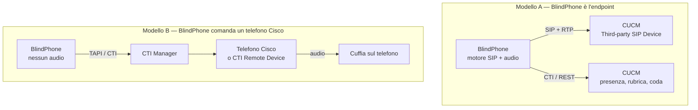

# BlindPhone — Valutazione del collegamento alle centrali Cisco

**Documento tecnico complementare a [ANALISI-BLINDPHONE.md](ANALISI-BLINDPHONE.md), sezione 9, e parallelo a [YEASTAR-INTEGRAZIONE.md](YEASTAR-INTEGRAZIONE.md)**

| | |
|---|---|
| **Versione** | 1.0 — 5 settembre 2026 |
| **Ambito** | Valutazione preliminare: quali funzionalità implementare per collegare BlindPhone a Cisco Unified Communications Manager, Unified Contact Center e Webex Calling |
| **Stato dei dati** | Ricavati dalla documentazione pubblica Cisco (developer.cisco.com e cisco.com, settembre 2026). **Nessuna verifica su impianto reale.** I punti marcati **[DA VERIFICARE]** vanno confermati quando il cliente consegna le specifiche |
| **Da compilare** | La [§10 Scheda di raccolta dati](#10-scheda-di-raccolta-dati-dal-cliente) è il modulo da riempire con le specifiche dell'impianto. Finché è vuota, le stime di questo documento sono ipotesi |

---

## 1. Premessa: perché Cisco non si affronta come Yeastar

Il connettore Yeastar è nato da una situazione fortunata: **una sola API**, REST + WebSocket, che copriva coda, presenza, rubrica, stato agente e controllo chiamata, con un unico documento di riferimento e un laboratorio virtualizzabile a costo zero.

Con Cisco non è così, e le tre differenze vanno messe in conto prima di stimare qualunque cosa:

1. **Non esiste "l'API Cisco".** Esistono tre piattaforme distinte, con famiglie di API che non condividono quasi nulla. Il connettore da scrivere dipende da quale delle tre ha il cliente.
2. **La rete di sicurezza universale non c'è.** L'analisi generale (§9.3) considera il BLF via SIP `SUBSCRIBE` come il livello B che *"funziona con quasi tutti i PBX"*. Su CUCM non funziona: vedi §4.
3. **Il vuoto di mercato è più stretto.** Su Yeastar la tesi commerciale è netta perché l'Operator Panel è drag-and-drop. Cisco dichiara invece che i propri attendant console sono utilizzabili con screen reader: vedi §9.

Nessuna delle tre chiude la strada. Tutte e tre cambiano il modo di percorrerla.

---

## 2. Le tre piattaforme, e come si riconoscono

La prima domanda da fare all'IT del cliente decide tutto il resto del progetto.

| Piattaforma | Come si riconosce | API rilevanti per il posto operatore |
|---|---|---|
| **CUCM on-prem** — Unified CM 12.5 / 14 / 15 | Server on-premise, telefoni Cisco registrati, nessun prodotto di contact center | **CTI** via TAPI/TSP o JTAPI · **UDS** REST (rubrica) · **AXL** SOAP (configurazione) · **Serviceability / PerfMon** SOAP (contatori) |
| **CUCM + UCCX o UCCE/PCCE** | Esiste un contact center con code, agenti, codici di pausa e reportistica | **Finesse** REST + XMPP su BOSH/WebSocket — l'equivalente Cisco delle Open API Yeastar |
| **Webex Calling** (cloud) | Nessun CUCM: gli utenti sono su Webex, telefoni MPP o app Webex | **Call Controls API** REST + webhook |

> **Attenzione ai casi misti.** Una PA di dimensione medio-grande può avere CUCM per la telefonia ordinaria e UCCX solo su un servizio (CUP, prenotazioni). Il posto operatore del centralino generale sta di solito **fuori** dal contact center, cioè nella riga peggiore della tabella. **[DA VERIFICARE]** su quale delle due insista il centralino da servire.

---

## 3. Il bivio architetturale: dove sta l'audio

Su Yeastar la scelta era fra SIP nativo e controllo via API, e si è risolta con un modello ibrido che teneva l'audio in BlindPhone. Su Cisco la stessa scelta è più vincolante, perché tocca la natura del prodotto.



| | **Modello A — endpoint SIP** | **Modello B — controllo CTI** |
|---|---|---|
| Registrazione su CUCM | Third-party SIP Device, autenticazione digest | Nessuna: si controlla un dispositivo già registrato |
| Dove sta l'audio | In BlindPhone: cuffia USB, NAudio, jitter buffer, codec, registrazione | Sul telefono Cisco |
| Linee disponibili | **Basic: una sola.** Advanced: fino a otto | Quelle del telefono |
| Presenza / BLF | **Non supportata** (§4) | Sì, via CTI |
| Rischio di interoperabilità SIP | Alto — è il rischio R4 dell'analisi, che nomina esplicitamente CUCM | Nullo |
| Costo di licenza per postazione | 3 DLU (Basic) o 6 DLU (Advanced) | Il telefono che il cliente ha già |
| Lavoro BlindPhone già fatto che si riusa | Tutto | Tutto tranne audio, codec, cuffia, registrazione |
| Conformità EN 301 549 §6.1 (banda larga) | Sotto controllo di BlindPhone | Dipende dal telefono Cisco |

**Il modello B è quello che usano tutti gli attendant console Cisco**, compresi quelli di Cisco stessa e quelli di Imagicle: il client parla con il CTI Manager attraverso il Cisco TSP e l'audio resta sull'apparecchio.

**Il modello A conserva l'identità di BlindPhone** — un softphone che l'operatore usa con la propria cuffia, senza dipendere da un apparecchio fisico — ma perde la presenza e, con la licenza Basic, è limitato a una linea sola: insufficiente per un posto operatore che deve tenere un chiamante in attesa mentre consulta un interno.

> **Decisione da prendere con il cliente, non in laboratorio.** Se l'ente vuole eliminare il telefono da tavolo, è modello A con licenza Advanced e presenza da recuperare via CTI in parallelo. Se il telefono resta sulla scrivania, il modello B costa meno e rischia meno, ma BlindPhone diventa un telecomando accessibile invece di un softphone.

---

## 4. Ciò che il piano attuale dà per scontato e su Cisco non vale

L'analisi generale (§9.3) classifica il connettore **BLF / dialog-info** — SIP `SUBSCRIBE` con `Event: dialog`, RFC 4235 — come *"universale, funziona con quasi tutti i PBX"*, ed è la rete di sicurezza su cui poggia la vendibilità del prodotto a centralini privi di API. In BlindPhone è implementato in `SipPresenceSource`.

**Su CUCM non funziona.** La documentazione Cisco elenca `Presence` e `Call Pickup` fra le funzioni **non supportate** per i telefoni SIP di terze parti, e le segnalazioni sul forum Cisco riportano `SUBSCRIBE` rifiutati per motivi di licenza su quel tipo di dispositivo.

Conseguenze pratiche:

- la funzionalità **S2 dell'analisi (presenza degli interni)** su CUCM si ottiene **solo dal CTI**, cioè con l'onere del §7 blocco 3, oppure non si ottiene;
- il **quadro dei colleghi in turno** (`ShiftBoardService`), che oggi prende lo stato dalla strada migliore disponibile, su CUCM puro senza CTI resta senza sorgente;
- l'avviso preventivo *"l'interno è fuori servizio"* prima di un trasferimento, che è una delle funzioni che distinguono BlindPhone, **non è disponibile** nel modello A senza CTI.

> **Va corretto in ANALISI-BLINDPHONE.md §9.3**, dove oggi si legge che il connettore BLF è universale. Non lo è: ha un'eccezione, ed è il centralino più diffuso nella PA di grandi dimensioni.

---

## 5. La coda: quello che su Cisco si può sapere davvero

È il punto più importante del documento e il più deludente.

### 5.1 CUCM senza contact center — livello B+

Il **Native Call Queuing** dei hunt pilot esiste dalla 9.x e mette in attesa fino a 100 chiamanti per pilota. Ma:

- **l'hunt pilot non è un indirizzo osservabile via CTI.** L'oggetto che rappresenta il pilota viene creato quando arriva una chiamata e distrutto quando finisce: JTAPI e TAPI non possono quindi elencare chi sta aspettando né da quanto;
- l'unico accesso programmatico documentato è il **contatore PerfMon della Serviceability API**, letto in SOAP con `perfmonCollectCounterData` su un percorso in stile UNC:

```
\\<cucm-host>\Cisco Hunt Pilots(<pilota>)\CallsQueued
```

Quindi su CUCM puro si ottiene **il numero delle chiamate in attesa, e nient'altro**: non il nome, non il numero, non il tempo di attesa, non la posizione.

Mappatura su `QueueProviderCapabilities`:

```csharp
new QueueProviderCapabilities(
    CanReadWaitingList:   false,
    CanReadCallerIdentity:false,
    CanReadWaitTime:      false,
    CanReadPosition:      false,
    CanPickSpecificCall:  false,
    CanManageAgentState:  false,   // vedi nota
    CanReadPresence:      false)   // true solo con il CTI del blocco 3
```

Il record delle capacità esiste esattamente per questo: la UI nasconde ciò che non c'è invece di offrire comandi muti. **Il requisito del capitolato — *"conoscere in tempo reale il numero delle chiamate in coda"* — resta soddisfatto.** Quello che non si può dare è l'elenco.

> **[DA VERIFICARE]** (a) il contatore `CallsQueued` è leggibile con l'utenza applicativa che si intende usare; (b) la frequenza di polling sostenibile senza pesare sul CUCM di produzione — PerfMon è un'API di monitoraggio, non di tempo reale, e va tarata; (c) se l'ente usa hunt pilot con queuing o distribuzione semplice, perché senza queuing non c'è coda da contare.

### 5.2 CUCM + UCCX o UCCE — livello A completo

Con un contact center la situazione si ribalta. **Finesse** espone in REST le famiglie `User`, `Dialog`, `Queue`, `Team`, `ReasonCode`, `WrapUpReason`, con eventi in tempo reale consegnati in **XMPP su BOSH o WebSocket** dal Notification Service (un OpenFire che gira sulla piattaforma Finesse). Il servizio REST è a sua volta un client CTI verso UCCE.

È la stessa forma dell'integrazione Yeastar: fonte di verità interrogabile + canale eventi, da combinare nel modello ibrido evento + riconciliazione già descritto in [YEASTAR-INTEGRAZIONE.md §5.3](YEASTAR-INTEGRAZIONE.md). Il codice di `YeastarQueueProvider`, `YeastarEventStream` e `CallCorrelator` è largamente riusabile nella struttura, non nei dettagli.

---

## 6. Mappatura sulle astrazioni esistenti

L'architettura regge: nessuna interfaccia del core va cambiata, tutte trovano un'implementazione. È il ritorno dell'investimento fatto tenendo `IQueueProvider` invece di scrivere codice Yeastar nel core.

| Astrazione | CUCM puro | CUCM + UCCX/UCCE | Webex Calling |
|---|---|---|---|
| `IQueueProvider` | Serviceability PerfMon — solo conteggio | **Finesse** REST + XMPP | Webex Calling API |
| `IPresenceSource` | **CTI / TAPI** — non SIP (§4) | CTI via Finesse | Webhook di presenza |
| `IContactSource` | **UDS** REST | UDS REST | Webex People API |
| `ITelephonyEngine` | SIP (modello A) **oppure** TAPI/TSP (modello B) | idem | SIP o Call Controls API |
| `ICallHistoryRepository` | Locale, come oggi | Locale | Locale |

### 6.1 Punto di innesto nel codice

La fabbrica `CreateQueueProvider(sp, settings)` in `src/BlindPhone.App/App.xaml.cs` è già il confine giusto: sceglie il connettore e ricade su `DisabledQueueProvider` quando non c'è nulla da collegare.

Manca però un **discriminante di famiglia**. `PbxSettings` è oggi modellato su Yeastar — `Host`, `Port`, `ClientId`, `QueueIds`, `WaitingListIsOrdered` — e va esteso con:

- `PbxSettings.Kind` : `Yeastar` | `CiscoCucm` | `CiscoFinesse` | `WebexCalling` | `Nessuno`;
- un blocco di impostazioni per famiglia, sul modello di `ContactsSqlServerSettings`, con i segreti nel deposito protetto e mai in `settings.json`;
- la procedura guidata corrispondente nella scheda Rubrica/Centralino delle impostazioni.

---

## 7. Le funzionalità da implementare, in ordine

Stime indicative in giornate/uomo, **da riconfermare** quando l'impianto è noto. L'ordine è per rapporto valore/rischio, non per completezza funzionale.

### Blocco 1 — vale su ogni CUCM, rischio basso — ≈ 10 gg

| # | Funzionalità | Tecnologia | Stima | Note |
|---|---|---|---|---|
| 1.1 | **`CiscoUdsContactSource`** | UDS REST | 5 gg | Rubrica aziendale. UDS è **installato e attivo per impostazione predefinita su tutti i nodi CUCM**, non richiede licenza. Ricerca per `first`, `last`, `number`, `numberLast`, `email`, `uri`. Si innesta su `IContactSource` accanto al SQL Server già fatto |
| 1.2 | **Selettore di provider** | Impostazioni + UI | 5 gg | `PbxSettings.Kind`, procedura guidata, diagnostica per famiglia |

È il blocco che rende BlindPhone **utile** in un ambiente Cisco senza toccare il controllo chiamata, e con il minimo rischio tecnico.

> **[DA VERIFICARE]** il parametro d'impresa *User Data Services / User Search Limit* (predefinito **64 risultati**): su una rubrica di ente serve la paginazione con `start` e `max`, e va verificato che il limite non sia stato abbassato.

### Blocco 2 — il conteggio di coda su CUCM puro — ≈ 7 gg

| # | Funzionalità | Tecnologia | Stima |
|---|---|---|---|
| 2.1 | **`CiscoServiceabilityQueueProvider`** | Serviceability SOAP, `perfmonCollectCounterData` | 7 gg |

Polling dei contatori `CallsQueued` per hunt pilot, capacità dichiarate onestamente al livello B+, degrado annunciato all'operatore quando il collegamento cade — la stessa regola di onestà dell'interfaccia già applicata al connettore Yeastar.

### Blocco 3 — il CTI, dove sta tutto il lavoro e tutto il rischio — ≈ 25–30 gg

| # | Funzionalità | Tecnologia | Stima |
|---|---|---|---|
| 3.1 | Interop TAPI 2.1 da .NET | `tapi32.dll` via P/Invoke o wrapper gestito | 8–10 gg |
| 3.2 | **`CiscoCtiPresenceSource`** | Device State Server del TSP | 6 gg |
| 3.3 | **`CiscoTapiTelephonyEngine`** (modello B) | Cisco TSP | 10–12 gg |
| 3.4 | Correlazione fra mondo CTI e mondo SIP (modello A) | — | 5 gg |

Il **Cisco TSP è conforme a TAPI 2.1** e supporta tutto ciò che serve a un posto operatore: risposta, attesa e ripresa con *hold reversion*, trasferimento diretto/cieco/con consultazione, conferenza ad hoc, parcheggio, prelievo (di gruppo, altrui, diretto), DTMF via `lineGenerateDigits()`, redirect, *Do Not Disturb*, stato linea e stato dispositivo.

**Non richiede licenze aggiuntive**: basta un Application User su CUCM con il ruolo *Standard CTI Enabled* e i dispositivi associati. È il vincolo di configurazione, non di costo.

Il rischio è tutto nell'interop: **non esiste una libreria gestita Cisco**, TAPI non è una libreria .NET, e si parte da zero o da un wrapper di terze parti. È tecnologia del 1997 su cui il debug è lento.

### Blocco 4 — solo con contact center — ≈ 15–18 gg

| # | Funzionalità | Tecnologia | Stima |
|---|---|---|---|
| 4.1 | **`CiscoFinesseQueueProvider`** | Finesse REST + XMPP/BOSH | 12 gg |
| 4.2 | Stato agente, codici di pausa, wrap-up | Finesse `User`, `ReasonCode`, `WrapUpReason` | 4–6 gg |

Struttura quasi identica al connettore Yeastar. Se il cliente pilota ha UCCX, **è qui che conviene andare direttamente**, saltando i blocchi 2 e 3.

### Blocco 5 — se il cliente è già in cloud — ≈ 12–15 gg

| # | Funzionalità | Tecnologia | Stima |
|---|---|---|---|
| 5.1 | **`WebexCallingProvider`** | Call Controls API REST + webhook | 12–15 gg |

I comandi ci sono tutti — *hold/resume*, *divert*, *transfer* nelle varianti attended/consultative/blind — con scope OAuth `spark:calls_read` e `spark:calls_write`, e webhook di livello utente per gli eventi di chiamata.

> **Ostacolo di rete, non di API:** i webhook Webex richiedono un endpoint raggiungibile da Internet. Su una postazione di ente dietro firewall non è praticabile senza un relay, e va progettato prima di stimare. **[DA VERIFICARE]** se esiste un canale in uscita utilizzabile o se serve un componente lato server.

---

## 8. Cosa non implementare

| Cosa | Perché no |
|---|---|
| **AXL** oltre la diagnostica | È l'API di *provisioning*: scrive la configurazione del centralino. BlindPhone non deve poterlo fare, e chiedere quelle credenziali all'IT di un ente è un ostacolo commerciale gratuito. UDS copre la rubrica in sola lettura ed è già attivo |
| **JTAPI** | È Java: richiederebbe una JVM affiancata su ogni postazione. Il TSP dà le stesse capacità in modo nativo su Windows |
| **Silent monitoring e registrazione lato CUCM** | Richiedono il *built-in bridge* acceso sui telefoni e toccano il trattamento dei dati di traffico. Fuori perimetro, e BlindPhone registra già in locale |
| **Sostituzione dell'attendant console Cisco sui suoi terreni** | Rubrica avanzata, code di reparto, statistiche: non è il prodotto. BlindPhone è il posto operatore accessibile, non il console server |

---

## 9. Il punto commerciale, detto per intero

Su Yeastar la tesi è netta e verificabile: l'Operator Panel si usa con il trascinamento, quindi è inaccessibile per costruzione, e nessun attributo ARIA lo rimedia.

**Su Cisco quella tesi non vale.** La documentazione ufficiale afferma che:

- **Unified Attendant Console Standard** è stato collaudato con **NVDA** e con l'**Assistente vocale di Windows**;
- **Unified Attendant Console Advanced** si usa con un **plug-in per JAWS**;
- entrambi offrono personalizzazione dell'aspetto per l'ipovisione.

Non state riempiendo un vuoto: entrate contro un prodotto che rivendica già l'accessibilità.

Questo **non chiude la partita**, e le ragioni per cui non la chiude vanno argomentate con dati, non con affermazioni:

- *«collaudato con NVDA»* non significa utilizzabile in produzione da un centralinista cieco per otto ore consecutive, con i tempi di reazione che il servizio richiede;
- la dipendenza da uno **script JAWS** è un costo di licenza ricorrente per postazione e un vincolo di aggiornamento: ogni versione di CUAC può romperlo;
- nulla di tutto ciò è progettato in italiano, né per il contesto della **Legge 113/1985**, né con l'interazione sonora ed earcon che BlindPhone mette al centro;
- resta la conformità **EN 301 549** da dimostrare, che è un requisito di gara e non un'opinione.

> **La verifica più economica del progetto, e quella che decide se ha senso: mezza giornata con un centralinista non vedente davanti a CUAC Standard con NVDA.** Costa quasi nulla e vale più di quaranta giornate di sviluppo fatte in previsione. Va fatta **prima** del blocco 3.

---

## 10. Scheda di raccolta dati dal cliente

Da compilare quando arrivano le specifiche dell'impianto. Finché è vuota, le stime di questo documento sono ipotesi.

### 10.1 Piattaforma

| Dato | Valore | Note |
|---|---|---|
| Piattaforma: CUCM on-prem / CUCM+UCCX / CUCM+UCCE / Webex Calling | | Decide il connettore (§2) |
| Versione CUCM e livello di SU | | 12.5 / 14 / 15 |
| Data di fine supporto della versione in esercizio | | Un aggiornamento in programma cambia le priorità |
| Numero di nodi del cluster e nodo su cui esporre le API | | PerfMon e UDS sono per nodo |
| Esiste un contact center? Su quale servizio? | | Se il centralino generale ne è fuori, vale il §5.1 |

### 10.2 Il posto operatore

| Dato | Valore | Note |
|---|---|---|
| Quante postazioni di centralino | | Incide su licenze e utenze applicative |
| Il telefono da tavolo resta o va eliminato | | **Decide il modello A o B (§3)** |
| Modello dei telefoni Cisco in uso | | Rileva per il modello B e per il codec |
| Interni da sorvegliare per la presenza (ordine di grandezza) | | Ogni dispositivo va associato all'utenza CTI |
| Code o hunt pilot da sorvegliare, con i rispettivi numeri pilota | | Servono per il percorso PerfMon |
| Il queuing è attivo sui hunt pilot | | Senza, non c'è coda da contare |

### 10.3 Autorizzazioni e licenze

| Dato | Valore | Note |
|---|---|---|
| Application User con *Standard CTI Enabled* ottenibile | | Bloccante per presenza e call control |
| Licenze *Third-party SIP Device Advanced* disponibili (6 DLU/postazione) | | Solo modello A |
| Registrazione di endpoint SIP di terze parti consentita dalla policy | | Solo modello A |
| Utenza di sola lettura per Serviceability/PerfMon | | Blocco 2 |
| Utenza per UDS | | Blocco 1 |
| Certificati: CA interna o autofirmati | | Si innesta su `CertificateTrustService`, già presente |

### 10.4 Rete

| Dato | Valore | Note |
|---|---|---|
| Porte raggiungibili dalla postazione verso CUCM (8443 HTTPS, 2748 CTI, 5060/5061 SIP) | | |
| Esiste un canale in uscita per webhook | | Solo Webex Calling |
| Presenza di firewall applicativi o proxy che ispezionano il traffico | | |

---

## 11. Verifiche da fare prima di quotare

| # | Verifica | Se negativo |
|---|---|---|
| 1 | Piattaforma identificata fra le tre di §2 | Non si può stimare |
| 2 | Esiste un contact center sul servizio del centralino | Senza: coda al solo conteggio. **Da dire prima della firma, non dopo** |
| 3 | Modello A o B deciso con il cliente | Il prodotto cambia natura: dirlo per tempo |
| 4 | Licenze Third-party SIP Advanced disponibili | Costo a preventivo, o modello B |
| 5 | Application User con *Standard CTI Enabled* concedibile | Niente presenza, niente call control CTI |
| 6 | Contatore `Cisco Hunt Pilots(<pilota>)\CallsQueued` leggibile | Nessuna visibilità di coda |
| 7 | Frequenza di polling PerfMon accettabile per l'IT | Ritarare l'aggiornamento del conteggio |
| 8 | UDS raggiungibile e limite di ricerca adeguato | Rubrica da SQL Server o LDAP, già implementate |
| 9 | Prova sul campo di CUAC Standard con NVDA (§9) | **Se è davvero usabile, ridiscutere l'investimento** |
| 10 | G.722 disponibile sull'interno o sul telefono | Requisito EN 301 549 §6.1 |

---

## 12. Impatto sulla pianificazione e raccomandazione

| Scenario del cliente | Blocchi da fare | Stima | Livello coda raggiunto |
|---|---|---|---|
| CUCM puro, si vuole solo la rubrica | 1 | ≈ 10 gg | — |
| CUCM puro, posto operatore completo, telefono Cisco che resta | 1 + 2 + 3 | ≈ 42–47 gg | B+ (conteggio) |
| CUCM puro, softphone puro senza telefono da tavolo | 1 + 2 + 3.4 + licenze Advanced | ≈ 27–32 gg | B+ (conteggio), presenza solo con CTI |
| CUCM + UCCX/UCCE | 1 + 4 | ≈ 25–28 gg | **A completo** |
| Webex Calling | 1 + 5 | ≈ 22–25 gg | Da verificare |

### Raccomandazione

1. **Fare subito il blocco 1** (≈ 10 gg): rischio quasi nullo, si innesta sul lavoro già fatto sulla rubrica, e rende BlindPhone utile in un ambiente Cisco senza toccare il controllo chiamata. È anche il modo più economico per avere un primo contatto tecnico riuscito con l'IT del cliente.
2. **Vincolare il blocco 3 a un cliente pilota reale con impegno scritto.** Venticinque-trenta giornate di interop su TAPI, senza libreria gestita e con un modello di prodotto diverso da quello attuale, sono troppe da fare in previsione.
3. **Se il cliente pilota ha UCCX, andare direttamente al blocco 4** e saltare il 2 e il 3: è la strada in cui il codice già scritto per Yeastar rende di più.
4. **Fare la verifica §9 prima di tutto il resto.** È mezza giornata, e può cambiare la decisione di investimento.

---

## Fonti

Consultate a settembre 2026. Nessuna verifica su impianto reale.

**Rubrica e dati utente**
- [UDS Developer Guide — User Data Services API](https://developer.cisco.com/docs/user-data-services/)
- [What Is UDS](https://developer.cisco.com/site/user-data-services/discover/what-is-uds/)
- [UDS — User Resources](https://developer.cisco.com/docs/user-data-services/user-resources/)

**CTI e controllo chiamata**
- [Cisco Unified TAPI Developers Guide, Release 15 — Features Supported by TSP](https://www.cisco.com/c/en/us/td/docs/voice_ip_comm/cucm/tapi_dev/15/cucm_b_tapi-dev-guide-15/cucm_b_tapi-dev-guide-1251_chapter_010.html)
- [TAPI — Technical Overview, Cisco DevNet](https://developer.cisco.com/site/tapi/discover/technical-overview/)
- [CTI Remote Device feature — Cisco DevNet Support](https://devnetsupport.cisco.com/hc/en-us/articles/360001987008-CTI-Remote-Device-feature)
- [Extend and Connect — Feature Configuration Guide CUCM 12.5](https://www.cisco.com/c/en/us/td/docs/voice_ip_comm/cucm/admin/12_5_1/featureConfig/cucm_b_feature-configuration-guide-1251/cucm_b_feature-configuration-guide-1251_chapter_0100.html)
- [CTI (TAPI/JTAPI) Supported Device Matrix](https://developer.cisco.com/site/jtapi/cti-tapi-jtapi-supported-device-matrix/)
- [CUCM CTI Configuration — Imagicle KB (ruoli e utenza applicativa)](https://kbp.imagicle.com/kb/cucm-cti-configuration_27.html)

**Coda**
- [Configure Call Queuing — Feature Configuration Guide CUCM 15](https://www.cisco.com/c/en/us/td/docs/voice_ip_comm/cucm/admin/cucm_b_feature-configuration-guide-for-15/cucm_m_configure-call-queuing.html)
- [Configure CUCM Native Call Queuing Feature](https://www.cisco.com/c/en/us/support/docs/unified-communications/unified-communications-manager-callmanager/200453-Configure-CUCM-Native-Call-Queuing-Featu.html)
- [PerfMon API — Serviceability SOAP, Cisco DevNet](https://developer.cisco.com/docs/sxml/perfmon-api/)
- [Getting number of calls waiting at hunt pilot in CUCM — Cisco Community](https://community.cisco.com/t5/call-control/getting-number-of-calls-waiting-at-hunt-pilot-in-cucm-9/td-p/3450518)

**Contact center**
- [Cisco Finesse REST APIs — Cisco DevNet](https://developer.cisco.com/docs/finesse/cisco-finesse-rest-apis/)
- [Understand UCCX Finesse Architecture Deep Dive](https://www.cisco.com/c/en/us/support/docs/contact-center/finesse/221598-understand-uccx-finesse-architecture-dee.html)
- [Finesse — Client Services (BOSH/XMPP)](https://developer.cisco.com/docs/finesse/client-services/)

**Endpoint SIP di terze parti**
- [How to register third-party SIP phones with Communications Manager](https://community.cisco.com/t5/collaboration-knowledge-base/how-to-register-third-party-sip-phones-with-communications/ta-p/3130315)
- [BLF is not working on third-party SIP phone — Cisco Community](https://community.cisco.com/t5/ip-telephony-and-phones/blf-is-not-working-on-third-party-sip-phone/td-p/4996591)

**Cloud**
- [Webex Calling — Call Controls API](https://developer.webex.com/docs/api/v1/call-controls)
- [Webex Calling: Getting Started with Call Control APIs](https://developer.webex.com/blog/webex-calling-getting-started-with-call-control-apis)

**Concorrenza e accessibilità**
- [Cisco Unified Attendant Console Standard 12.0 — Data Sheet](https://www.cisco.com/c/en/us/products/collateral/unified-communications/unified-attendant-console/datasheet-c78-739479.html)
- [Cisco Unified Attendant Console Advanced 12.0 — Data Sheet](https://www.cisco.com/c/en/us/products/collateral/unified-communications/unified-attendant-console/datasheet-c78-740351.html)
- [Cisco Unified Attendant Console Advanced 14.0 — Design Guide](https://www.cisco.com/c/dam/en/us/td/docs/voice_ip_comm/cucmac/cuaca/14_0_1/design_guide/CUACA_DG_140102.pdf)
