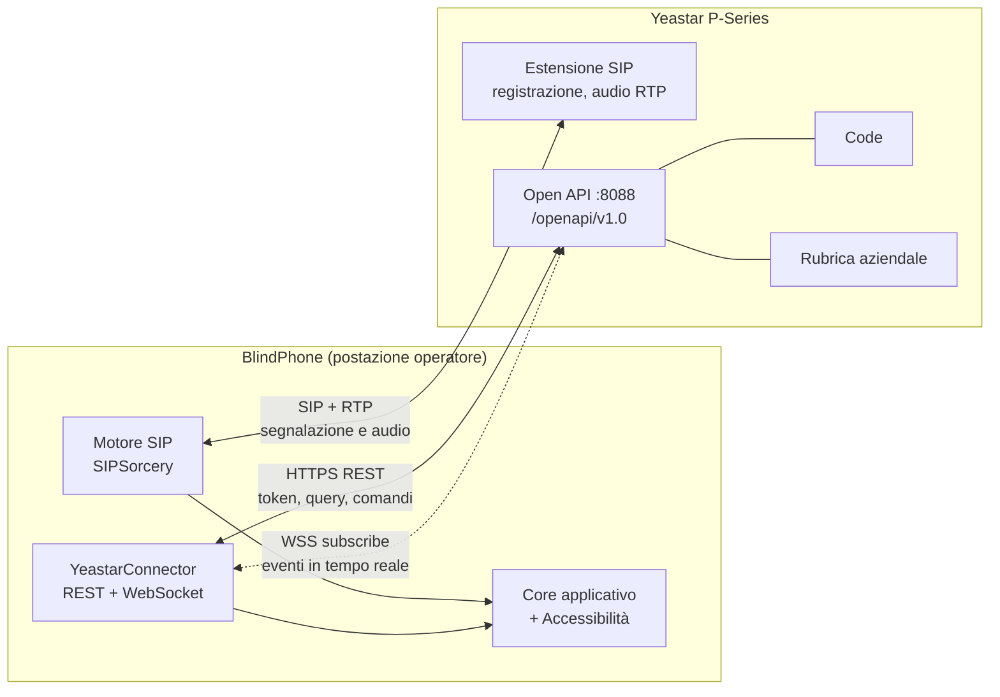

# BlindPhone — Progetto di dettaglio del connettore Yeastar P-Series

**Documento tecnico complementare a [ANALISI-BLINDPHONE.md](ANALISI-BLINDPHONE.md), sezione 9**

| | |
|---|---|
| **Versione** | 1.0 — 3 agosto 2026 |
| **Ambito** | Implementazione di `IQueueProvider`, `IContactSource` e call control ausiliario su PBX Yeastar |
| **Stato dei dati** | Ricavati dalla documentazione pubblica Yeastar (help.yeastar.com, agosto 2026). I punti marcati **[DA VERIFICARE]** richiedono conferma su PBX reale prima della stima definitiva |

---

## 1. Premessa: perché Yeastar cambia il progetto in meglio

Nell'analisi generale il rischio R1 era *"il PBX del cliente non espone l'informazione di coda"*, classificato ad alta probabilità e impatto critico. **Con Yeastar P-Series quel rischio si chiude.**

Yeastar espone una **Open API REST + WebSocket** che fornisce esattamente ciò che serve, incluso un endpoint dedicato che restituisce l'elenco dei chiamanti in attesa con nome, numero e tempo di attesa. Questo porta BlindPhone al **livello A (completo)** della tabella §9.1 dell'analisi, senza fallback e senza degrado.

C'è di più: le API coprono anche la **rubrica aziendale**, lo **stato agente con codici di pausa**, la **presenza degli interni** e il **controllo chiamata**. Diverse funzionalità che nell'analisi generale richiedevano sviluppo dedicato (rubrica multi-sorgente, stato agente, presenza/BLF) diventano un'integrazione unica con un solo sistema.

### 1.1 Il vuoto di mercato che BlindPhone riempie

Yeastar fornisce già la sua risposta al posto operatore: l'**Operator Panel**, interfaccia web integrata in Linkus Web Client, e il **Queue Panel** del Call Center Console. La documentazione ufficiale li descrive come strumenti in cui si gestiscono e smistano le chiamate *"con una semplice azione di trascinamento"* (drag-and-drop) dal browser.

**Un'interfaccia drag-and-drop è, per definizione, inutilizzabile senza vista.** Non è un difetto di implementazione correggibile con qualche attributo ARIA: è il modello di interazione stesso a essere inaccessibile. Questo è il vuoto esatto in cui si colloca BlindPhone, e va detto così nelle proposte commerciali: *non sostituisce Yeastar, sostituisce l'Operator Panel di Yeastar per l'operatore non vedente*, usando le stesse API ufficiali.

---

## 2. Prerequisiti e vincoli di piattaforma

Da verificare **in fase pre-vendita**, con checklist da consegnare all'IT del cliente.

| Requisito | Valore | Impatto se non soddisfatto |
|---|---|---|
| **Modello PBX** | P-Series. Per l'Appliance Edition la documentazione indica **P550, P560, P570** | I modelli inferiori o la vecchia **S-Series** richiedono un connettore diverso (vedi §9) |
| **Edizione** | Appliance / Software (PSE) / Cloud — le API sono comuni alle tre | — |
| **Firmware** | **37.7.0.16 o superiore** (Appliance Edition) | Aggiornamento firmware necessario |
| **Piano di licenza** | **Enterprise Plan** o **Ultimate Plan** | Il piano Standard non include l'API: **blocco totale del progetto**. Costo da mettere a preventivo |
| **Funzione API abilitata** | Da attivare nel portale web del PBX, con generazione di Client ID e Client Secret | Configurazione, non ostacolo |
| **Rete** | Accesso HTTPS al PBX (porta di default **8088** negli esempi della documentazione) dalla postazione operatore | Regola firewall |
| **Interno SIP** | Un'estensione dedicata all'operatore, registrabile da client di terze parti | Verificare che il piano/policy non forzi solo client Linkus |

> **Azione commerciale:** il piano Enterprise è comunque già necessario al cliente per avere l'Operator Panel e il Call Center Console. Se la PA ha un posto operatore, con ogni probabilità la licenza c'è già. **Va verificato prima di quotare**, perché in caso contrario è un costo che ricade sul progetto.

---

## 3. Architettura dell'integrazione

BlindPhone parla con Yeastar su **due canali paralleli e indipendenti**:



### 3.1 Divisione delle responsabilità — la decisione chiave

Yeastar permette due modelli di controllo chiamata. La scelta ha conseguenze dirette sull'esperienza dell'operatore.

| | **Modello A — SIP nativo** | **Modello B — API (third-party call control)** |
|---|---|---|
| Rispondi/riaggancia | INVITE/BYE locale | `call/accept_inbound`, `call/hangup` |
| Attesa | re-INVITE locale | `call/hold`, `call/unhold` |
| Trasferimento | REFER locale | `call/transfer` con `type: blind` / `type: attended` |
| **Latenza** | ~10–30 ms | **~150–400 ms** (round-trip HTTPS + elaborazione PBX) |
| Dipendenza dall'API | Nessuna per le funzioni critiche | Totale: API giù = telefono inutilizzabile |
| Aderenza al comportamento PBX | Da verificare in interoperabilità | Garantita per costruzione |
| Funzioni non ottenibili altrimenti | — | Parcheggio su slot, prelievo da coda, stato agente |

**Decisione raccomandata: modello ibrido.**

- **SIP nativo per il percorso critico:** rispondi, riaggancia, attesa, riprendi, DTMF, alternanza, audio. Sono le azioni su cui l'operatore preme un tasto e si aspetta un riscontro immediato. Un ritardo di 300 ms su "Rispondi", ripetuto 200 volte al giorno, è la differenza tra uno strumento che si dimentica di usare e uno che si nota di continuo. Per un utente che si orienta solo con l'udito, il ritardo è anche disorientante: senza riscontro visivo, 300 ms di silenzio si interpretano come "il comando non ha funzionato" e si preme di nuovo.
- **API per ciò che il SIP non può dare:** visibilità della coda, stato agente, presenza degli interni, rubrica aziendale, parcheggio su slot, prelievo selettivo dalla coda.
- **API come rete di sicurezza sul trasferimento:** se il PBX rifiuta il `REFER` (403/405), fallback automatico a `call/transfer`, con annuncio trasparente all'operatore. Copre anche eventuali policy Yeastar che limitano il REFER da client di terze parti.

---

## 4. Autenticazione e gestione della sessione API

```
POST https://<pbx-host>:8088/openapi/v1.0/get_token
User-Agent: BlindPhone/1.0
Content-Type: application/json

{ "username": "<Client ID>", "password": "<Client Secret>" }
```

Risposta:

| Campo | Significato |
|---|---|
| `errcode` | 0 = successo |
| `access_token` | Token per le chiamate successive |
| `access_token_expire_time` | **1800 s (30 minuti)** |
| `refresh_token` | Per rinnovare senza ricredenziarsi |
| `refresh_token_expire_time` | **86400 s (24 ore)** |

**Vincoli operativi e come gestirli:**

| Vincolo documentato | Implementazione in BlindPhone |
|---|---|
| Access token valido 30 minuti | Rinnovo proattivo a **25 minuti** (`refresh_token`), mai al primo 401 |
| Refresh token valido 24 ore | Ri-autenticazione completa a **20 ore**, pianificata fuori dai picchi. Se scade in turno, ri-autenticazione silenziosa con Client ID/Secret conservati in Credential Manager |
| **Massimo 8 access token simultanei per applicazione** | Un solo token per istanza; `del_token` alla chiusura. **Attenzione: con più postazioni BlindPhone servono Client ID distinti per postazione**, altrimenti alla nona postazione si invalidano token altrui. Da progettare fin da subito: il Client ID è un parametro di postazione, non di prodotto |
| Client Secret in chiaro nel file di configurazione | **No.** Windows Credential Manager o DPAPI ambito utente, come le credenziali SIP (§15.1 dell'analisi) |

---

## 5. Monitoraggio della coda — il cuore del connettore

### 5.1 Fonte autorevole: `queue/call_status`

```
GET https://<pbx>:8088/openapi/v1.0/queue/call_status?id=<queue_id>&access_token=<token>
```

Risposta (struttura reale dalla documentazione Yeastar):

```json
{
    "errcode": 0,
    "errmsg": "SUCCESS",
    "waiting_calls": 1,
    "waiting_list": [
        {
            "call_id": "1699424450.42",
            "caller_number": "5505501",
            "caller_display_name": "Leo Ball",
            "callee_number": "6402",
            "callee_display_name": "Tech Support",
            "duration": 5
        }
    ],
    "ringing_calls": 1,
    "ringing_list": [ { "...": "..." } ],
    "active_calls": 2,
    "active_list": [ { "...": "..." } ]
}
```

**Questo endpoint da solo soddisfa il requisito centrale del capitolato.** Mappatura diretta sul modello di dominio dell'analisi (§9.2):

| Campo Yeastar | Campo `QueuedCaller` | Uso in BlindPhone |
|---|---|---|
| `waiting_calls` | conteggio | **Risposta al tasto `F12`**: *"3 chiamate in coda"* |
| `waiting_list[].caller_display_name` | `CallerName` | Nome annunciato; se vuoto, risoluzione via rubrica |
| `waiting_list[].caller_number` | `CallerNumber` | Numero letto cifra per cifra |
| `waiting_list[].duration` | `WaitSeconds` → `EnqueuedAt` | Tempo di attesa; soglie di allerta; *"attesa massima 2 minuti e 10"* |
| `waiting_list[]` indice | `Position` | Posizione in coda **[DA VERIFICARE]** che l'ordine dell'array rispecchi l'ordine di servizio |
| `callee_display_name` | `QueueName` | Nome della coda quando se ne monitorano più d'una |
| `call_id` | `Id` | Chiave di correlazione e target delle azioni |
| `ringing_list` | — | Chiamate già distribuite e in squillo: distinte dall'attesa negli annunci |
| `active_list` | — | Chiamate in conversazione: base per le statistiche del servizio |

> **[DA VERIFICARE] su PBX reale:** (a) l'ordine di `waiting_list` corrisponde all'ordine di servizio della coda; (b) `duration` è il tempo di attesa in coda in secondi e non la durata totale della chiamata; (c) il comportamento con code a priorità. Sono tre verifiche di mezza giornata che vanno fatte **prima** di scrivere il codice del pannello coda.

### 5.2 Fonte reattiva: eventi WebSocket

```
wss://<pbx>:8088/openapi/v1.0/subscribe?access_token=<token>
```

Eventi rilevanti per BlindPhone, con destinazione funzionale:

| ID | Evento | Uso |
|---|---|---|
| **30011** | Call State Changed | Motore principale: stato chiamata in tempo reale. `call_path` indica il passaggio per Queue/IVR/Ring Group. `member_status`: `ALERT`, `RING`, `ANSWERED`, `ANSWER`, `HOLD`, `BYE`, `EARLYMEDIA` |
| **30008** | Extension Call State Changed | Stato chiamata riferito alla **nostra** estensione: più semplice da correlare di 30011 |
| **30016** | Incoming Call Request | Preavviso di chiamata entrante: consente di anticipare l'annuncio P0 e la risoluzione del nome in rubrica |
| **30013** | Call Transfer Report | **Esito del trasferimento**: alimenta l'annuncio *"Trasferimento completato"* / *"non riuscito"* (§11.4 dell'analisi) |
| **30015** | Call Failure Report | Motivo del fallimento in linguaggio naturale |
| **30012** | Call End Details (CDR) | Alimenta il registro chiamate locale |
| **30009** | Extension Presence State Changed | **Presenza degli interni**: realizza la funzionalità S2 dell'analisi senza implementare BLF SIP |
| **30007** | Extension Registration Status Changed | Interno non registrato → avviso preventivo prima di trasferire |
| **30029** | Agent Status Changed | Stato agente in coda |
| **30025** | Agent Automatic Pause | **Pausa automatica per chiamate perse**: da annunciare in P0, altrimenti l'operatore smette di ricevere chiamate senza accorgersene. Difetto grave se trascurato |
| **30026** | Agent Ringing Timeout | Chiamata persa per timeout: annuncio + registro |
| **30010** | Trunk Registration State Changed | Linea esterna caduta: informazione che l'operatore deve avere subito |
| **30034–30036** | System Event (Information / Warning / Alert) | Allarmi PBX, filtrati per rilevanza |

**Vincolo critico documentato: la connessione WebSocket cade dopo 60 secondi di inattività.**

Gestione obbligatoria:
- heartbeat ogni **20 secondi** (margine 3×);
- riconnessione con backoff esponenziale (1, 2, 4, 8, 16, 30 s, poi ogni 30 s);
- **alla riconnessione, `queue/call_status` immediato** per riallineare lo stato: gli eventi persi durante la disconnessione non vengono recapitati;
- **dopo 15 secondi di CTI non disponibile, annuncio P1 all'operatore**: *"Dettaglio coda non disponibile"*. È una regola di onestà dell'interfaccia: un operatore non vedente non ha modo di accorgersi da solo che il contatore è congelato, e continuerebbe a fidarsi di un numero vecchio.

### 5.3 Modello ibrido evento + riconciliazione

Né il solo polling né i soli eventi sono sufficienti. Il polling ha latenza; gli eventi si perdono alle disconnessioni.

```
WebSocket (30011/30008/30016)  →  aggiornamento ottimistico immediato  →  annuncio entro 300 ms
              +
queue/call_status              →  fonte di verità
                                  · ogni 10 s a riposo
                                  · ogni 3 s con chiamate in coda
                                  · sempre entro 500 ms da un evento di coda
                                  · sempre alla riconnessione WebSocket
              ↓
      Riconciliazione: se lo stato riconciliato differisce da quello ottimistico,
      vince la fonte di verità; l'annuncio viene corretto solo se la differenza
      è percepibile (conteggio diverso), mai per aggiustamenti di un secondo
      sul tempo di attesa.
```

L'ultima riga è una regola di accessibilità, non di ingegneria: correggere un annuncio già pronunciato confonde più di quanto informi. Si corregge il conteggio, non i decimali.

---

## 6. Stato agente

Mappatura diretta sui comandi previsti in §9.5 dell'analisi:

| Comando BlindPhone | Endpoint Yeastar |
|---|---|
| `Ctrl+Alt+L` — Login/logout coda | `queue/agent_login` |
| `Ctrl+Alt+P` — Pausa/ripresa | `queue/agent_pause` |
| Elenco codici motivo pausa | `queue_pause_reason/list` |
| `Ctrl+Alt+S` — Stato agente corrente | `queue/agent_status` |
| Notifica cambio stato | Evento **30029** |
| Notifica pausa automatica | Evento **30025** → **annuncio P0** |

I codici motivo di pausa vengono letti dal PBX invece che configurati localmente: l'operatore sceglie da un elenco navigabile con le frecce, coerente con quello che vedono i colleghi vedenti sul Queue Panel e con quello che risulta nella reportistica del servizio.

---

## 7. Rubrica: Yeastar come sorgente primaria

Le API `company_contact/*` e `phonebook/*` (list, search, get, query) permettono un `YeastarContactSource` che **sostituisce vantaggiosamente CSV e LDAP** per questo cliente:

| Aspetto | CSV | LDAP | **Yeastar API** |
|---|---|---|---|
| Aggiornamento | Manuale | Pianificato | Pianificato + coerente con il PBX |
| Corrispondenza numero → interno | Da mappare | Da mappare | **Nativa** |
| Presenza dell'interno | No | No | **Sì** (evento 30009) |
| Sforzo di configurazione per l'IT | Alto e ricorrente | Medio | **Nullo: già configurata nel PBX** |

**Raccomandazione:** `YeastarContactSource` come sorgente primaria, con **cache locale cifrata** per il funzionamento a PBX irraggiungibile. CSV e LDAP restano implementati — sono nel capitolato e servono per i contatti esterni non presenti nel PBX e per le installazioni non Yeastar — ma scendono di priorità nella pianificazione.

L'ordine di risoluzione del chiamante diventa: **rubrica personale locale → rubrica Yeastar → LDAP → CSV importato**, configurabile.

---

## 8. Controllo chiamata via API

Endpoint disponibili e loro impiego nel modello ibrido:

| Endpoint | Uso in BlindPhone |
|---|---|
| `call/dial` | Chiamata da rubrica su richiesta (in alternativa all'INVITE locale); click-to-call da integrazioni esterne |
| `call/transfer` (`type: blind` / `type: attended`) | **Fallback** del trasferimento se il REFER SIP viene rifiutato. Mappa esattamente sulle due modalità del tasto `F9` |
| `call/hold` / `call/unhold` | Fallback dell'attesa |
| `call/accept_inbound` / `call/refuse_inbound` | Fallback di risposta/rifiuto |
| `call/hangup` | Fallback di chiusura |
| `call/mute` / `call/unmute` | Mute lato server, sincronizzabile con il mute della cuffia |
| **`call/park`** | **Parcheggio su slot** — funzionalità S3 dell'analisi, ottenibile senza sviluppo SIP dedicato |

### 8.1 Prelievo di una chiamata specifica dalla coda — punto aperto

Il comando *"`Invio` sull'elenco coda preleva la chiamata selezionata"* (§9.4 dell'analisi) **non ha un endpoint dedicato evidente** nella documentazione pubblica.

Il Queue Panel di Yeastar fa esattamente questo con il trascinamento, quindi la capacità esiste nel prodotto; la questione è se sia esposta nella Open API o solo nell'API interna del pannello web.

**Ipotesi implementativa da verificare:** invocare `call/transfer` con `type: blind`, `channel_id` della chiamata in attesa (ricavato da `waiting_list[].call_id` correlato all'evento 30011) e destinazione l'interno dell'operatore stesso. Semanticamente è "prendi questa chiamata e portala a me" — che è precisamente il gesto del drag-and-drop.

**[DA VERIFICARE] con priorità alta.** Tre esiti possibili:
1. Funziona → si implementa il prelievo selettivo come previsto.
2. Non funziona ma esiste un altro endpoint → si adatta.
3. Non è possibile → la coda resta **in sola lettura** e l'operatore riceve le chiamate secondo la strategia di distribuzione configurata sul PBX. **Non è un fallimento**: il requisito del capitolato è *"visualizzare le chiamate in coda e conoscere in tempo reale il numero"*, che resta pienamente soddisfatto. Va però comunicato al cliente prima della firma, non dopo.

Questa verifica è la **prima cosa da fare** appena disponibile un PBX di prova.

---

## 9. Correlazione tra mondo SIP e mondo API — il rischio tecnico principale

BlindPhone vede la stessa chiamata da due angolazioni con identificativi diversi:

| Mondo | Identificativo | Esempio |
|---|---|---|
| SIP locale | `Call-ID` dell'header SIP | `a84b4c76e66710@blindphone` |
| Yeastar API | `call_id` + `channel_id` | `1699424450.42`, `PJSIP/2002-0000004f` |

**Non c'è un campo che li leghi direttamente.** Senza correlazione affidabile si producono difetti insidiosi: l'annuncio "trasferimento completato" riferito alla chiamata sbagliata quando ce ne sono due in corso, o il pannello coda che non si aggiorna dopo la risposta.

**Strategia di correlazione a tre livelli:**

1. **Preferenziale — evento 30008** (Extension Call State Changed): è già filtrato sulla nostra estensione, quindi il numero di candidati è minimo. Si correla su `numero estensione + numero controparte + finestra temporale di ±2 s`.
2. **Conferma — `channel_id`**: il formato `PJSIP/<estensione>-<hex>` contiene il numero di estensione, che restringe ulteriormente.
3. **Disambiguazione — ordinamento temporale**: con due chiamate contemporanee verso lo stesso numero (raro ma possibile), si applica l'ordine di arrivo. In caso di ambiguità residua, **si degrada in modo sicuro**: l'annuncio omette il riferimento specifico (*"Trasferimento completato"* invece di *"Trasferimento di Mario Rossi completato"*) anziché rischiare un'informazione errata.

L'ultimo punto è una regola generale che vale per tutto il prodotto: **per un operatore che non può verificare a schermo, un'informazione sbagliata è peggio di un'informazione mancante.**

Stima: 5 giornate di sviluppo e test, incluso un banco di prova con chiamate concorrenti. Va pianificata esplicitamente, non assorbita in "integrazione API".

---

## 10. Yeastar S-Series e altri scenari

| Scenario | Approccio |
|---|---|
| **P-Series** (tutte le edizioni) | Connettore descritto in questo documento |
| **S-Series** (legacy) | API diversa e più limitata. Se il parco installato del cliente la include, **va valutata separatamente**: possibile ricaduta sul connettore BLF generico (livello B) |
| Yeastar Cloud PBX / K2 | Da verificare caso per caso |
| PBX non Yeastar | L'astrazione `IQueueProvider` resta: il connettore Asterisk AMI previsto nell'analisi generale conserva valore come secondo mercato |

**Nota di prodotto:** conviene comunque mantenere l'astrazione `IQueueProvider` anziché scrivere codice Yeastar-specifico nel core. Il costo aggiuntivo è di 3–4 giornate; il beneficio è che il prodotto resta vendibile alla PA che ha Asterisk, 3CX o Wildix senza riscriverlo. Considerata la dimensione del mercato di riferimento (§ documento PA), è un investimento che si ripaga alla seconda installazione con un centralino diverso.

---

## 11. Laboratorio di sviluppo e test

- **P-Series Software Edition** con licenza di prova gratuita, ottenibile anche via API: laboratorio virtualizzato a costo nullo, replicabile in CI.
- Configurazione di riferimento: 1 coda, 3 interni agente, 1 trunk simulato, generatore di chiamate (SIPp) per riempire la coda.
- **Scenari di collaudo obbligatori:**
  1. 10 chiamate in coda simultanee → verifica conteggio, ordine, tempi di attesa
  2. Disconnessione WebSocket forzata durante chiamate in coda → verifica riallineamento e annuncio di degrado
  3. Scadenza del token durante una chiamata attiva → verifica rinnovo trasparente
  4. Trasferimento cieco e con annuncio in tutte le combinazioni di esito (§11.4 dell'analisi)
  5. Pausa automatica agente (evento 30025) → verifica annuncio P0
  6. Due chiamate concorrenti verso lo stesso interno → verifica correlazione (§9)
  7. PBX irraggiungibile → verifica che SIP continui a funzionare e che il degrado sia annunciato

---

## 12. Impatto sulla pianificazione

| Voce | Analisi generale | Con Yeastar | Delta |
|---|---|---|---|
| Connettore coda (M1) | 25 gg (generico multi-PBX) | **15 gg** (Yeastar) + 4 gg astrazione | **−6 gg** |
| Stato agente (M2) | 6 gg | **3 gg** (API pronta) | −3 gg |
| Presenza/BLF (S2) | 12 gg (SUBSCRIBE SIP) | **4 gg** (evento 30009) | **−8 gg** |
| Parcheggio (S3) | 6 gg | **2 gg** (`call/park`) | −4 gg |
| Rubrica LDAP+CSV | 18 gg | 18 gg (restano a capitolato) + **5 gg** Yeastar | +5 gg |
| **Correlazione SIP↔API** | — | **+5 gg** (nuovo) | +5 gg |
| Verifica prelievo da coda | — | **+2 gg** | +2 gg |
| **Totale** | | | **≈ −9 gg** |

Il risparmio netto è modesto, ma il **rischio scende molto**: le funzionalità S2 e S3, che nell'analisi generale erano "da valutare", diventano economiche al punto da poter entrare in v1.0 senza discussione.

**Fase F2 (Coda) della roadmap:** invariata a 5 settimane, ma con dentro anche presenza e stato agente completi invece del solo conteggio.

---

## 13. Riepilogo delle verifiche da fare sul PBX del cliente

Da eseguire prima di chiudere il preventivo. Mezza giornata di lavoro, evita settimane di sorprese.

| # | Verifica | Se negativo |
|---|---|---|
| 1 | Modello PBX ∈ {P550, P560, P570} o edizione Software/Cloud | Connettore diverso, ripianificare |
| 2 | Firmware ≥ 37.7.0.16 | Aggiornamento a carico del cliente |
| 3 | **Piano Enterprise o Ultimate attivo** | **Costo licenza a preventivo — bloccante** |
| 4 | API attivabile, Client ID/Secret generabili | Bloccante |
| 5 | Registrazione di un interno da client SIP di terze parti consentita | Bloccante: verificare policy |
| 6 | `queue/call_status` restituisce `waiting_list` popolata su coda reale | Rivedere il modello coda |
| 7 | Ordine di `waiting_list` = ordine di servizio | Rimuovere la colonna "posizione" |
| 8 | `duration` = tempo di attesa in coda | Ricalcolare lato client |
| 9 | Prelievo selettivo via `call/transfer` verso il proprio interno (§8.1) | Coda in sola lettura: **comunicarlo al cliente** |
| 10 | REFER SIP accettato dal PBX da client di terze parti | Trasferimento via API (modello B) |
| 11 | Numero di postazioni BlindPhone previste vs limite di 8 token | Client ID separati per postazione |
| 12 | G.722 disponibile sugli interni | Vedi requisito EN 301 549 §6.1 nel documento PA |

---

## Fonti

- [Yeastar P-Series API — Introduzione e prerequisiti](https://help.yeastar.com/en/p-series-appliance-edition/developer-guide/about-this-guide.html)
- [API Interfaces & Events Summary](https://help.yeastar.com/en/p-series-cloud-edition/developer-guide/api-interfaces-and-events-summary.html)
- [API Events Overview — WebSocket e Webhook](https://help.yeastar.com/en/p-series-appliance-edition/developer-guide/api-events-overview.html)
- [Monitor Events via WebSocket](https://help.yeastar.com/en/p-series-cloud-edition/developer-guide/monitor-events-via-websocket.html)
- [Get Access Token](https://help.yeastar.com/en/p-series-appliance-edition/developer-guide/get-access-token.html)
- [Query Call Status of a Queue](https://help.yeastar.com/en/p-series-software-edition/developer-guide/query-call-status-of-a-queue.html)
- [Evento (30011) Call State Changed](https://help.yeastar.com/en/p-series-cloud-edition/developer-guide/event-call-status-changed.html)
- [Transfer a Call](https://help.yeastar.com/en/p-series-cloud-edition/developer-guide/transfer-a-call.html)
- [Operator Panel Overview](https://help.yeastar.com/en/p-series-software-edition/operator-panel-user-guide/operator-panel-overview.html)
- [Queue Panel Overview](https://help.yeastar.com/en/p-series-software-edition/contact-center-guide/queue-panel-overview.html)
