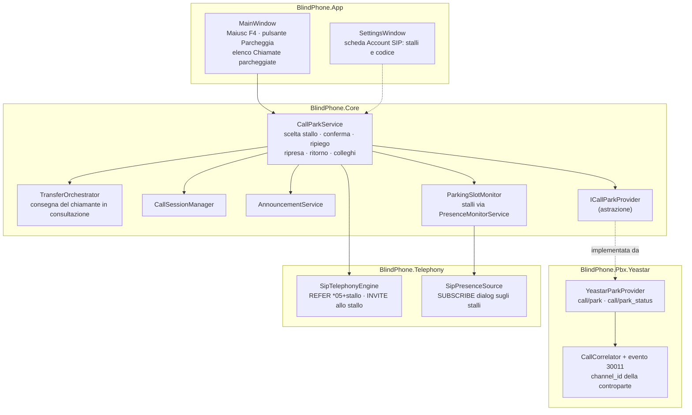
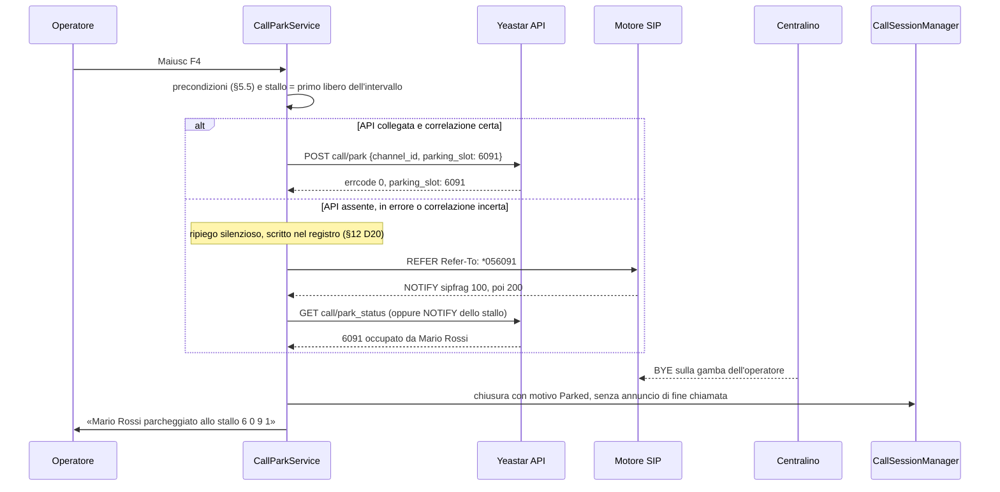
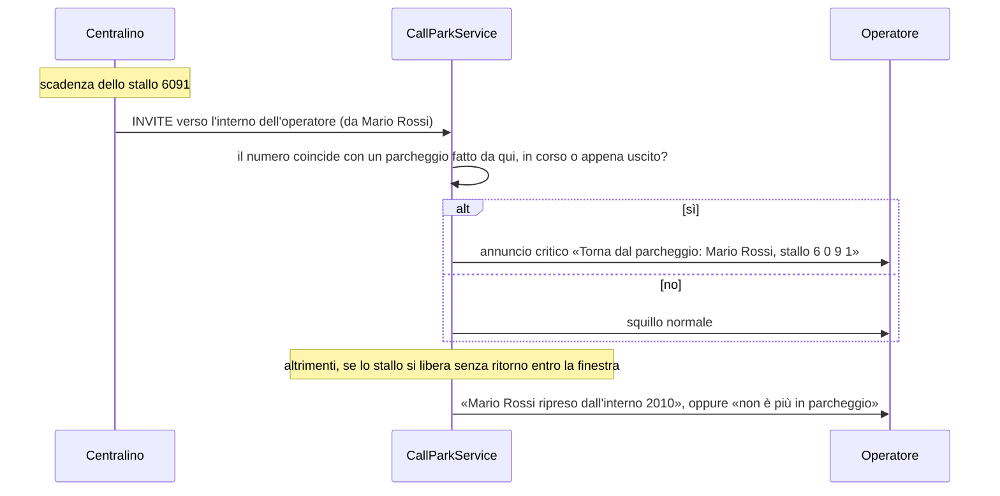

# BlindPhone — Analisi del parcheggio delle chiamate

**Documento tecnico complementare a [ANALISI-BLINDPHONE.md](../ANALISI-BLINDPHONE.md), §16.2 voce S3, e a [YEASTAR-INTEGRAZIONE.md](../YEASTAR-INTEGRAZIONE.md), §8**

| | |
|---|---|
| **Versione** | 1.0 — 20 novembre 2026 |
| **Ambito** | Parcheggio della chiamata in corso su uno stallo del centralino, ripresa dalla stessa postazione o da un collega, ritorno della chiamata non ripresa |
| **Centralino di riferimento** | Yeastar P-Series (Appliance, Software, Cloud Edition). 3CX e Cisco solo come note (§3.5, §3.6) |
| **Base di codice** | Ramo `versione-1.0.22`. Nessuna riga di codice è stata scritta o modificata per questa analisi |
| **Stato delle decisioni** | Prese con il committente il 20 novembre 2026, una per una: elenco in §12 |
| **Stato dei dati** | Documentazione pubblica Yeastar (help.yeastar.com, novembre 2026) e lettura del codice. I punti marcati **[DA VERIFICARE]** richiedono una prova su PBX reale prima della stima definitiva (§10) |

> **Documenti collegati**
> - [YEASTAR-INTEGRAZIONE.md](../YEASTAR-INTEGRAZIONE.md) — connettore Yeastar: token, eventi, correlazione SIP↔API (§9), checklist pre-vendita (§13)
> - [SCHEDA-TASTI-RAPIDI.md](../SCHEDA-TASTI-RAPIDI.md) — scheda dei tasti, da aggiornare con il nuovo comando
> - [CONFORMITA-PA-ITALIANA.md](../CONFORMITA-PA-ITALIANA.md) — EN 301 549 e statistiche d'uso (§7.3, che ha deciso la §12 voce D23)
> - [3CX-INTEGRAZIONE.md](../3CX-INTEGRAZIONE.md), [CISCO-INTEGRAZIONE.md](../CISCO-INTEGRAZIONE.md) — gli altri centralini

---

## Indice

1. [Sintesi](#1-sintesi)
2. [Obiettivo e casi d'uso](#2-obiettivo-e-casi-duso)
3. [Come funziona il parcheggio sui centralini](#3-come-funziona-il-parcheggio-sui-centralini)
4. [Cosa esiste già nel codice](#4-cosa-esiste-già-nel-codice)
5. [Architettura proposta](#5-architettura-proposta)
6. [Modifiche previste, file per file](#6-modifiche-previste-file-per-file)
7. [Interfaccia accessibile](#7-interfaccia-accessibile)
8. [Casi limite](#8-casi-limite)
9. [Rischi](#9-rischi)
10. [Verifiche sul centralino prima dello sviluppo](#10-verifiche-sul-centralino-prima-dello-sviluppo)
11. [Piano di prove](#11-piano-di-prove)
12. [Decisioni](#12-decisioni)
13. [Stima](#13-stima)

---

## 1. Sintesi

L'operatore ha in linea un chiamante, preme **`Maiusc F4`** e la chiamata va in uno **stallo** del centralino, un numero virtuale come 6091. La voce dice *«Mario Rossi parcheggiato allo stallo 6 0 9 1»*. Da quel momento la chiamata non occupa più la postazione: chiunque, da qualunque telefono dell'ente, la riprende componendo 6091. Se nessuno la riprende entro il tempo impostato sul centralino (60 secondi di partenza su Yeastar), torna all'operatore, e BlindPhone la annuncia per quello che è: *«Torna dal parcheggio: Mario Rossi, stallo 6 0 9 1»*.

Le scelte che definiscono la funzione, tutte prese con il committente:

1. **Meccanismo ibrido.** Si parcheggia con l'API Yeastar `call/park` quando c'è; se manca o rifiuta, si ripiega sul codice di parcheggio diretto `*05` seguito dallo stallo, raggiunto con un trasferimento SIP. Il ripiego è silenzioso per l'operatore e resta nel registro.
2. **Lo stallo lo sceglie BlindPhone**, dentro un intervallo riservato alla postazione (per esempio 6090–6099). Lo stallo è quindi noto *prima* di parcheggiare, e la voce può dirlo subito.
3. **Niente parcheggio senza conferma.** Se nessuna fonte può confermare in quale stallo è finita la chiamata — né l'API né la sorveglianza SIP degli stalli — il comando si rifiuta a voce invece di parcheggiare. È la regola di [YEASTAR-INTEGRAZIONE.md](../YEASTAR-INTEGRAZIONE.md) §9 applicata a un caso concreto: *per un operatore che non può verificare a schermo, un'informazione sbagliata è peggio di un'informazione mancante*. Un chiamante parcheggiato nello stallo sbagliato è un chiamante perso.
4. **Ripresa in tre modi**, che convivono: dall'elenco «Chiamate parcheggiate» con `Invio`; con lo stesso `Maiusc F4` a linea libera, che riprende l'ultima parcheggiata da qui; componendo il numero dello stallo come un interno qualunque.
5. **Si parcheggia anche durante la consultazione**: il caso tipico è *«ti parcheggio Rossi al 6091»* detto al collega, con il chiamante che aspetta dentro la procedura di trasferimento.

> **Conseguenza da comunicare subito.** Sul centralino su cui il prodotto è oggi in esercizio tutte le sottoscrizioni SIP `dialog` ricevono `404` (registro del 17 agosto 2026, vedi [SipDialogPresence.cs](../src/BlindPhone.Core/Services/SipDialogPresence.cs)). Lì, **senza API Yeastar il parcheggio non sarà disponibile**: non c'è nessuna fonte che confermi lo stallo, e per la scelta 3 il comando risponde con un rifiuto parlato. Con il piano Enterprise o Ultimate e l'API attiva la funzione c'è per intero.

**Stima:** circa 21 giornate (§13), contro le 2 indicate in [YEASTAR-INTEGRAZIONE.md](../YEASTAR-INTEGRAZIONE.md) §12. Quelle 2 giornate contavano la sola chiamata `call/park`. Mancavano la correlazione per ricavare il `channel_id`, la conferma dello stallo, il ritorno, la ripresa e l'interfaccia.

---

## 2. Obiettivo e casi d'uso

### 2.1 Obiettivo

Dare all'operatore non vedente il parcheggio che i colleghi vedenti hanno sul telefono da tavolo (il tasto «Park & Retrieve» con la spia verde o rossa) e nell'Operator Panel di Yeastar (trascinamento sullo stallo). Deve funzionare da tastiera, con riscontro vocale e braille, senza mai lasciare l'operatore incerto su dove sia finito il chiamante.

### 2.2 Perché serve a chi non vede

- **Le spie degli stalli non si vedono.** Sul telefono da tavolo lo stato di uno stallo è una luce. Senza un canale sonoro equivalente, l'operatore non sa se il suo parcheggio è ancora lì o se qualcuno l'ha già preso.
- **L'Operator Panel è un'interfaccia di trascinamento**, inaccessibile per costruzione ([YEASTAR-INTEGRAZIONE.md](../YEASTAR-INTEGRAZIONE.md) §1.1).
- **Il numero dello stallo detto dal centralino è audio fuori controllo.** Sul parcheggio casuale `*5` Yeastar comunica lo stallo con un messaggio vocale. Si ascolta una volta, si sovrappone alla voce dello screen reader, non si ripete e non va sul display braille. Lo stallo scelto da BlindPhone, invece, passa dalla pipeline degli annunci: si ripete con `Control F12`, finisce in braille e nello storico.
- **L'attesa non basta.** Una chiamata in attesa resta sulla postazione: nessun collega può prenderla, e l'operatore ha una linea occupata. Il parcheggio la consegna al centralino. **[DA VERIFICARE V11]** se Yeastar consideri occupato l'agente in coda che ha una chiamata in attesa: in quel caso il parcheggio è anche il modo di tornare a ricevere dalla coda.

### 2.3 Casi d'uso

| # | Caso | Sequenza per l'operatore | Frequenza attesa |
|---|---|---|---|
| P1 | **Il collega da cercare.** Il dottor Bianchi è in sede ma non al suo interno | Risponde, `Maiusc F4`, sente lo stallo, avvisa Bianchi (messaggio con `Alt M`, altoparlante, collega). Bianchi compone 6091 da qualunque telefono | Alta |
| P2 | **Parcheggio durante la consultazione** | Ha chiamato Bianchi con `F9`; Bianchi dice «arrivo, mettimelo da parte». `Maiusc F4` parcheggia il chiamante esterno, chiude la procedura e lascia l'operatore in linea con Bianchi, a cui legge lo stallo appena annunciato | Alta |
| P3 | **Liberare la postazione** con la coda piena e una pratica lunga da riprendere | `Maiusc F4` sulla chiamata lunga, risponde alle altre, poi riprende il parcheggiato | Media |
| P4 | **Ripresa dalla stessa postazione** | A linea libera, `Maiusc F4`: riprende l'ultima chiamata parcheggiata da qui | Alta |
| P5 | **Ripresa di un parcheggio qualunque** | Va sull'elenco «Chiamate parcheggiate» (`Maiusc F4` due volte, oppure `Control Tab`), frecce, `Invio`. Senza conferme, anche se l'ha parcheggiata un collega | Media |
| P6 | **Ripresa componendo lo stallo** | `F8`, 6091, `Invio`: BlindPhone riconosce lo stallo e dice chi sta riprendendo | Media |
| P7 | **Ritorno per scadenza** | Nessuno ha ripreso: la chiamata torna a squillare da lui con un annuncio critico distinto da una chiamata nuova | Media |
| P8 | **Il collega ha ripreso** | La voce dice, con priorità normale, *«Mario Rossi ripreso dall'interno 2010»* | Media |
| P9 | **Il parcheggio non si può fare** | Funzione non configurata, nessuna fonte di conferma, conferenza aperta, chiamata che squilla, modalità simulata: la voce dice perché e cosa fare | Rara |

---

## 3. Come funziona il parcheggio sui centralini

### 3.1 Yeastar P-Series: i concetti

| Elemento | Valore documentato | Note per BlindPhone |
|---|---|---|
| **Stallo** (*parking number*, anche *slot* o *orbit*) | Interno virtuale; una chiamata per stallo | — |
| **Intervallo degli stalli** | **6000–6099** di partenza, configurabile in *Call Features → Feature Code → Call Parking*, campo *Parking Number Range* | Sulla vecchia S-Series e su Cloud PBX la documentazione indica 6900–6999. L'intervallo della postazione va quindi configurato, non presunto (§12 D19) |
| **Parcheggio casuale** | Codice `*5`: primo stallo libero, a partire dal basso. Il centralino **annuncia a voce** lo stallo a chi parcheggia | Non usato da BlindPhone: lo stallo arriverebbe solo come audio (§2.2) |
| **Parcheggio diretto** | Codice `*05` seguito dallo stallo (esempio della documentazione: `*056099`) | È il ripiego SIP di BlindPhone (§5.4) |
| **Stallo diretto già occupato** | *«the system parks the call to the next available parking number»*: il centralino passa al successivo libero, senza dire quale | È il motivo per cui il ripiego SIP richiede una conferma (§5.5). **[DA VERIFICARE V2]** la direzione della ricerca e se il parcheggiatore viene informato |
| **Consiglio di Yeastar** | Assegnare gli stalli del parcheggio diretto **dall'alto** (da 6099 in giù), perché quello casuale li occupa dal basso | Gli intervalli di postazione vanno presi in fondo all'intervallo del centralino |
| **Ripresa** | Si compone il numero dello stallo, da qualunque telefono, oppure si preme il tasto funzione | BlindPhone compone lo stallo con un normale INVITE (§5.7) |
| **Scadenza** | Campo *Parking Timeout (s)*, **60 secondi** di partenza | — |
| **Destinazione alla scadenza** | Di partenza *Call Parking Initiator*, cioè chi ha parcheggiato. In alternativa: riaggancio, interno, segreteria, IVR, gruppo, coda, numero esterno, messaggio e uscita | BlindPhone riconosce il ritorno solo con la destinazione di partenza (§8, voce L9). Va nella checklist per l'IT |
| **Tasti funzione dei telefoni** | Tipo *Park & Retrieve*, valore = uno stallo; verde libero, rosso occupato | Dimostra che il centralino sa notificare lo stato di uno stallo ai telefoni. **Con quale protocollo non è documentato** (**[DA VERIFICARE V6]**) |

### 3.2 Yeastar P-Series: l'API

| Endpoint | Richiesta | Risposta | Uso in BlindPhone |
|---|---|---|---|
| `POST call/park` | `channel_id` (obbligatorio): il canale **della parte da parcheggiare**, ricavato dall'evento **30011** *Call State Changed*. `parking_slot` (facoltativo): lo stallo; se vuoto ne sceglie uno il centralino | `errcode`, `errmsg`, `call_id`, **`parking_slot`** effettivo | Parcheggio principale. Si passa sempre `parking_slot` (§12 D2), e lo stallo della risposta è quello che si annuncia |
| `GET call/park_status` | Nessun parametro | `data[]` con `parker` (interno che ha parcheggiato), `parked_party` (numero parcheggiato), `parking_slot`, `park_time`, `channel_id` | **Fonte di verità** sugli stalli occupati: elenco, conferma, ripresa da parte di un collega, ritorno |
| `POST call/dial` | `caller`, `callee` = stallo | `call_id` | **Non serve.** BlindPhone è l'interno: riprende con un INVITE suo, con audio e annunci suoi |

Tre limiti dell'API, che il progetto deve assorbire:

- **Nessun evento WebSocket di parcheggio** compare nel riepilogo degli eventi (30005–30039) (**[DA VERIFICARE V10]** sull'elenco completo). Lo stato degli stalli si conosce solo **interrogando** `call/park_status`, come la coda con `queue/call_status`. Ne segue una latenza pari all'intervallo di interrogazione su ripresa e ritorno (§9, R5).
- **`park_time` è descritto in modo ambiguo**: *«il tempo per cui una chiamata può restare parcheggiata»*. Nell'esempio vale 60, cioè la scadenza intera e non il tempo che resta. **[DA VERIFICARE V4]**. Per questo il progetto non ne dipende: il «da quanto aspetta» si misura in locale, dall'istante del parcheggio.
- **`call/park` vuole il `channel_id` della controparte**, che il mondo SIP non conosce. Serve la correlazione di [YEASTAR-INTEGRAZIONE.md](../YEASTAR-INTEGRAZIONE.md) §9. [CallCorrelator.cs](../src/BlindPhone.Pbx.Yeastar/CallCorrelator.cs) la implementa, ma **oggi non è usato da nessuna parte**: va agganciato agli eventi 30011 (§6). Nessun firmware minimo è indicato per queste API (**[DA VERIFICARE V12]**).

### 3.3 Yeastar P-Series: la strada SIP

La documentazione descrive il gesto dal telefono («componi `*5`») ma non dice con quale meccanismo SIP il codice arrivi al centralino durante una chiamata. Le strade possibili sono due, e solo la prima è adatta a BlindPhone:

| Strada | Come | Valutazione |
|---|---|---|
| **Trasferimento cieco verso il codice** | `REFER` sul dialogo del chiamante con `Refer-To: sip:*056091@dominio`. Il centralino porta il chiamante nell'applicazione di parcheggio, risponde con `NOTIFY` `message/sipfrag` e chiude la nostra gamba con `BYE` | **Strada del ripiego.** Riusa per intero `ITelephonyEngine.BlindTransferAsync` e la gestione dei `NOTIFY` già collaudata sul trasferimento (§4). È il comportamento standard dei centralini derivati da Asterisk. **[DA VERIFICARE V1]** su Yeastar con un client di terze parti |
| **Toni DTMF in conversazione** | `*056091` inviati come toni durante la chiamata | Scartata. Dipende dalla rilevazione dei toni sul centralino, non dà nessun esito in segnalazione, e il chiamante sente i toni |

**Sorveglianza SIP degli stalli.** I tasti *Park & Retrieve* dei telefoni fanno pensare a una sottoscrizione `dialog` (RFC 4235) sul numero dello stallo, la stessa che [SipPresenceSource.cs](../src/BlindPhone.Telephony/SipPresenceSource.cs) già fa sugli interni. Non è documentata (**[DA VERIFICARE V6]**). Sul centralino in esercizio, poi, le sottoscrizioni `dialog` ricevono tutte `404`: vedi la nota in §1.

### 3.4 Che cosa si ottiene da ciascuna fonte

| Capacità | API Yeastar | Codice `*05` via REFER | BLF SIP sugli stalli |
|---|---|---|---|
| Parcheggiare | Sì (`call/park`) | Sì | No |
| Conoscere lo stallo effettivo | **Sì, nella risposta** | No: si conosce lo stallo *chiesto* | Sì, se si sorveglia lo stallo chiesto e il successivo |
| Elenco di tutti gli stalli occupati | Sì, con chi ha parcheggiato | No | Solo degli stalli sorvegliati (tetto di 24 sottoscrizioni, §9 R6) |
| Chi è parcheggiato | Sì (`parked_party`) | No | Talvolta, se il `NOTIFY` porta l'identità remota |
| Sapere che lo stallo si è liberato | Sì, all'interrogazione successiva | No | Sì, con un `NOTIFY` |
| Sapere chi ha ripreso | No (**[DA VERIFICARE V10]** negli eventi 30011/30012) | No | No |
| Requisiti | Piano Enterprise o Ultimate, API attiva, correlazione | Solo SIP | Centralino che accetti le sottoscrizioni |

### 3.5 3CX — nota, senza impegno (§12 D12)

- Due funzioni distinte. Il **parcheggio a orbite**: trasferimento cieco verso `*00`–`*09` per parcheggiare e `*10`–`*19` per riprendere. Lo **Shared Parking** (`SP0`…): tasti BLF sui telefoni e nel client 3CX. Secondo il forum ufficiale non comunicano fra loro, e dalla V20 lo Shared Parking si riprende solo componendo direttamente l'interno `SP`.
- La Call Control API **non ha `park`** ([3CX-INTEGRAZIONE.md](../3CX-INTEGRAZIONE.md) §6.1). Resterebbe quindi la sola strada SIP.
- **Cosa servirebbe**: rendere configurabili il codice di parcheggio e quello di ripresa (oggi solo `*05`, §6), e trovare una fonte di conferma, perché il trasferimento verso `*0x` non dice dove è finita la chiamata. Senza conferma, per §12 D15 il comando si rifiuterebbe: il lavoro su 3CX comincia da questa verifica.

### 3.6 Cisco CUCM — nota, senza impegno

- *Call Park* (numero assegnato dal sistema, mostrato sul display del telefono Cisco) e *Directed Call Park* (trasferimento verso un numero di parcheggio con prefisso di ripresa). La scadenza (*reversion timer*) vale 60 o 300 secondi secondo la versione.
- Il *Park Monitoring* è documentato solo per alcuni telefoni Cisco SIP. Un client di terze parti non deve contare sulle notifiche di stato.
- La strada naturale è TAPI, che [CISCO-INTEGRAZIONE.md](../CISCO-INTEGRAZIONE.md) indica come capace di parcheggio. Il *Directed Call Park* via REFER somiglia al ripiego Yeastar, con prefissi diversi. Va progettato insieme al connettore Cisco, non qui.

### 3.7 Zoom

Non pertinente: il collegamento con Zoom è l'ingresso in riunione, non un centralino ([ZOOM-INTEGRAZIONE.md](../ZOOM-INTEGRAZIONE.md)). Una riunione in corso si mette in attesa come ogni chiamata. Parcheggiarla non ha un significato utile.

---

## 4. Cosa esiste già nel codice

Nessuna parte del parcheggio esiste. Esiste però quasi tutto quello su cui il parcheggio si appoggia.

| Componente | Cosa offre oggi | Come lo usa il parcheggio |
|---|---|---|
| [`ITelephonyEngine.BlindTransferAsync`](../src/BlindPhone.Core/Abstractions/ITelephonyEngine.cs) e [`SipTelephonyEngine`](../src/BlindPhone.Telephony/SipTelephonyEngine.cs) | `REFER` con `Refer-To` costruito da `destination@dominio`; esito dai `NOTIFY` sipfrag in `HandleTransferNotify`; **la linea la chiude il `BYE`, mai il `NOTIFY`** (correzione dell'11 agosto 2026) | Ripiego `*05`+stallo senza toccare il motore: la destinazione è `*056091` |
| `ITelephonyEngine.DialAsync` | Chiamata uscente | Ripresa: comporre lo stallo |
| `TransferProgress` | Evento con esito del `REFER` | Esito intermedio del ripiego. [`TransferOrchestrator.OnTransferProgress`](../src/BlindPhone.Core/Services/TransferOrchestrator.cs) ignora le chiamate che non sono la sua `OriginalCall`. Nel parcheggio durante la consultazione la procedura va quindi chiusa **prima** di mandare il `REFER` (§5.6) |
| [`CallSessionManager`](../src/BlindPhone.Core/Services/CallSessionManager.cs) | Attesa, ripresa, alternanza; `AnswerAsync` mette in attesa chi è in linea; `ApplyTrigger(..., suppressAnnouncement)`; promemoria dell'attesa in `Pump` | Ripresa a linea occupata (§12 D17); chiusura silenziosa della gamba parcheggiata |
| [`TransferOrchestrator`](../src/BlindPhone.Core/Services/TransferOrchestrator.cs) | Fasi `EnteringDestination`, `Consulting`, `Completing`; doppia pressione (`_pendingKeyPressAt`, finestra in `TransferOptions`); conferme preventive | Parcheggio durante la consultazione (§12 D11); finestra della doppia pressione di `Maiusc F4` |
| [`CallActionCatalog`](../src/BlindPhone.Core/Services/CallActionCatalog.cs) | Pulsanti per stato, con la regola *«un pulsante visibile è un pulsante che funziona»* e la barra che non cambia forma | Pulsante «Parcheggia» accanto a «Metti in attesa» |
| [`HotkeyCommand`](../src/BlindPhone.Core/Domain/HotkeyCommand.cs), [`HotkeyCommandCatalog`](../src/BlindPhone.Core/Services/HotkeyCommandCatalog.cs), [`HotkeyProfile.CreateDefault`](../src/BlindPhone.Core/Services/HotkeyProfile.cs) e `AddMissingDefaults` | Comando rimappabile in un punto solo; il test di copertura del catalogo; aggiunta delle combinazioni nuove ai profili esistenti | Nuovo comando `ParkCall` su `Maiusc F4`, solo locale |
| [`SimplifiedKeypad`](../src/BlindPhone.Core/Services/SimplifiedKeypad.cs) | Quattro tasti, una sola azione per tasto e per stato | **Nessuna modifica** (§12 D8): va solo provato che `Maiusc F4` passi anche in modalità semplificata |
| [`AnnouncementService`](../src/BlindPhone.Core/Accessibility/AnnouncementService.cs), `Announcement.High(...)` con `EarconKind`, `coalesceKey` e `braille` | Doppio canale (UIA e voce interna), priorità, testo braille compatto | Tutti gli annunci di §7.2 |
| [`EarconKind`](../src/BlindPhone.Core/Accessibility/EarconKind.cs) e `EarconRouting` | Famiglie con posizione stereo: coda a sinistra, chiamata al centro, controllo della linea a destra | Due earcon nuovi (§7.2) |
| [`IQueueProvider`](../src/BlindPhone.Core/Abstractions/IQueueProvider.cs) e `QueueProviderCapabilities` | Capacità dichiarate **con onestà**, per nascondere ciò che non funziona | Stesso schema per le capacità di parcheggio |
| [`YeastarApiClient`](../src/BlindPhone.Pbx.Yeastar/YeastarApiClient.cs) | `GetAsync`/`PostAsync` autenticati, rinnovo proattivo del token, errori già tradotti in italiano | `call/park` e `call/park_status` senza nuova infrastruttura |
| [`YeastarQueueProvider`](../src/BlindPhone.Pbx.Yeastar/YeastarQueueProvider.cs) | Ciclo di interrogazione adattivo; riallineamento dopo un evento e alla riconnessione | Modello per l'interrogazione di `call/park_status` |
| [`YeastarEventStream`](../src/BlindPhone.Pbx.Yeastar/YeastarEventStream.cs) e [`CallCorrelator`](../src/BlindPhone.Pbx.Yeastar/CallCorrelator.cs) | Eventi 30008/30011; correlazione a tre livelli con **degrado sicuro** (`IsUsable` solo se `Certain`) | Il `channel_id` per `call/park`. Il correlatore c'è ma non è agganciato |
| [`IPresenceSource`](../src/BlindPhone.Core/Abstractions/IPresenceSource.cs), [`SipPresenceSource`](../src/BlindPhone.Telephony/SipPresenceSource.cs), [`PresenceSubscriptionPolicy`](../src/BlindPhone.Core/Services/PresenceSubscriptionPolicy.cs), [`SipDialogPresence`](../src/BlindPhone.Core/Services/SipDialogPresence.cs) | Sottoscrizioni `dialog`, tetto di 24 interni, rinuncia dopo 12 rifiuti senza accettazioni, *«lo stato di un telefono si impara solo da un NOTIFY»* | Sorveglianza degli stalli come ripiego (§12 D7) |
| [`PresenceMonitorService`](../src/BlindPhone.Core/Services/PresenceMonitorService.cs) con `PresenceWatcher` | Unione delle richieste di sorveglianza in ordine di precedenza | Nuova voce `ParkingSlots` |
| [`LineStatusCatalog`](../src/BlindPhone.Core/Services/LineStatusCatalog.cs), `AnnouncementTexts.StatusSummary` | Riepilogo dello stato con `Control F5` | Le chiamate parcheggiate da questa postazione e da quanto aspettano (§12 D16) |
| `MainWindow`: `QueueList`, `ColleaguesList`, `PickSelectedQueueCall` con `Invio` | Elenchi accessibili nella scheda della postazione | Modello per l'elenco «Chiamate parcheggiate» |
| [`HelpBook.Mancante()`](../src/BlindPhone.Core/Services/HelpBook.cs) | Dice che il parcheggio *«non è ancora disponibile»* | Da aggiornare, con un argomento nuovo |
| [`TelemetryCatalog.Comando`](../src/BlindPhone.Core/Services/TelemetryCatalog.cs) | *«Un comando nuovo entra da sé»*: l'elenco è `Enum.GetNames<HotkeyCommand>()` | Per §12 D23 il nuovo comando va **escluso esplicitamente** |
| [`ConfigurationBundle`](../src/BlindPhone.Infrastructure/ConfigurationBundle.cs), [`MachinePolicyStore`](../src/BlindPhone.Infrastructure/MachinePolicyStore.cs) | Pacchetto di configurazione; criterio di macchina con `SezioniBloccate` | Distribuzione e blocco della configurazione (§12 D14, punto aperto A1) |
| `FakeTelephonyEngine`, `FakeEngine.cs`, `TestDoubles.cs` | Motori finti per le prove | Prove deterministiche senza centralino |

> **Attenzione a una parola già usata.** Nel codice «parcheggio» compare oggi con il senso di *attesa*: `CallSessionManager.ParkedConference` e `ParkConferenceAsync` (la conferenza messa in attesa intera), `TransferOrchestrator.ParkAsync`, e i commenti sul *«chiamante parcheggiato dentro la procedura»* di trasferimento. Gli annunci invece dicono già *«in attesa»* (per esempio `AnnouncementTexts.ConferenceParked` pronuncia «Conferenza in attesa»), quindi l'operatore non sente l'ambiguità. Nel codice nuovo il parcheggio vero va chiamato `CallPark`/`ParkingSlot`. Se rinominare i vecchi identificativi è il punto aperto A4.

---

## 5. Architettura proposta

### 5.1 Principi

1. **SIP per la ripresa, API per ciò che il SIP non dà**: il modello ibrido di [YEASTAR-INTEGRAZIONE.md](../YEASTAR-INTEGRAZIONE.md) §3.1. Il parcheggio passa dall'API perché solo lei dà lo stallo vero; la ripresa passa dal SIP perché è una chiamata dell'operatore.
2. **Precondizione di conferma.** Prima di far uscire il chiamante dalla postazione deve esistere una fonte capace di dire dove è finito. Se non c'è, il comando si rifiuta (§12 D15).
3. **Capacità dichiarate e funzione spenta di partenza.** Con l'intervallo vuoto la funzione non c'è: niente pannello, niente pulsante, e il tasto risponde con un rifiuto che dice dove configurarla (§12 D19). Il pannello compare o sparisce solo con la configurazione, mai con lo stato delle chiamate, così il giro di tabulazione non cambia durante il turno.
4. **Il core non conosce Yeastar.** L'astrazione resta generica, perché 3CX e Cisco restino possibili (§12 D12).

### 5.2 Componenti

| Componente | Ruolo |
|---|---|
| **`ICallParkProvider`** (nuovo, Core) | Fonte di centralino per il parcheggio. `Capabilities` (`CanPark`, `CanListSlots`, `CanConfirmSlot`), `ParkAsync(callId, slot)` che restituisce lo stallo effettivo o un esito tradotto, `ParkedCalls`, evento `ParkedCallsChanged`, `LinkStatus`. Implementazione Yeastar; in sua assenza, un'implementazione «disattivata» come `DisabledQueueProvider` |
| **`YeastarParkProvider`** (nuovo, Pbx.Yeastar) | `call/park` con `channel_id` dalla correlazione e `parking_slot` sempre valorizzato; `call/park_status` interrogato in modo adattivo: fitto se questa postazione ha parcheggi aperti, rado altrimenti, e subito dopo un evento 30011 |
| **`ParkingSlotMonitor`** (nuovo, Core) | Ripiego senza API: chiede a `PresenceMonitorService` di sorvegliare gli stalli **dell'intervallo della postazione**, con la nuova voce `PresenceWatcher.ParkingSlots`, e traduce lo stato `dialog` di uno stallo in libero o occupato. Dichiara `CanConfirmSlot` solo dopo che almeno una sottoscrizione su uno stallo è stata accettata |
| **`CallParkService`** (nuovo, Core) | Il cuore: precondizioni, scelta dello stallo, tentativo via API e ripiego via codice, conferma, annunci, registro dei parcheggi fatti da qui, riconoscimento del ritorno e della ripresa altrui, ripresa |
| **`ParkingOptions`** (nuovo, Core) | Intervallo della postazione, codice di parcheggio diretto (`*05`), tempo massimo per la conferma, finestra di riconoscimento del ritorno |

### 5.3 Quando la funzione è disponibile

| Situazione | Disponibile | Parcheggio | Conferma dello stallo | Elenco |
|---|---|---|---|---|
| Intervallo della postazione vuoto | **No** (spenta) | — | — | Nascosto |
| Modalità simulata | **No** (§12 D24) | — | — | Nascosto |
| API collegata | Sì | `call/park`; ripiego `*05` | Risposta API; per il ripiego, `call/park_status` | Tutti gli stalli, anche dei colleghi |
| API assente, sottoscrizione su uno stallo accettata | Sì | `*05` via `REFER` | `NOTIFY` dello stallo | Solo l'intervallo della postazione |
| API assente, sottoscrizioni rifiutate (**il centralino in esercizio**) | **No** | — | — | Nascosto; il tasto dice perché |
| API configurata ma collegamento degradato, nessun BLF | No, finché non torna | — | — | Visibile, con l'intestazione «non aggiornato» |

### 5.4 Il parcheggio, passo per passo

**Scelta dello stallo.** Il numero più basso dell'intervallo della postazione che la fonte di verità dà per libero. Con l'API si escludono gli stalli presenti in `call/park_status`, con il BLF quelli con un dialogo `early` o `confirmed`. Se non ce n'è nessuno: *«Nessuno stallo libero fra 6090 e 6099»*, e la chiamata resta dov'è.

**Perché si passa sempre lo stallo anche all'API.** Lasciarlo scegliere al centralino lo metterebbe nell'intervallo comune, dal basso, dove lo prende anche il parcheggio casuale dei telefoni. Gli stalli della postazione restano invece prevedibili, e l'elenco del ripiego BLF li conosce già.

**Quando l'API diventa ripiego.** Si passa al codice quando: l'API non è collegata; il correlatore non è `Certain` sul `channel_id` della controparte, e allora **non si chiama `call/park` per niente**, perché un `channel_id` sbagliato parcheggerebbe la chiamata di un altro; oppure `call/park` risponde con un errore. Il `REFER` agisce sul dialogo dell'operatore, e quindi sulla chiamata giusta per costruzione.

### 5.5 La regola della conferma

| Fonte disponibile **prima** del parcheggio | Strada | Conferma | Esito annunciato |
|---|---|---|---|
| API collegata, correlazione certa | `call/park` | `parking_slot` della risposta | Stallo della risposta, anche se diverso da quello chiesto |
| API collegata, `call/park` non usabile | `REFER *05`+stallo | Entro N secondi, `call/park_status` mostra il numero del chiamante in uno stallo | Lo stallo in cui compare davvero |
| API assente, BLF accettato sugli stalli | `REFER *05`+stallo | Entro N secondi, un `NOTIFY` porta lo stallo chiesto (o il successivo) da libero a occupato | Lo stallo passato a occupato |
| Nessuna delle due | **Nessuna**: il comando si rifiuta | — | *«Parcheggio non disponibile: il centralino non permette di confermare lo stallo»* |

**Il caso che la precondizione non copre.** Il `REFER` è partito, il chiamante ha già lasciato la postazione, e la conferma non arriva entro il tempo. Rifiutare non è più possibile. Che cosa dire è il punto aperto **A2**.

### 5.6 Il parcheggio durante la consultazione

Durante `TransferPhase.Consulting` il chiamante esterno è in attesa dentro la procedura, e l'operatore parla con il collega (che può anche squillare ancora). `Maiusc F4`:

1. chiede a `TransferOrchestrator` di **consegnare** il chiamante: un metodo nuovo chiude la sessione senza riprendere l'esterno e senza annunci di annullamento, e lascia la consultazione come chiamata normale;
2. parcheggia l'esterno con la procedura di §5.4. Il `REFER` parte dal dialogo dell'esterno, che è in attesa;
3. annuncia *«Mario Rossi parcheggiato allo stallo 6 0 9 1»*, mentre l'operatore resta in linea con il collega e gli legge lo stallo.

L'ordine è obbligato: se la sessione fosse ancora aperta, l'esito del `REFER` arriverebbe a `TransferOrchestrator.OnTransferProgress` come quello di un trasferimento, e verrebbe annunciato come tale. In `TransferPhase.Completing` il comando si rifiuta: il chiamante è già in volo verso l'interno.

### 5.7 La ripresa

| Via | Comportamento |
|---|---|
| **Elenco + `Invio`** | Riprende lo stallo sotto il cursore, chiunque l'abbia parcheggiato, senza conferma (§12 D18) |
| **`Maiusc F4` a linea libera** | Riprende l'**ultima** chiamata parcheggiata da questa postazione. Due pressioni rapide portano invece il cursore sull'elenco. Per distinguere le due, la ripresa parte allo scadere della finestra della doppia pressione, la stessa del trasferimento (proposta derivata, §12.2) |
| **Composizione dello stallo** | Un numero dentro l'intervallo noto, o presente nell'elenco, viene riconosciuto come stallo. L'INVITE parte come una chiamata normale, e l'annuncio dice chi si sta riprendendo |

In tutti e tre i casi: se l'operatore è in linea con qualcuno, quella chiamata va in attesa come quando si risponde a una seconda chiamata (§12 D17). L'annuncio è *«Riprendi Mario Rossi dallo stallo 6 0 9 1»*, con *«parcheggiato da Bianchi»* quando a parcheggiare è stato un altro. Uno stallo già vuoto produce *«Lo stallo 6 0 9 1 è vuoto»* (**[DA VERIFICARE V8]** la risposta del centralino).

### 5.8 Il ritorno e la ripresa altrui

- **Riconoscere il ritorno** (§12 D6). Una chiamata entrante il cui numero coincide con quello di un parcheggio fatto da questa postazione, ancora aperto o uscito da meno di W secondi, è un ritorno. L'annuncio della chiamata entrante viene sostituito da quello del ritorno, con priorità critica e un earcon proprio. Si confronta in tutti e due gli ordini, perché l'INVITE può arrivare prima che l'interrogazione di `call/park_status` mostri lo stallo libero. Il riconoscimento non dipende dalla scadenza configurata sul centralino, che BlindPhone non conosce. **[DA VERIFICARE V7]** come Yeastar presenti l'identità nel ritorno.
- **Ripresa altrui di un mio parcheggio** (§12 D21). Lo stallo si libera e nessun ritorno arriva entro W: annuncio normale *«Mario Rossi ripreso dall'interno 2010»*. **Il «da chi» si dice solo se è certo** (**[DA VERIFICARE V10]**). Altrimenti la frase degrada a *«Mario Rossi non è più in parcheggio»*, perché il chiamante potrebbe anche aver riagganciato.
- **Parcheggi dei colleghi** (§12 D9): nessuna voce. Compaiono nell'elenco.

### 5.9 Modalità semplificata

Nessun tasto del tastierino dedicato (§12 D8). `Maiusc F4` funziona anche in modalità semplificata, con gli stessi annunci. Va verificato che il gestore del tastierino in `MainWindow` non lo intercetti. Gli annunci nominano `Maiusc F4` in tutte e due le modalità: è il solo tasto del parcheggio che la modalità insegna.

---

## 6. Modifiche previste, file per file

> **Prima di cominciare.** Sul ramo `versione-1.0.22` c'è una correzione degli aggiornamenti non ancora committata, che tocca alcuni degli stessi file: `AppSettings.cs`, `SettingsWindow.xaml(.cs)`, `MainWindow.xaml.cs`, `HelpBook.cs`, `TelemetryCatalog.cs`. Il lavoro sul parcheggio va cominciato **dopo** che quella correzione è committata, su un ramo suo.

### 6.1 BlindPhone.Core

| File | Nuovo / modificato | Modifica |
|---|---|---|
| `Domain/ParkedCall.cs` | **Nuovo** | Record: stallo, parte parcheggiata (`CallParty`), interno che ha parcheggiato, istante (locale), `ParkedHere`, `channel_id` se noto |
| `Domain/ParkingSlotRange.cs` | **Nuovo** | Intervallo `6090-6099`: lettura, validazione (solo cifre, inizio ≤ fine, al più 24 stalli per il tetto BLF, §9 R6), appartenenza, enumerazione |
| `Domain/ParkOutcome.cs` | **Nuovo** | `Parked`, `Disabled`, `Simulated`, `Unconfirmable`, `NoFreeSlot`, `NothingToPark`, `RingingCall`, `InConference`, `TransferInFlight`, `RejectedByPbx`, `Unconfirmed`, `Failed` |
| `Domain/HotkeyCommand.cs` | Modificato | `ParkCall`, categoria `CallControl` |
| `Domain/CallEndReason.cs` | Modificato | `Parked`: la gamba chiusa dal centralino dopo il parcheggio non deve dire *«l'interlocutore ha chiuso»* |
| `Abstractions/ICallParkProvider.cs` | **Nuovo** | Interfaccia e `CallParkCapabilities` (§5.2) |
| `Services/DisabledCallParkProvider.cs` | **Nuovo** | Fornitore senza capacità, sul modello di `DisabledQueueProvider` |
| `Services/ParkingSlotMonitor.cs` | **Nuovo** | Ripiego BLF (§5.2) |
| `Services/CallParkService.cs` | **Nuovo** | Orchestrazione (§5.4–§5.8); `Pump` per i tempi di conferma e di ritorno, come `CallSessionManager.Pump` |
| `Services/ParkingOptions.cs` | **Nuovo** | Opzioni (§5.2) |
| `Services/TransferOrchestrator.cs` | Modificato | Metodo di consegna del chiamante in consultazione (§5.6), senza riprenderlo né annunciare l'annullamento |
| `Services/CallSessionManager.cs` | Modificato | Chiusura con `CallEndReason.Parked`; attesa di chi è in linea prima della ripresa (stessa regola di `AnswerAsync`) |
| `Services/CallActionCatalog.cs` | Modificato | `CallAction.Park`; `CallActionContext.CanPark`; pulsante «Parcheggia» accanto a «Metti in attesa», solo quando il parcheggio è eseguibile davvero, come `CanBargeIn`. Nessun pulsante di ripresa (§12 D25) |
| `Services/HotkeyCommandCatalog.cs` | Modificato | Voce «Parcheggia o riprendi», con una descrizione che spiega le tre vie di ripresa |
| `Services/HotkeyProfile.cs` | Modificato | `Maiusc F4` locale, senza globale (§12 D3, D13). Va verificato che `AddMissingDefaults` non rubi `Maiusc F4` a un profilo che lo usa già per altro |
| `Services/PresenceMonitorService.cs` | Modificato | `PresenceWatcher.ParkingSlots`, dopo `Colleagues`: anche gli stalli si sorvegliano per tutto il turno |
| `Services/LineStatusCatalog.cs` | Modificato | Le chiamate parcheggiate da qui entrano nel riepilogo, ma **non** fra «chi aspetta in linea»: non sono più sulla postazione |
| `Services/CallAnnouncementMapper.cs` | Modificato | Nessun annuncio di fine per `Parked`; il ritorno sostituisce l'annuncio di chiamata entrante |
| `Services/HelpBook.cs` | Modificato | Argomento nuovo «Il parcheggio delle chiamate»; togliere il parcheggio da `Mancante()` |
| `Services/HotkeyCardWriter.cs` | Da verificare | Se genera la scheda dal catalogo, il comando entra da sé |
| `Services/TelemetryCatalog.cs`, `Services/TelemetryDiary.cs` | Modificato | **Escludere** `ParkCall` da `Comando`, che oggi accetta ogni voce di `HotkeyCommand`, e dalla registrazione di `CommandUsed` (§12 D23). La prova che sorveglia il catalogo deve conoscere l'eccezione |
| `Speech/AnnouncementTexts.cs` | Modificato | Testi di §7.2 e riga del riepilogo dello stato |
| `Accessibility/EarconKind.cs` | Modificato | `CallParked` (famiglia controllo della linea, a destra), `ParkedCallReturning` (allarme della chiamata, centrale) e classificazione in `EarconRouting` |

### 6.2 BlindPhone.Pbx.Yeastar

| File | Nuovo / modificato | Modifica |
|---|---|---|
| `YeastarParkProvider.cs` | **Nuovo** | `ICallParkProvider` su `call/park` e `call/park_status`; interrogazione adattiva; stato del collegamento |
| `YeastarModels.cs` | Modificato | `YeastarParkResponse` (`call_id`, `parking_slot`), `YeastarParkStatusResponse` con `data[]` (`parker`, `parked_party`, `parking_slot`, `park_time`, `channel_id`) |
| `YeastarEventStream.cs` | Modificato | Lettura dei membri dell'evento 30011 con il loro `channel_id`, per il correlatore |
| `CallCorrelator.cs` | Modificato | Agganciato per la prima volta: dalla chiamata SIP locale al `channel_id` della controparte. Solo `Certain` è usabile |
| `YeastarOptions.cs` | Modificato | Intervalli di interrogazione di `call/park_status` |

### 6.3 BlindPhone.Telephony

| File | Nuovo / modificato | Modifica |
|---|---|---|
| `SipTelephonyEngine.cs` | **Nessuna modifica prevista** | `BlindTransferAsync("*056091")` costruisce già `sip:*056091@dominio`. Da provare: che SIPSorcery accetti l'asterisco nella parte utente del `Refer-To` |
| `SipPresenceSource.cs` | Nessuna modifica | Le sottoscrizioni sugli stalli passano dallo stesso tetto e dalla stessa politica di rinuncia |
| `FakeTelephonyEngine.cs` | Nessuna modifica | In modalità simulata il parcheggio non è disponibile (§12 D24) |

### 6.4 BlindPhone.Infrastructure

| File | Nuovo / modificato | Modifica |
|---|---|---|
| `AppSettings.cs` | Modificato | Per account SIP: intervallo degli stalli della postazione (vuoto di partenza) e codice di parcheggio diretto (`*05`) |
| `SettingsService.cs`, `ConfigurationBundle.cs` | Modificato | Persistenza ed esportazione dei due campi insieme alla sezione dell'account |
| `MachinePolicyStore.cs` | Da decidere (A1) | Oggi blocca sezioni intere (`SezioniBloccate`); bloccare i soli due campi richiede valori nuovi sotto `SOFTWARE\Policies\BlindPhone` e il modello ADMX |
| `FileLogger.cs`, `LogAnonymizer.cs` | Nessuna modifica | Le righe del parcheggio passano dall'anonimizzazione come le altre (§12 D16) |

### 6.5 BlindPhone.App

| File | Nuovo / modificato | Modifica |
|---|---|---|
| `MainWindow.xaml` | Modificato | Scheda «Chiamate parcheggiate» fra coda e colleghi (`ParkedSection`, `ParkedHeaderText`, `ParkedList`, nomi UIA); visibile solo se la funzione è configurata |
| `MainWindowLayout.cs` | Modificato | Nuova riga fra `QueueRow` e `ColleaguesRow`; ordine di `Control Tab` |
| `MainWindow.xaml.cs` | Modificato | Comando `ParkCall` con pressione singola o doppia; `Invio` e doppio clic sull'elenco; pulsante; riconoscimento dello stallo composto |
| `SettingsWindow.xaml(.cs)` | Modificato | Due campi nella scheda Account SIP, con tasto di accesso e validazione parlata |
| `RicercaImpostazioni.cs` | Modificato | I due campi trovabili con la ricerca delle impostazioni |
| `DiagnosticSnapshotFactory.cs` | Modificato | Fonte di conferma in uso (API, BLF, nessuna), stato delle sottoscrizioni sugli stalli, parcheggi aperti |

### 6.6 Documentazione

| File | Modifica |
|---|---|
| [SCHEDA-TASTI-RAPIDI.md](../SCHEDA-TASTI-RAPIDI.md) | §1: `Maiusc F4`; nuova sezione «Parcheggio» con le tre vie di ripresa |
| [README.md](../README.md) | Elenco delle funzioni |
| [YEASTAR-INTEGRAZIONE.md](../YEASTAR-INTEGRAZIONE.md) | §8 e §12: rimando a questo documento e stima corretta; §13: verifiche V1–V13 |
| [ANALISI-BLINDPHONE.md](../ANALISI-BLINDPHONE.md) | §16.2 S3: rimando |
| [docs/INSTALLAZIONE.md](INSTALLAZIONE.md) | Configurazione degli intervalli per postazione e requisiti sul centralino (destinazione alla scadenza = iniziatore) |
| `dist/` | Note di rilascio della versione che porta la funzione |

---

## 7. Interfaccia accessibile

### 7.1 Comandi

| Gesto | Stato | Effetto |
|---|---|---|
| `Maiusc F4` | Chiamata attiva | Parcheggia l'interlocutore |
| `Maiusc F4` | Sola chiamata in attesa | Parcheggia quella in attesa |
| `Maiusc F4` | Una attiva e una in attesa | Parcheggia quella attiva, come `F4` mette in attesa quella attiva |
| `Maiusc F4` | Consultazione di trasferimento | Parcheggia il chiamante esterno e resta con il collega (§5.6) |
| `Maiusc F4` | Linea libera, parcheggi fatti da qui | Riprende l'ultimo |
| `Maiusc F4` due volte | Linea libera | Cursore sull'elenco «Chiamate parcheggiate» |
| `Invio` / doppio clic | Elenco | Riprende lo stallo sotto il cursore |
| Stallo + `Invio` | Campo di composizione | Riprende componendo |
| `Control F5` | Sempre | Il riepilogo nomina i parcheggi fatti da qui e da quanto aspettano |
| Pulsante «Parcheggia» | Barra della chiamata | Come `Maiusc F4` con una chiamata |

### 7.2 Annunci

Lo stallo si legge **cifra per cifra**, come i numeri di telefono (`SpeechFormatter`).

| Evento | Testo proposto | Priorità | Earcon | Braille |
|---|---|---|---|---|
| Parcheggio riuscito | «Mario Rossi parcheggiato allo stallo 6 0 9 1» | Alta | `CallParked` (nuovo) | `PARK 6091` |
| Ripresa | «Riprendi Mario Rossi dallo stallo 6 0 9 1» (+ «parcheggiato da Bianchi») | Alta | `CallResumed` | `RIPR 6091` |
| Ripresa con un altro in linea | «Verdi in attesa. Riprendi Mario Rossi dallo stallo 6 0 9 1» | Alta | `CallResumed` | `RIPR 6091` |
| Stallo vuoto | «Lo stallo 6 0 9 1 è vuoto» | Alta | `CommandRejected` | `6091 VUOTO` |
| **Ritorno per scadenza** | «Torna dal parcheggio: Mario Rossi, stallo 6 0 9 1» | **Critica** | `ParkedCallReturning` (nuovo) | `RIT 6091 ROSSI` |
| Ripresa da un collega | «Mario Rossi ripreso dall'interno 2010» | Normale | — | `RIPRESO 6091` |
| Uscita senza sapere come | «Mario Rossi non è più in parcheggio» | Normale | — | `6091 LIBERO` |
| Rifiuto: funzione spenta | «Parcheggio spento: scrivi gli stalli della postazione in Impostazioni, scheda Account SIP» | Alta | `CommandRejected` | `PARK SPENTO` |
| Rifiuto: nessuna conferma possibile | «Parcheggio non disponibile: il centralino non permette di confermare lo stallo» | Alta | `CommandRejected` | `PARK NO` |
| Rifiuto: stalli pieni | «Nessuno stallo libero fra 6 0 9 0 e 6 0 9 9» | Alta | `CommandRejected` | `PARK PIENO` |
| Rifiuto: conferenza | «In conferenza non si parcheggia: sciogli prima con F7» (tasto letto dal profilo) | Alta | `CommandRejected` | `PARK NO CONF` |
| Rifiuto: chiamata in squillo | «Rispondi prima: una chiamata che squilla non si parcheggia» | Alta | `CommandRejected` | `PARK NO` |
| Rifiuto: niente da riprendere | «Nessuna chiamata parcheggiata da te. Maiusc F4 due volte per l'elenco» | Alta | `CommandRejected` | `PARK NESSUNA` |
| Rifiuto: modalità simulata | «Parcheggio non disponibile in modalità simulata» | Alta | `CommandRejected` | `PARK SIMUL` |
| Parcheggio rifiutato dal centralino, chiamante ancora in linea | «Parcheggio non riuscito: Mario Rossi è ancora in linea» | Alta | `TransferFailed` | `PARK FALLITO` |

**Durante una conversazione**, come gli altri annunci: «alta» non interrompe un annuncio critico; «normale» si tace se è attiva l'impostazione che silenzia gli annunci in conversazione; il ritorno, critico, interrompe la voce e attenua l'audio della chiamata come una chiamata entrante. I parcheggi dei colleghi non producono voce (§12 D9). Quando l'API ripiega sul codice, l'annuncio non cambia (§12 D20).

### 7.3 Screen reader

- **Elenco «Chiamate parcheggiate»**: `ListView` con `AutomationProperties.Name` *«Chiamate parcheggiate, 2»*. Ogni riga ha un nome completo, nell'ordine in cui si decide: *«6 0 9 1, Mario Rossi, da 40 secondi, parcheggiata da te»* oppure *«…, parcheggiata da Bianchi»*. Elenco vuoto: *«Nessuna chiamata parcheggiata»*, come per la coda.
- **Collegamento degradato**: l'intestazione diventa *«Chiamate parcheggiate, elenco non aggiornato»*. È la stessa regola di onestà della coda: un elenco congelato è indistinguibile da uno fermo ([YEASTAR-INTEGRAZIONE.md](../YEASTAR-INTEGRAZIONE.md) §5.2).
- **Il focus non si sposta mai da solo**: il ritorno annuncia, ma non porta il cursore da nessuna parte.
- **Pulsante «Parcheggia»**: nome accessibile uguale all'etichetta; descrizione *«Mette la chiamata in uno stallo del centralino: un collega la riprende componendo lo stallo»* con il tasto rapido nel fumetto.
- EN 301 549 §11.5 (nome, ruolo, stato, valore) è coperto dal gate di CI già esistente sugli `AutomationProperties.Name`.

### 7.4 Braille

I testi compatti di §7.2 stanno in 20 celle, quindi anche sui display piccoli della matrice di prova ([ANALISI-BLINDPHONE.md](../ANALISI-BLINDPHONE.md) §17.2). Lo stallo è sempre la prima informazione numerica, perché è quella da ripetere al collega.

### 7.5 Ipovedenti

Pulsante con glifo Segoe Fluent Icons e etichetta sempre visibile. Righe dell'elenco con la stessa tipografia della coda. Nessuna informazione affidata al solo colore: «parcheggiata da te» è testo, non una tinta.

### 7.6 Guida e scheda dei tasti

L'argomento nuovo della guida spiega: che cos'è uno stallo, le tre vie di ripresa, perché a volte il parcheggio si rifiuta (con la frase esatta e cosa fare), il ritorno dopo la scadenza, e che la scadenza la decide il centralino. È il contenuto che EN 301 549 §12 chiede alla documentazione. La scheda dei tasti va aggiornata nello stesso rilascio.

---

## 8. Casi limite

| # | Caso | Che cosa succede | Gestione proposta |
|---|---|---|---|
| L1 | Fra la scelta dello stallo e il parcheggio un collega occupa lo stesso stallo | Yeastar parcheggia nel successivo libero | Con l'API vale lo stallo della risposta. Nel ripiego la conferma cerca il numero del chiamante in `call/park_status`, o il passaggio a occupato fra gli stalli sorvegliati, e annuncia lo stallo vero |
| L2 | Due postazioni con intervalli sovrapposti | Gara continua sugli stessi stalli | Come L1, sempre gestita. Le installazioni vanno comunque configurate con intervalli distinti (checklist IT) |
| L3 | Correlazione ambigua (due chiamate con lo stesso numero) | Il `channel_id` non è certo | Nessuna chiamata a `call/park`: ripiego sul codice, che agisce sul dialogo giusto |
| L4 | `call/park` riuscito, ma il centralino non chiude la gamba dell'operatore | L'operatore resterebbe su una linea che sente solo il messaggio dello stallo | **[DA VERIFICARE V3]**. Se succede, BlindPhone chiude la propria gamba solo **dopo** che `call/park_status` mostra il chiamante nello stallo. Chiuderla prima rischierebbe di farlo cadere |
| L5 | Il chiamante riaggancia mentre è parcheggiato | Lo stallo si libera senza ritorno | «Mario Rossi non è più in parcheggio»: non si sa se l'abbiano ripreso (§5.8) |
| L6 | Il chiamante riaggancia e richiama subito | La nuova chiamata viene presa per un ritorno | Accettato: la finestra W è breve. **[DA VERIFICARE V7]** se il ritorno porti un segno distintivo (`Alert-Info`, prefisso nel nome) che elimini l'ambiguità |
| L7 | Ritorno mentre l'operatore è in conversazione | Seconda chiamata in squillo | Annuncio critico. Rispondere mette in attesa chi è in linea, come per ogni seconda chiamata |
| L8 | Il ritorno arriva prima che l'interrogazione veda lo stallo libero | Ordine degli eventi invertito | Il confronto si fa in tutti e due gli ordini (§5.8) |
| L9 | Sul centralino la destinazione alla scadenza non è l'iniziatore | Il chiamante va altrove; BlindPhone non lo sa | Lo stallo si libera senza ritorno: «non è più in parcheggio». Requisito nella checklist IT |
| L10 | Ripresa simultanea dello stesso stallo da due postazioni | Una delle due riceve un rifiuto o uno stallo vuoto | «Lo stallo 6 0 9 1 è vuoto» (**[DA VERIFICARE V9]**) |
| L11 | Collegamento API caduto con parcheggi aperti | Elenco congelato | Intestazione «non aggiornato» e avviso di collegamento già esistente (`PbxLinkDegraded`). Senza BLF, nuovi parcheggi rifiutati finché il collegamento non torna |
| L12 | Token API scaduto durante `call/park` | Rinnovo proattivo già gestito da `YeastarApiClient` | Nessun lavoro nuovo. In caso d'errore, ripiego sul codice |
| L13 | Consultazione con il collega che squilla ancora | Il chiamante esterno è in attesa, la consultazione non ha dialogo confermato | Si parcheggia l'esterno; l'operatore resta sulla chiamata uscente verso il collega (§5.6) |
| L14 | Trasferimento in volo (`Completing`) | Il chiamante sta passando all'interno | Rifiuto: «trasferimento in corso» |
| L15 | Registrazione della conversazione attiva | La chiamata lascia la postazione | Chiusura della registrazione con il suo annuncio abituale. La modalità toni si spegne come a fine chiamata |
| L16 | Chiamata uscente non ancora risposta, o entrante che squilla | Non c'è una conversazione da parcheggiare | Rifiuto con spiegazione |
| L17 | Riavvio di BlindPhone con parcheggi aperti | Si perde il registro locale «parcheggiate da te» | Con l'API, `parker` = proprio interno ricostruisce i parcheggi di questa postazione. Senza API, il ritorno squilla come una chiamata normale. Per scelta, nessuna persistenza su disco: la stessa regola della presenza (*«uno stato conservato è uno stato vecchio»*) |
| L18 | Doppia pressione di `Maiusc F4` a linea libera | La ripresa con la pressione singola aspetta la finestra della doppia | Ritardo pari alla finestra del trasferimento, da misurare nelle prove con gli operatori |
| L19 | Codici diversi sul centralino del cliente (`*06` S-Series, codice cambiato dall'amministratore) | Il `REFER` va al codice sbagliato | Il codice è un campo configurabile (§6.4); il centralino risponde con un errore che arriva come esito del `REFER` e diventa «Parcheggio non riuscito» |
| L20 | Lo stallo composto è anche un interno vero (intervallo configurato male) | Riconoscimento sbagliato | La validazione accetta solo numeri presenti nell'elenco o nell'intervallo della postazione |

---

## 9. Rischi

| # | Rischio | Prob. | Impatto | Mitigazione |
|---|---|---|---|---|
| R1 | **Sul centralino in esercizio la funzione non è disponibile senza API** (sottoscrizioni `dialog` tutte `404`) | **Alta** | Alto | Dirlo al cliente prima, non dopo. Con piano Enterprise o Ultimate la funzione c'è. Il comando lo dice da solo, a voce, invece di fallire in silenzio |
| R2 | Correlazione `channel_id` sbagliata: verrebbe parcheggiata la chiamata di un altro | Media | **Critico** | Solo `Certain` è usabile; in ogni altro caso, ripiego sul codice, che agisce sul proprio dialogo. Prova con chiamate concorrenti dallo stesso numero |
| R3 | Il `REFER` verso un codice funzione non è accettato da Yeastar | Media | Alto | **[DA VERIFICARE V1]** per primo. Se fallisce, il ripiego non esiste e la funzione richiede l'API |
| R4 | Il comportamento del parcheggio diretto su stallo occupato differisce fra firmware | Media | Medio | La conferma non presume lo stallo: lo cerca (L1) |
| R5 | Nessun evento WebSocket di parcheggio: ripresa e uscita si scoprono con un ritardo pari all'interrogazione | Certa | Basso | Interrogazione fitta con parcheggi aperti; riallineamento immediato a ogni evento 30011 |
| R6 | Tetto di 24 sottoscrizioni SIP condiviso con colleghi e rubrica | Media | Medio | Intervallo di postazione limitato a 24 stalli dalla validazione. Precedenza degli stalli subito dopo i colleghi; avviso nel registro se l'unione supera il tetto |
| R7 | `Maiusc F4` già usato da uno screen reader o da un programma comune | Bassa | Medio | **[DA VERIFICARE V14]** su NVDA, JAWS, Narratore e SuperNova; rilevamento conflitti già esistente |
| R8 | Ambiguità del termine «parcheggio» nel codice esistente | Certa | Basso | Nomi nuovi distinti (§4); rinomina dei vecchi decisa a parte (A4) |
| R9 | Annuncio di un ritorno falso (L6) | Bassa | Basso | Finestra W breve; segno distintivo del ritorno, se esiste (V7) |
| R10 | Licenza Yeastar senza API | Media | Alto | Già in [YEASTAR-INTEGRAZIONE.md](../YEASTAR-INTEGRAZIONE.md) §13 voce 3: il parcheggio ne aumenta il peso |

---

## 10. Verifiche sul centralino prima dello sviluppo

Da eseguire su una Yeastar P-Series Software Edition di prova ([YEASTAR-INTEGRAZIONE.md](../YEASTAR-INTEGRAZIONE.md) §11). Circa una giornata e mezza. Le prime tre decidono se la stima regge.

| # | Verifica | Se negativo |
|---|---|---|
| V1 | `REFER` con `Refer-To: *05<stallo>` da un client di terze parti: accettato, chiamante parcheggiato, `NOTIFY` 200, `BYE` all'operatore | Il ripiego non esiste: parcheggio solo con l'API |
| V2 | Parcheggio diretto (codice e `call/park` con `parking_slot`) su stallo occupato: dove va la chiamata, e se `call/park` risponde con un errore invece di spostarla | Adattare la conferma |
| V3 | Dopo `call/park` riuscito: che cosa sente e riceve la gamba dell'operatore (messaggio, `BYE`, niente) | Gestione L4 |
| V4 | Semantica di `park_time` in `call/park_status`, e valore di `parker` per un parcheggio fatto via codice | Nessuna, se non lo si usa; va solo documentato |
| V5 | Il `channel_id` della controparte si ricava dall'evento 30011 per una chiamata della nostra estensione, entrante e uscente, anche via trunk (`PJSIP/trunk-…`) | La strada API si limita ai casi correlabili |
| V6 | `SUBSCRIBE` `dialog` su un numero di parcheggio: `200` e `NOTIFY` con stati `early`/`confirmed`? (sia sul PBX di prova sia, con l'IT, su quello in esercizio) | Il ripiego BLF non esiste su quel centralino |
| V7 | Ritorno per scadenza: `From`, nome mostrato, `Alert-Info` dell'INVITE che torna all'iniziatore | Riconoscimento solo per numero (L6) |
| V8 | Composizione di uno stallo vuoto: codice di risposta o messaggio vocale | Testo dell'annuncio |
| V9 | Ripresa simultanea da due interni | Testo dell'annuncio |
| V10 | Eventi 30011/30012 durante una ripresa: dicono chi ha ripreso? | La ripresa altrui degrada sempre a «non è più in parcheggio» |
| V11 | Agente in coda con una chiamata in attesa: riceve ancora dalla coda? E con la chiamata parcheggiata? | Solo documentazione (§2.2) |
| V12 | Firmware minimo per `call/park` e `call/park_status` | Requisito nella checklist pre-vendita |
| V13 | Codici e intervallo predefiniti sul firmware del cliente | Configurazione |
| V14 | `Maiusc F4` non intercettato da NVDA, JAWS, Narratore, SuperNova | Altra combinazione predefinita |

---

## 11. Piano di prove

### 11.1 Prove automatiche del core (`BlindPhone.Core.Tests`)

| Prova | Che cosa verifica |
|---|---|
| `CallParkServiceTests` (nuova) | Scelta dello stallo (primo libero, intervallo pieno); la tabella di §5.5 caso per caso, compreso il **rifiuto senza fonte di conferma**; ripiego silenzioso dall'API al codice; correlazione non certa = nessuna `call/park`; parcheggio in consultazione (consegna prima del `REFER`); rifiuto in conferenza, in squillo, in `Completing`, in modalità simulata, a funzione spenta; ripresa con chi è in linea che va in attesa; pressione singola e doppia a linea libera; ritorno riconosciuto in tutti e due gli ordini; ripresa altrui con e senza il «da chi» |
| `ParkingSlotRangeTests` (nuova) | Lettura e validazione dell'intervallo, tetto di 24 |
| `AnnouncementCoverageTests` | Ogni `ParkOutcome` ha un annuncio, con testo braille |
| `CallActionCatalogTests` | «Parcheggia» c'è solo quando il parcheggio è eseguibile; la barra non cambia forma; nessun pulsante di ripresa |
| `HotkeyConfigurationTests` | `Maiusc F4` predefinito e solo locale; `AddMissingDefaults` su un profilo esistente, anche con `Maiusc F4` già occupato |
| `SimplifiedKeypadTests` | Tabella invariata: nessun tasto del tastierino parcheggia |
| `TransferOrchestratorTests` | La consegna del chiamante chiude la sessione senza riprenderlo e senza annunciare l'annullamento; i `NOTIFY` del `REFER` di parcheggio non toccano la procedura |
| `PresenceMonitorTests`, `RinunciaAllaSorveglianzaTests` | Precedenza di `ParkingSlots`; tetto; rinuncia dopo i rifiuti |
| `SipDialogPresenceTests` | Stato di uno stallo da `dialog-info` |
| `HelpBookTests` | Argomento presente; `Mancante()` non cita più il parcheggio |
| `StatisticheDusoTests` | `ParkCall` non compare mai nei valori di `comando` (§12 D23) |

### 11.2 Connettore Yeastar

Prove con un server HTTP finto, come `ServerAggiornamentiFinto`: corpo di `call/park`; lettura di `call/park_status` con chiamante interno e da trunk; errori tradotti; interrogazione fitta e rada; riallineamento dopo l'evento 30011; correlazione con due chiamate concorrenti.

### 11.3 Prove Windows (`BlindPhone.Windows.Tests`)

`FinestraPrincipaleTests` e `AccessibilitaTastieraTests`: nome UIA dell'elenco e delle righe, ordine di `Control Tab`, `Invio` sull'elenco, pannello nascosto a funzione spenta. `SettingsPersistenceTests`, `ConfigurationBundleTests`, `SezioniBloccateTests`: i due campi nuovi. `SottoscrizioniBlfTests`: sottoscrizioni sugli stalli.

### 11.4 Laboratorio

Le quattordici verifiche di §10, poi gli scenari: parcheggio e ripresa da un telefono fisico; parcheggio in consultazione; ritorno; ripresa da un collega; API staccata a metà turno; stalli pieni; due BlindPhone con lo stesso intervallo.

### 11.5 Con gli operatori

Con almeno tre operatori non vedenti ([ANALISI-BLINDPHONE.md](../ANALISI-BLINDPHONE.md) §17.3), su NVDA e JAWS, con un display braille a 40 celle e uno a 20:

- tempo da `Maiusc F4` a stallo comunicato al collega, nel caso P2;
- errori di ripresa (stallo sbagliato, chiamata altrui ripresa per errore);
- comprensione del ritorno: viene distinto da una chiamata nuova?
- comprensione dei rifiuti: l'operatore sa che cosa fare dopo averli sentiti?
- ritardo della pressione singola a linea libera (L18): si nota?
- suono dei due earcon nuovi (A3).

### 11.6 Criteri di accettazione

1. Nessuno scenario in cui la voce annunci uno stallo diverso da quello in cui si trova il chiamante.
2. Nessun parcheggio partito senza una fonte di conferma disponibile.
3. Scenari P1–P9 completati da tutti gli operatori senza assistenza.
4. Tutte le prove automatiche di §11.1–§11.3 verdi; verifiche V1–V6 superate o con una decisione registrata.

---

## 12. Decisioni

### 12.1 Prese con il committente il 20 novembre 2026

| # | Tema | Decisione | Alternative scartate |
|---|---|---|---|
| D1 | Meccanismo | **Ibrido**: API `call/park` quando c'è, ripiego automatico sul codice `*05`+stallo via `REFER` | Solo codice SIP; solo API; attesa locale tenuta da BlindPhone |
| D2 | Numerazione | **Lo stallo lo sceglie BlindPhone**, primo libero dell'intervallo riservato alla postazione | Primo libero scelto dal centralino; stallo digitato dall'operatore; stallo fisso per postazione |
| D3 | Tasto | **`Maiusc F4`** | `Alt P` (troppo vicino a `Control Alt P`, la pausa in coda); nessun tasto predefinito |
| D4 | Ripresa | **Tre vie insieme**: elenco + `Invio`; `Maiusc F4` a linea libera (ultima parcheggiata da qui; due pressioni aprono l'elenco); composizione dello stallo | — |
| D5 | Annuncio di parcheggio | **Nome e stallo**, stallo cifra per cifra, earcon nuovo, priorità alta, testo braille | Solo stallo con l'earcon dell'attesa; solo earcon |
| D6 | Scadenza | **Riconoscere il ritorno**, con annuncio critico distinto | Preavviso prima della scadenza; promemoria periodico; nessuna gestione |
| D7 | Monitoraggio stalli | **API `call/park_status`** come fonte di verità, **BLF SIP** come ripiego | Solo BLF; solo API; nessun monitoraggio |
| D8 | Modalità semplificata | **Nessun tasto del tastierino**: `Maiusc F4` funziona anche lì | Asterisco del tastierino; nessun parcheggio |
| D9 | Parcheggi dei colleghi | **Nessuna voce**: elenco e riepilogo | Annuncio solo nel proprio intervallo; annuncio per ogni parcheggio |
| D10 | Posizione | **Pannello «Chiamate parcheggiate» accanto alla coda**; pulsante «Parcheggia» nella barra della chiamata | Sezione dentro l'elenco della coda; finestra separata |
| D11 | In consultazione | **Parcheggia il chiamante esterno**, chiude la procedura, resta col collega | Rifiuto con spiegazione |
| D12 | Centralini | **Yeastar completo**, 3CX e Cisco come note; core generico | Codici configurabili per tutti subito; solo Yeastar |
| D13 | Variante globale | **Nessuna**, solo locale | `Control Alt Maiusc F4` |
| D14 | Configurazione | **Scheda Account SIP + criterio dell'ente** | Solo impostazioni; solo criterio |
| D15 | Stallo non confermabile | **Rifiutare il parcheggio** se nessuna fonte può confermarlo | Parcheggiare annunciandolo «non confermato»; consultazione verso `*5` ascoltando il centralino |
| D16 | Tracce | **Registro diagnostico** e **riepilogo dello stato** | Elenco delle ultime chiamate |
| D17 | Ripresa a linea occupata | **Chi è in linea va in attesa** | Rifiuto con spiegazione |
| D18 | Parcheggi altrui | **Nessuna conferma**; l'annuncio dice di chi era | Conferma con un secondo `Invio` |
| D19 | Intervallo di partenza | **Vuoto: funzione spenta** finché non configurata | 6090–6099 per tutte le postazioni |
| D20 | Ripiego API → codice | **Silenzioso**, solo nel registro | Frase breve in coda all'annuncio |
| D21 | Mio parcheggio ripreso da un collega | **Annuncio normale** | Solo un suono; silenzio |
| D22 | Conferenza | **Rifiuto con spiegazione** | Parcheggiare entrambi |
| D23 | Statistiche anonime | **Nessuna**: `ParkCall` escluso esplicitamente dall'evento «comando usato». La prima scelta era «un contatore d'uso», che contrasta con [CONFORMITA-PA-ITALIANA.md](../CONFORMITA-PA-ITALIANA.md) §7.3 (nessun conteggio, art. 4 dello Statuto dei lavoratori). Messo davanti al conflitto, il committente ha scelto di non avere statistiche | Solo «usato nel giorno»; «usato nel giorno» più il canale (API o codice) |
| D24 | Modalità simulata | **Non disponibile**, con rifiuto parlato | Stalli simulati |
| D25 | Pulsante di ripresa | **No**: basta l'elenco | Pulsante «Riprendi dal parcheggio» a linea libera |

### 12.2 Proposte derivate dalle decisioni, da confermare in revisione

Non sono state chieste una per una, perché discendono dalle decisioni sopra o da regole già scritte nel codice. Si possono comunque cambiare.

1. Con una chiamata attiva e una in attesa, `Maiusc F4` parcheggia quella attiva. Con la sola chiamata in attesa, parcheggia quella (come `F4`).
2. «Primo libero» è il numero più basso libero dell'intervallo della postazione.
3. A linea libera, la pressione singola aspetta la finestra della doppia pressione del trasferimento prima di riprendere (L18).
4. Il «ripreso da» si dice solo se è certo; altrimenti «non è più in parcheggio» (degrado sicuro, [YEASTAR-INTEGRAZIONE.md](../YEASTAR-INTEGRAZIONE.md) §9).
5. Il ripiego BLF sorveglia solo l'intervallo della postazione, limitato a 24 stalli.
6. Nuovo motivo di fine `CallEndReason.Parked`, per non annunciare la gamba chiusa dal centralino.
7. Il pannello compare o sparisce solo con la configurazione, mai con lo stato delle chiamate.
8. Nessuna persistenza su disco dei parcheggi aperti (L17).
9. In `TransferPhase.Completing` il parcheggio si rifiuta.

### 12.3 Ancora aperte

**A1 — Blocco dei due campi da parte dell'ente.** Oggi il criterio di macchina blocca sezioni intere (`SezioniBloccate`).
- *Bloccare la sezione Account SIP* — pro: esiste già, zero lavoro. Contro: blocca anche gli altri campi dell'account, che spesso l'IT vuole lasciare all'operatore.
- *Valori nuovi del criterio* (`StalliParcheggio`, `CodiceParcheggio` sotto `SOFTWARE\Policies\BlindPhone`) che impongono e bloccano solo quei campi — pro: preciso, si distribuisce via GPO. Contro: estensione di `MachinePolicyStore` e del modello ADMX, circa una giornata in più.

**A2 — Conferma che non arriva dopo il `REFER`** (§5.5, ultimo capoverso).
- *Dirlo onestamente*: «Parcheggio inviato, stallo non confermato: controlla l'elenco». Pro: non afferma nulla di falso, e l'operatore sa di dover verificare. Contro: è proprio la frase «non confermato» che D15 voleva evitare, anche se qui arriva solo come eccezione a posteriori.
- *Trattarlo come fallito*: «Parcheggio non riuscito». Pro: frase netta. Contro: può essere falso, perché il chiamante può essere davvero parcheggiato, e l'operatore non lo cercherebbe più.

**A3 — Suono dei due earcon nuovi.** Timbro, durata, famiglia stereo (controllo della linea a destra, oppure chiamata al centro). Si decide con gli operatori (§11.5), confrontandoli con l'earcon dell'attesa, da cui devono distinguersi.

**A4 — Rinominare gli identificativi che usano «park» per l'attesa** (`ParkedConference`, `ParkConferenceAsync`, `TransferOrchestrator.ParkAsync` e i commenti).
- *Rinominare* — pro: codice e registro senza ambiguità. Contro: modifiche sparse in file molto toccati, con rischio di conflitti con il lavoro in corso.
- *Lasciare* — pro: zero rischio. Contro: chi legge il codice confonde le due cose.

**A5 — Tempi.** Il tempo massimo di conferma N (proposta: 5 secondi), la finestra di ritorno W (proposta: 10 secondi) e gli intervalli di interrogazione di `call/park_status` (proposta: 2 secondi con parcheggi aperti, 15 senza). Più fitto significa annunci più pronti e più carico sul PBX. Vanno tarati dopo V1–V4.

**A6 — Quando affrontare 3CX e Cisco.** Il core resta generico (D12). Va deciso se il codice di ripresa configurabile (servirebbe a 3CX, `*1x`) entra già nella prima versione, a costo quasi nullo, o si rimanda.

**A7 — Destinazione alla scadenza diversa dall'iniziatore** (L9). Basta documentarla come requisito per l'IT, oppure va prevista un'impostazione che dichiari a BlindPhone dove vanno i parcheggi scaduti, per dirlo all'operatore?

---

## 13. Stima

| Voce | Giornate |
|---|---|
| Dominio, astrazione, opzioni, validazione dell'intervallo | 1,5 |
| `CallParkService`: stallo, conferma, ripiego, ripresa, ritorno, colleghi | 4 |
| Connettore Yeastar: `call/park`, `call/park_status`, interrogazione adattiva | 2 |
| Correlazione `channel_id`: aggancio di `CallCorrelator` all'evento 30011 | 3 |
| Ripiego SIP e conferma via BLF degli stalli | 1,5 |
| Interfaccia: pannello, pulsante, tasto, impostazioni | 3 |
| Annunci, earcon, guida, scheda dei tasti, note di rilascio | 1,5 |
| Prove automatiche | 2,5 |
| Verifiche sul centralino (§10) | 1,5 |
| Prove con gli operatori | 1 |
| **Totale** | **≈ 21,5** |

Se si sceglie il blocco per campo (A1), si aggiunge circa una giornata. Le 3 giornate di correlazione coincidono in parte con le 5 di [YEASTAR-INTEGRAZIONE.md](../YEASTAR-INTEGRAZIONE.md) §12, che non risultano ancora spese: `CallCorrelator` esiste ma nessuno lo usa. Se la correlazione viene fatta prima per un'altra funzione, questa voce si riduce.

---

## Fonti

- [Yeastar P-Series — Call Parking Overview](https://help.yeastar.com/en/p-series-software-edition/administrator-guide/call-parking-overview.html)
- [Yeastar P-Series — Directed Call Parking](https://help.yeastar.com/en/p-series/administrator-guide/directed-call-parking.html)
- [Yeastar P-Series — Set up Parking Timeout Destination](https://help.yeastar.com/en/p-series-software-edition/administrator-guide/set-up-parking-timeout-destination.html)
- [Yeastar P-Series — Monitor a Parking Number on an IP Phone](https://help.yeastar.com/en/p-series/administrator-guide/monitor-a-parking-number-on-an-ip-phone.html)
- [Yeastar P-Series API — Park a Call](https://help.yeastar.com/en/p-series/developer-guide/park-a-call.html)
- [Yeastar P-Series API — Query Parked Calls](https://help.yeastar.com/en/p-series/developer-guide/query-parked-calls.html)
- [Yeastar P-Series API — Make a Call](https://help.yeastar.com/en/p-series/developer-guide/make-a-call.html)
- [Yeastar P-Series API — Interfaces & Events Summary](https://help.yeastar.com/en/p-series/developer-guide/api-interfaces-and-events-summary.html)
- [Yeastar S-Series — Call Parking](https://help.yeastar.com/en/s-series/topic/call_parking.html)
- [3CX — Park & Pickup a Parked Call for IP Phones](https://www.3cx.com/user-manual/park-calls/)
- [3CX — Shared Parking Configuration Guide](https://www.3cx.com/docs/shared-parking/)
- [3CX Community — Shared Parking on v20](https://www.3cx.com/community/threads/shared-parking-on-v20.128947/)
- [Cisco — Call Park (CUCM Features and Services)](https://cisco.com/en/US/docs/voice_ip_comm/cucm/admin/4_2_1/ccmfeat/fscallpk.html)
- [Cisco Community — Directed call park reversion](https://community.cisco.com/t5/ip-telephony-and-phones/directed-call-park-not-reverting-calls-disconnecting/td-p/2355864)
