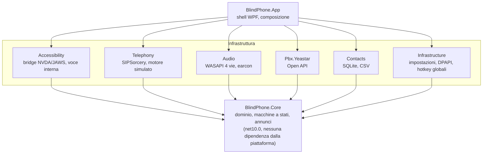

# Architettura di BlindPhone

Mappa dei progetti, dipendenze e punti di estensione. Complementa
[ANALISI-BLINDPHONE.md §5](../ANALISI-BLINDPHONE.md), che contiene la motivazione
delle scelte; qui c'è dove sono finite nel codice.

---

## 1. Vista d'insieme



**Le frecce vanno solo verso il basso.** Il core non conosce nessuno degli altri
progetti, e questo è verificato dal compilatore: targetta `net10.0` e non
`net10.0-windows`, quindi un riferimento a WPF o Win32 non compila.

---

## 2. I progetti

| Progetto | TFM | Responsabilità |
|---|---|---|
| `BlindPhone.Core` | `net10.0` | Dominio, macchine a stati, pipeline di annuncio, testi parlati, interfacce |
| `BlindPhone.Accessibility` | `net10.0-windows` | Bridge NVDA (P/Invoke) e JAWS (COM), voce interna SAPI |
| `BlindPhone.Telephony` | `net10.0-windows` | `ITelephonyEngine` su SIPSorcery, motore simulato |
| `BlindPhone.Audio` | `net10.0-windows` | `IAudioEngine` su WASAPI, earcon a sintesi, percorso RTP della conversazione, ponte della conferenza |
| `BlindPhone.Pbx.Yeastar` | `net10.0` | `IQueueProvider` e `IContactSource` su Open API |
| `BlindPhone.Contacts` | `net10.0-windows` | Archivio SQLite, importazione CSV |
| `BlindPhone.Infrastructure` | `net10.0-windows` | Impostazioni JSON, segreti DPAPI, scorciatoie globali, pulsanti e spie della cuffia (HID), rapporti di errore, pacchetto per l'assistenza |
| `BlindPhone.App` | `net10.0-windows` | Shell WPF e composizione delle dipendenze |

---

## 3. Il flusso di un evento

Dall'arrivo di una chiamata alla voce nell'orecchio dell'operatore:

```
INVITE SIP
   │
   ▼
SipTelephonyEngine                  traduce il protocollo in eventi di dominio
   │  IncomingCallEventArgs
   ▼
CallSessionManager                  applica la transizione alla macchina a stati
   │  CallTransition
   ▼
CallAnnouncementMapper              decide COSA dire (esaustivo, verificato dai test)
   │  Announcement { testo, priorità, earcon, braille }
   ▼
AnnouncementService                 decide SE e QUANDO dirlo
   │                                (priorità, accorpamento, anti-ripetizione,
   │                                 soppressione durante conversazione o digitazione)
   ├──────────────► IEarconPlayer   il suono passa SEMPRE, anche se la voce tace
   ▼
CompositeSpeechOutput               decide COME dirlo
   ├─► NVDA / JAWS                  bridge diretto, se il client controller c'è
   └─► voce interna SAPI            su dispositivo audio dedicato,
                                    se consentita e se nessun altro sta già parlando

AnnouncementService.Spoken ─► MainWindow ─► RaiseNotificationEvent (UI Automation)
                                    canale sempre attivo, indipendente dal precedente
```

**Il canale UI Automation è sempre acceso**, e questo vincola la voce interna. La
notifica parte per ogni annuncio, e uno screen reader in esecuzione la legge: se
nello stesso momento parla anche la voce interna, l'operatore sente la stessa frase
due volte, da due voci diverse e sfasate. Per questo la modalità automatica tace
quando risulta uno screen reader attivo — verificato con `SPI_GETSCREENREADER` e non
solo con la disponibilità del bridge diretto, che richiede
`nvdaControllerClient64.dll` accanto all'eseguibile e nel pacchetto distribuito non
c'è. La regola è isolata in `CompositeSpeechOutput.ShouldSpeakInternally`, funzione
pura, perché i suoi due modi di sbagliare — parlare due volte, non parlare affatto —
sono entrambi invisibili a chi guarda lo schermo.

La separazione fra "cosa", "se e quando" e "come" è il cuore dell'architettura. Il
"cosa" è testabile senza audio, il "se e quando" senza interfaccia, il "come" è
l'unico pezzo che dipende dall'ambiente.

---

## 3-bis. Il percorso audio della conferenza a tre

La conferenza è l'unica funzione in cui il posto operatore non si limita a
trasportare audio: lo **somma**. Il missaggio è locale, e la scelta è deliberata —
una sala conferenze lato centralino richiede configurazione, codici di servizio
diversi per ogni marca e un piano di licenza che non è detto ci sia, mentre due
chiamate contemporanee il prodotto sa già gestirle perché servono al trasferimento
con annuncio.

```
        gamba A (esterno, G.729 8 kHz)        gamba B (interno, G.722 16 kHz)
        ─────────────────────────────         ──────────────────────────────
RTP in ──► decodifica ──┬──► JitterBuffer ──► WASAPI conversazione ──┐
                        │                                            │ il mixer di
                        │  DecodedAudioReady                         │ Windows somma
                        ▼                                            │ i due flussi
                 ConferenceBridge                                    │ nell'orecchio
                        │  N meno uno: a nessuno la propria voce     │ dell'operatore
                        ▼                                            │
             SubmitConferenceAudio (coda + WdlResampler)             │
                        │                                            │
microfono ──► WdlResampler ──► SendFrame ──┤ somma con saturazione   │
                                           ▼                         │
                                     codifica ──► RTP out           ─┘
```

Tre punti che non si possono ricavare guardando il disegno:

1. **La regola è N meno uno.** Ogni gamba riceve tutto tranne se stessa. È l'unica
   riga di logica in `ConferenceBridge`, ed è anche l'unico modo di sbagliarla:
   rimandare a una linea il proprio audio produce un'eco ritardata del giro di rete.
2. **La riproduzione verso l'operatore non passa dal ponte.** Ogni gamba riproduce
   già per conto proprio sul dispositivo della conversazione, e WASAPI in modalità
   condivisa somma i due flussi nel suo mixer. Sommarli anche nel ponte li farebbe
   sentire due volte.
3. **Il missaggio viene dopo il muto.** In `SendFrame` si azzera prima la voce
   dell'operatore e si somma poi il contributo: silenziare il proprio microfono non
   deve scollegare fra loro gli altri due. È un difetto che chi lo provoca non
   sentirebbe.

Le due gambe possono aver negoziato codec diversi, quindi il contributo viene
ricampionato con filtro sinc, in modalità guidata dall'uscita come ogni altra
conversione del percorso audio: si chiede il pacchetto che serve e il ricampionatore
dichiara quanti campioni gli occorrono. Se non ci sono si trasmette la sola voce
dell'operatore e si conta un pacchetto «a vuoto» — non si inventa niente, che su
questo percorso è la regola imparata a caro prezzo.

---

## 4. Punti di estensione

### Sostituire il centralino

Implementa `IQueueProvider` e registralo in `App.BuildServices`. Il core non cambia.

`QueueProviderCapabilities` è la parte che va compilata con onestà: dichiarare una
capacità non supportata produce comandi muti, che per un operatore non vedente sono
peggio di una funzione assente.

Il connettore nuovo entra nello stesso pacchetto di tutti gli altri: vedi §4-bis, che
spiega perché e quali sono le due sole eccezioni.

### Cambiare account SIP senza riavviare

Il motore telefonico è un singleton e mezzo prodotto vi si aggancia: gestore delle
chiamate, orchestratore del trasferimento, sorveglianza degli interni, finestra
principale, pannello delle impostazioni. Sostituirlo significherebbe riagganciare a
mano tutti quei sottoscrittori, oppure riavviare — che su un telefono di servizio vuol
dire smettere di essere raggiungibili.

`SwitchableTelephonyEngine` è l'involucro che tiene ferma la superficie: i
sottoscrittori restano agganciati a lui e non sanno che sotto il motore è cambiato.
Registrato in DI come `ITelephonyEngine`, e come sé stesso per chi deve commutarlo.

L'ordine dentro `SwitchAsync` non è reversibile: **sgancia, ferma, costruisce,
aggancia, avvia.** Agganciare prima di avviare è ciò che garantisce di non perdere
l'evento di registrazione del nuovo account, che è il primo che arriva e l'unico che
l'operatore stia aspettando.

### Verificare un certificato del centralino

Un solo servizio, `CertificateTrustService`, condiviso fra SIP su TLS, API REST e
WebSocket degli eventi. La condivisione è deliberata: sono la stessa macchina e lo
stesso certificato, e chiedere tre volte insegnerebbe soltanto a rispondere di sì
senza ascoltare.

La decisione è nel core e si collauda senza fabbricare certificati:
`CertificateDescriptionFactory` è l'unico punto che tocca `X509Certificate2`, tutto il
resto lavora sul record di dominio. Chi implementa `ICertificateTrustPrompt` deve
**rispondere sempre** — la domanda nasce su un thread di rete, e un'implementazione che
si blocca tiene fermo il collegamento senza che nulla lo dica.

### Sostituire lo stack SIP

Implementa `ITelephonyEngine`. `FakeTelephonyEngine` mostra la superficie minima e
serve già a due scopi reali: i test e la modalità formazione.

`SupportsConference` va compilato con la stessa onestà di
`QueueProviderCapabilities`: dichiararlo su un motore senza percorso audio produce una
conferenza che si apre e in cui nessuno sente nessuno, e a orecchio è
indistinguibile da una riuscita in cui non parla nessuno.

### Aggiungere una sorgente di rubrica

Implementa `IContactSource`. `TestAsync` deve restituire messaggi in **linguaggio
naturale**, non codici di errore: quel testo viene pronunciato e l'operatore lo
ascolta una volta sola.

### Aggiungere un comando da tastiera

1. Aggiungi la voce a `HotkeyCommand`
2. Assegna un tasto predefinito in `HotkeyProfile.CreateDefault`
3. Aggiungi il ramo in `MainWindow.ExecuteCommandAsync` — **con riscontro anche nel
   caso di rifiuto**
4. Aggiungi l'etichetta in `MainWindow.DescribeCommand`, che alimenta la lettura
   dell'elenco scorciatoie

### Aggiungere uno stato alla chiamata

1. Aggiungi la voce a `CallState` e i trigger a `CallTrigger`
2. Dichiara le transizioni in `CallStateMachine.TransitionTable`, comprese quelle di
   uscita: uno stato senza via d'uscita blocca la chiamata in un punto da cui nessun
   comando la trova più
3. Verifica `CallStateMachine.HasActiveAudio`: da lì dipende la soppressione degli
   annunci durante la conversazione
4. Mappa **ogni** nuova transizione in `CallAnnouncementMapper`
5. Insegna a `AnnouncementCoverageTests.BuildCallInState` come raggiungere il nuovo
   stato

Il quarto passo non è facoltativo e non è affidato alla diligenza: il gate di
copertura enumera la tabella e fallisce sulla prima transizione muta. Il quinto è
quello che si dimentica, e il sintomo è chiaro — il gate non riesce a costruire una
chiamata nello stato nuovo e fallisce sull'asserzione dello stato, non su quella
dell'annuncio.

`CallState.Conferenced` è l'esempio da leggere: aggiunto per la conferenza a tre
proprio perché in conferenza le chiamate attive sono due, e con lo stesso stato di una
conversazione normale il posto operatore non avrebbe potuto dire quale delle due è
«quella in linea».

### Aggiungere un earcon

1. Aggiungi la voce a `EarconKind`
2. Classificalo in `EarconCategoryExtensions.Category` — la famiglia determina il
   posizionamento stereo e la via audio
3. Definisci la sequenza di toni in `ToneEarconPlayer.BuildTone`

Sequenze ascendenti per "arrivato o riuscito", discendenti per "finito", intervalli
dissonanti per "non ha funzionato": un operatore le interpreta correttamente al
primo ascolto.

---

## 4-bis. Un solo binario per tutti i centralini

> **Decisione, 5 settembre 2026 — un solo prodotto, un solo pacchetto di
> installazione, connettori scelti a runtime. Non si costruisce una variante per
> marchio di centralino.**

La domanda si ripresenterà — arriva puntuale quando il secondo connettore entra in
piano — quindi qui c'è la risposta e il perché.

### L'architettura la implementa già

`CreateQueueProvider` in `App.BuildServices` sceglie il connettore a runtime dalla
configurazione e ricade su `DisabledQueueProvider` quando non c'è nulla da collegare.
**Un connettore non configurato non viene mai istanziato**, quindi un difetto nel
codice di un centralino non può manifestarsi su una postazione che ne usa un altro.

`QueueProviderCapabilities` fa il resto: la stessa interfaccia nasconde le funzioni
che quel centralino non offre. È ciò che permette a un binario solo di servire un
impianto che dà il solo conteggio delle chiamate in coda e uno che dà l'elenco
completo, senza mentire a nessuno dei due.

### I quattro conti

| | Con un pacchetto solo | Con un pacchetto per marchio |
|---|---|---|
| **Lavoro di packaging** | Nullo: `BlindPhone.wxs` raccoglie l'intera cartella di pubblicazione con `<Files Include="…\**" />` | Un `.wxs` o una variabile per variante |
| **Peso** | Un connettore è 100–300 KB su un pacchetto autonomo da 64 MB: **0,3%** | Lo stesso peso moltiplicato per il numero di varianti |
| **Rilascio** | 2 pacchetti (x64, arm64), 2 file di novità, 2 impronte SHA256 | *marchi × architetture*, e altrettante novità e impronte da tenere allineate |
| **Conformità** | Una dichiarazione EN 301 549, un ciclo di collaudo con NVDA e JAWS | Una per variante, per un prodotto che è lo stesso |

Il terzo è quello che si sottovaluta. `UpdateCatalog.InstallerPrefix` è la costante
`"BlindPhone-"` e il legame fra pacchetto e novità è il **nome del file**:
`BlindPhone-1.2.0-x64.msi` accanto a `BlindPhone-1.2.0-x64.txt`. Con sei marchi e due
architetture diventano dodici pacchetti per rilascio, dodici file di novità e dodici
impronte — un lavoro manuale che sbaglia da solo alla seconda volta.

Il quarto pesa nel mercato di riferimento: nell'Accordo Quadro Consip è **la PA a
scegliere il marchio** fra quelli dell'aggiudicatario, quindi un posto operatore
venduto per marchio è la forma sbagliata per quel canale. Vedi
[PIATTAFORME-PA.md](../PIATTAFORME-PA.md).

### L'argomento che vale più di tutti gli altri

**Una sola build significa gli stessi tasti ovunque.** Un centralinista che cambia
sede, o un formatore che insegna su un impianto e assiste su un altro, trova la stessa
mappa: stessa scheda dei tasti rapidi, stesso `HelpBook`, stessi annunci.

Con build separate le differenze di comportamento diventano inevitabili — una funzione
che c'è di là e non di qua — e **chi non vede non può scoprirle guardando lo schermo**.
Le scopre premendo un tasto che non fa nulla, che è precisamente ciò che
`QueueProviderCapabilities` è stato scritto per evitare.

### La differenziazione per cliente è configurazione, non compilazione

Il meccanismo esiste già nell'installatore:

```
msiexec /i BlindPhone-1.2.0-x64.msi /qn ^
    CONFIGURAZIONE="\\server\deploy\cisco-asl.bpcfg" ^
    SEZIONIBLOCCATE=SipAccounts,Pbx
```

Un pacchetto di configurazione per cliente, lo stesso MSI per tutti. Si può comunque
**vendere** «BlindPhone per Cisco»: è una voce di listino e un `.bpcfg`, non un
eseguibile diverso.

### Le due sole eccezioni

Non riguardano i marchi ma i **componenti che non si possono spedire a tutti**:

1. **Un redistribuibile di terze parti con licenza per postazione** — per esempio un
   middleware CSTA commerciale, che non può finire nel pacchetto di chi non l'ha
   acquistato.
2. **Un driver nativo da installare separatamente** — per esempio il TSP di Cisco.

In entrambi i casi la risposta **non è una seconda build**: è un **prerequisito**, che
si documenta, si rileva all'avvio e la cui assenza degrada la funzione senza impedire
l'uso del prodotto. Il precedente è già in casa: il client controller di NVDA in
`BlindPhone.App.csproj` è un binario nativo di terze parti, uno per architettura, fuori
dal repository, incluso condizionalmente — e senza di lui il programma funziona lo
stesso, ricadendo sulle notifiche UI Automation.

### Regole per chi aggiunge un connettore

- **Riferimento diretto al progetto e un ramo nella fabbrica.** Niente sistema a
  plugin: la riflessione romperebbe il trimming, aggiungerebbe modi di fallire a
  caricamento e non risolverebbe nulla con l'ordine di grandezza di connettori che
  questo prodotto avrà.
- **Un connettore non deve poter impedire l'avvio.** Se una dipendenza nativa manca,
  `StartAsync` fallisce in modo ordinato e dichiara `PbxLinkStatus.Disabled` con un
  motivo pronunciabile. Mai un errore di caricamento all'avvio: su una postazione dove
  nessuno guarda lo schermo, un programma che non parte è un guasto senza diagnosi.

### Se la decisione viene rimessa in discussione

L'obiezione che arriverà è quella di un ufficio IT che non vuole sulla propria
postazione codice per centralini di altri fornitori. La via di mezzo esiste **senza
creare un secondo prodotto**: le `Feature` di WiX rendono i connettori selezionabili
dentro lo stesso pacchetto. Va fatta solo quando qualcuno la chiede davvero, perché
ogni funzione facoltativa è una combinazione in più da collaudare.

---

## 5. Il modello di esecuzione temporale

I servizi del core **non possiedono timer**. Espongono `Pump(now)` e il ciclo vive
in `App.StartPumpLoop`, a 100 ms.

Ordine di invocazione, che conta:

```csharp
transfer.Pump(now);       // può generare annunci
calls.Pump(now);          // promemoria di chiamata in attesa
queue.Pump(now);          // avviso di degrado del collegamento
announcements.Pump(now);  // consegna, per ultimo
```

Con la pipeline di annuncio invocata per prima, i messaggi prodotti nello stesso
ciclo aspetterebbero il successivo, aggiungendo 100 ms alla latenza percepita.

Il budget è 150 ms dalla pressione del tasto all'inizio dell'annuncio: sopra quella
soglia l'operatore interpreta il silenzio come "il comando non ha funzionato" e
preme di nuovo.

---

## 6. Concorrenza

| Thread | Cosa fa |
|---|---|
| UI (Dispatcher) | Interfaccia, pump, esecuzione comandi |
| SIPSorcery | Segnalazione e media |
| WebSocket Yeastar | Ricezione eventi + heartbeat |
| Poll Yeastar | Interrogazione adattiva |

Gli stati condivisi (`CallSessionManager._calls`, `AnnouncementService._pending`,
`YeastarQueueProvider._snapshot`) sono protetti da `Lock`. Gli eventi verso la UI
passano da `Dispatcher.Invoke`.

**Nessuna operazione di I/O sul thread UI.** Un blocco dell'interfaccia, per un
operatore non vedente, è indistinguibile da un guasto totale: non vede la clessidra.

---

## 7. Debito tecnico noto

### Punti da verificare su PBX reale

Tre comportamenti Yeastar sono assunti e non confermati. Sono tutti gestiti con
degrado sicuro — la funzione resta disattiva finché non è verificata — ma vanno
chiusi appena si ha accesso a un centralino di prova:

1. L'ordine di `waiting_list` corrisponde all'ordine di servizio
2. `duration` nelle voci in attesa è il tempo di attesa, non la durata totale
3. Il prelievo selettivo via `call/transfer` verso il proprio interno funziona

Dettaglio in [YEASTAR-INTEGRAZIONE.md §13](../YEASTAR-INTEGRAZIONE.md).

### Formato del messaggio di sottoscrizione WebSocket

`{"topic_list":[...]}` è ricavato dalla documentazione ma non verificato sul
firmware. Una sottoscrizione rifiutata si manifesta come **assenza di eventi**, che
è facile scambiare per una coda vuota: è la prima cosa da provare su un PBX reale.

---

## 7-bis. Errori che nessuno vede

Su una postazione dove nessuno guarda lo schermo, un errore grave non lascia traccia
percepibile: il programma si riapre e sembra tutto a posto. `CrashReporter` intercetta
da **tre sorgenti**, e sono tre perché tre sono i modi in cui un errore sfugge.

| Sorgente | Cosa raccoglie | Si può assorbire |
|---|---|---|
| `DispatcherUnhandledException` | Errori dell'interfaccia | Sì: dopo, il programma continua |
| `AppDomain.UnhandledException` | Errori che stanno terminando il processo | No: resta il tempo di scrivere un file |
| `TaskScheduler.UnobservedTaskException` | Attività di sfondo che nessuno ha atteso | Sì, e va fatto |

La terza non è teorica: riconnessione al centralino, rinnovo dei token, flusso eventi e
operazioni audio girano tutte su attività lanciate e non attese. Va marcata come
osservata — senza, in alcune configurazioni l'errore verrebbe risollevato dal
raccoglitore di memoria e chiuderebbe il processo, cioè un guasto nel collegamento al
centralino farebbe cadere le chiamate in corso.

Il raccoglitore **non solleva mai eccezioni**: viene invocato dove un errore non ha più
nessuno che lo raccolga, e fallire lì lo trasformerebbe nella causa del guasto peggiore.

---

## 8. Perché il core è testabile

286 test girano in pochi secondi senza rete, senza audio, senza interfaccia e senza
centralino. È il risultato di quattro scelte:

1. `IClock` iniettabile — le finestre temporali si controllano invece di aspettarle
2. `Pump(now)` invece di timer interni — il comportamento temporale è deterministico
3. `ITelephonyEngine` e `IQueueProvider` come interfacce — gli esiti si impongono
4. `IAnnouncer` come interfaccia — l'accessibilità si asserisce come un valore di
   ritorno

Il beneficio concreto: gli scenari che con un PBX reale sarebbero lenti da
riprodurre e impossibili da rendere deterministici — interno occupato, chiamante che
riaggancia a metà consultazione, centralino che respinge il REFER — qui sono una
riga di codice ciascuno.
